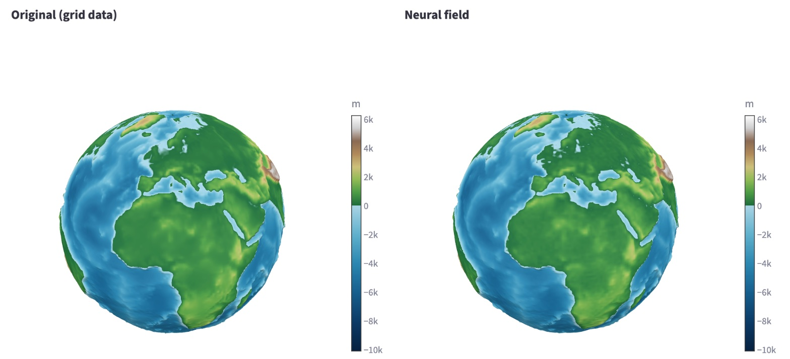

<p align="center">
  
</p>

<h1 align="center">The Earth as a Neural Field</h1>

<p align="center">
  <b>The elevation model of the whole Earth, stored in the weights of a small neural network.</b><br>
  <b>Das Höhenmodell der ganzen Erde, gespeichert in den Gewichten eines kleinen neuronalen Netzes.</b>
</p>

<p align="center">
  <a href="https://python-app-neural-earth-field.streamlit.app"></a>
</p>

<p align="center">
  
  
  
  
  <a href="https://gkvoelkl.github.io/python-streamlit-neural-earth-field/"></a>
  <a href="https://github.com/gkvoelkl/python-streamlit-neural-earth-field/actions/workflows/docs.yml"></a>
  <a href="https://claude.com/claude-code"></a>
  <a href="LICENSE"></a>
</p>

<p align="center">
  <a href="https://python-app-neural-earth-field.streamlit.app">App online</a> ·
  <a href="https://gkvoelkl.github.io/python-streamlit-neural-earth-field/en/">Tutorial (English)</a> ·
  <a href="https://gkvoelkl.github.io/python-streamlit-neural-earth-field/">Tutorial (Deutsch)</a> ·
  <a href="README_en.md">README (English)</a> ·
  <a href="README_de.md">README (Deutsch)</a>
</p>

---

## English

The elevation model of the entire Earth – 2.3 million values, 4.4 MB – stored in
the weights of a small neural network of 323 KB. Instead of a table of
elevations you keep a function `f(lon, lat) → elevation`, trained deliberately on
exactly this one dataset: **the weights are the file**.

### What you get

- **Software to try out** – a Streamlit app in which you train the network
  yourself and watch the result: file size and compression ratio before
  training, the live error curve, original and reconstruction as two rotatable
  globes, error maps, queries at any coordinate, a rate-distortion curve and the
  export of the weights in float32 or float16.
- **A matching tutorial** – eleven chapters and an appendix with measurements,
  each linking an idea to an experiment in the app: from the grid as a function
  through training, network architecture, spherical coordinates and Fourier
  features to the context field and an outlook on vector data. No program code,
  but diagrams, worked examples and screenshots – for readers who know neural
  networks at most from introductions. Written in German, with an English
  translation in progress.

### Getting started

You need Python 3.14 or newer and the package manager [uv](https://docs.astral.sh/uv/).

```bash
git clone https://github.com/gkvoelkl/python-streamlit-neural-earth-field.git
cd python-streamlit-neural-earth-field
uv sync
uv run streamlit run app.py
```

The app opens in the browser. On the first start it looks for the elevation data
(ETOPO 2022, 456 MB) and asks whether it may download it – this happens only once.

- **Online without installing:** [python-app-neural-earth-field.streamlit.app](https://python-app-neural-earth-field.streamlit.app) – on a shared CPU without GPU, with much less data (coarser grids, lighter training).
- **Tutorial:** [website](https://gkvoelkl.github.io/python-streamlit-neural-earth-field/en/) · [Markdown](docs/tutorial/en/README.md)
- **Details:** data download, the three tricks, results, tests → [README_en.md](README_en.md)

---

<p align="center">
  
  <br><sub><em>Original and neural field side by side in the app · Original und neuronales Feld nebeneinander in der App</em></sub>
</p>

---

## Deutsch

Das Höhenmodell der ganzen Erde – 2,3 Millionen Werte, 4,4 MB – gespeichert in den
Gewichten eines kleinen neuronalen Netzes von 323 KB. Statt einer Tabelle von
Höhen behält man eine Funktion `f(lon, lat) → Höhe`, absichtlich auf genau diesen
einen Datensatz trainiert: **Die Gewichte sind die Datei.**

### Was Sie bekommen

- **Software zum Ausprobieren** – eine Streamlit-App, in der Sie das Netz selbst
  trainieren und das Ergebnis ansehen: Dateigröße und Kompressionsrate schon vor
  dem Training, die Fehlerkurve live, Original und Rekonstruktion als zwei
  drehbare Globen, Fehlerkarten, Abfragen an beliebigen Koordinaten, eine
  Rate-Distortion-Kurve und den Export der Gewichte in float32 oder float16.
- **Ein passendes Tutorial** – elf Kapitel und ein Anhang mit Messungen, jedes
  Kapitel verbindet eine Idee mit einem Experiment in der App: vom Raster als
  Funktion über Training, Netzarchitektur, Kugelkoordinaten und Fourier-Features
  bis zum Kontextfeld und einem Ausblick auf Vektordaten. Ohne Programmcode,
  dafür mit Diagrammen, Rechenbeispielen und Screenshots – für alle, die
  neuronale Netze höchstens aus Einführungen kennen. Auf Deutsch geschrieben,
  die englische Übersetzung entsteht gerade.

### Loslegen

Sie brauchen Python 3.14 oder neuer und den Paketmanager [uv](https://docs.astral.sh/uv/).

```bash
git clone https://github.com/gkvoelkl/python-streamlit-neural-earth-field.git
cd python-streamlit-neural-earth-field
uv sync
uv run streamlit run app.py
```

Die App öffnet sich im Browser. Beim ersten Start sucht sie die Höhendaten
(ETOPO 2022, 456 MB) und fragt, ob sie sie herunterladen darf – das geschieht nur einmal.

- **Online ohne Installation:** [python-app-neural-earth-field.streamlit.app](https://python-app-neural-earth-field.streamlit.app) – auf einer geteilten CPU ohne GPU, mit erheblich weniger Daten (gröbere Raster, leichteres Training).
- **Tutorial:** [Website](https://gkvoelkl.github.io/python-streamlit-neural-earth-field/) · [Markdown](docs/tutorial/de/README.md)
- **Details:** Daten herunterladen, die drei Kniffe, Ergebnisse, Tests → [README_de.md](README_de.md)

---

<sub>MIT License · ETOPO 2022 data: NOAA NCEI, DOI <a href="https://doi.org/10.25921/fd45-gt74">10.25921/fd45-gt74</a> · Chester and Aiko images generated with Kling AI</sub>
