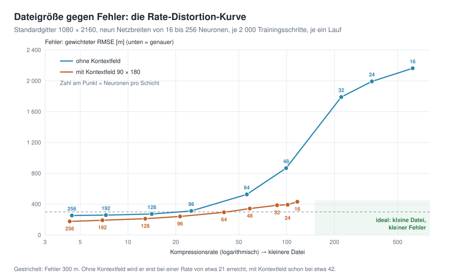

# Die Erde als neuronales Feld

*[English](README_en.md) · Deutsch · [Startseite](README.md)*

Ein kleines Lernprojekt zu **Implicit Neural Representations (INR)** als
Kompressionsverfahren: Statt Höhen an Gitterpunkten zu speichern, trainiert man
ein Netz `f(lon, lat) → Höhe` absichtlich auf *genau diesen einen* Datensatz –
und **die Gewichte sind dann die Datei**.

Vorbild ist Huang & Hoefler, *Compressing multidimensional weather and climate
data into neural networks* (ICLR 2023). Hier ist das Zielfeld die Topographie und
Bathymetrie der Erde (ETOPO 2022), und das Ergebnis lässt sich als 3D-Globus
ansehen.

```bash
git clone https://github.com/gkvoelkl/python-streamlit-neural-earth-field.git
cd python-streamlit-neural-earth-field
uv sync
uv run streamlit run app.py
```

**Online ohne Installation:** <https://python-app-neural-earth-field.streamlit.app> – auf einer geteilten CPU ohne GPU und deshalb mit erheblich weniger Daten: gröbere Raster (voreingestellt 360 × 720) und leichteres Training (siehe [unten](#gpu-und-online-fassung)).

**Tutorial:** ein Schritt-für-Schritt-Tutorial ohne Programmcode, auf Deutsch
geschrieben und in Übersetzung ins Englische: [Deutsch](docs/tutorial/de/README.md) ·
[English](docs/tutorial/en/README.md). Es erscheint auch als Website:
<https://gkvoelkl.github.io/python-streamlit-neural-earth-field/>.

## Daten

Die App braucht das globale Höhenraster ETOPO 2022 (1 Bogenminute, 456 MB) im Ordner
`data/`. Fehlt die Datei, fragt die App beim Start, ob sie sie herunterladen darf, und
zeigt den Fortschritt. Lehnen Sie ab, weist sie darauf hin, dass die Daten nötig sind,
und beendet sich. Wer die Datei lieber selbst herunterlädt:

```bash
mkdir -p data
curl -L -o data/ETOPO_2022_v1_60s_N90W180_surface.nc \
  https://www.ngdc.noaa.gov/thredds/fileServer/global/ETOPO2022/60s/60s_surface_elev_netcdf/ETOPO_2022_v1_60s_N90W180_surface.nc
```

Die App mittelt es auf die gewählte Arbeitsauflösung (180 × 360 bis 2160 × 4320)
und legt das Ergebnis unter `data/cache/` ab.

## GPU und Online-Fassung

`uv sync` installiert PyTorch von PyPI. Auf dem Mac rechnet es auf dem Apple-Grafikchip (MPS),
unter Linux auf einer NVIDIA-GPU, falls vorhanden (der Download ist wegen der CUDA-Bibliotheken
groß). Unter Windows bietet PyPI PyTorch nur für die CPU an; für eine NVIDIA-GPU installiert man
die CUDA-Fassung wie auf [pytorch.org](https://pytorch.org/get-started/locally/) beschrieben.

Die Online-Fassung unter <https://python-app-neural-earth-field.streamlit.app> läuft aus dem Ordner [`cloud/`](cloud/README.md) in der
Streamlit Community Cloud: PyTorch nur für die CPU, und die bereits verkleinerten Höhenraster kommen aus
dem Release [`data-v1`](https://github.com/gkvoelkl/python-streamlit-neural-earth-field/releases/tag/data-v1)
statt aus der 456 MB großen ETOPO-Datei. Weil die Community Cloud Apps drosselt, die die CPU
lange auslasten, arbeitet die Online-Fassung mit erheblich weniger Daten: Raster mit höchstens
540 × 1080 Zellen (voreingestellt 360 × 720, ein Neuntel des Standardgitters), 8 192 Punkte und
höchstens 2 000 Schritte pro Training. Ihre Zahlen weichen deshalb vom Tutorial ab. Lokale
Installationen betrifft das nicht.

## Was die App zeigt

| Reiter | Inhalt |
|---|---|
| **Idea & Budget** | Rohgröße, Zahl der Parameter und Kompressionsrate – vor dem Training |
| **Training** | Fehlerkurve live, RMSE / gewichteter RMSE / MAE / R² |
| **Globe 3D** | Original und Rekonstruktion als zwei drehbare Kugeln |
| **Maps & Error** | Höhenkarten, Fehlerkarte, Histogramm der Fehler |
| **Super-Resolution** | das Feld an beliebig feinen Koordinaten abfragen |
| **Rate & Error** | Rate-Distortion-Kurve über mehrere Netzgrößen |
| **Export** | Gewichte als `.pt` in float32 / float16, mit Ladebeispiel |

<p align="center">
  
  <br><sub><em>Die App nach dem Start: Einstellungen in der Seitenleiste, sieben Reiter für Budget, Training und Ergebnisse.</em></sub>
</p>

## Die drei Kniffe

1. **Koordinaten auf der Kugel.** `(lon, lat)` hat eine Naht bei ±180° und zwei
   entartete Pole, `(x, y, z)` auf der Einheitskugel nicht. In der App
   umschaltbar – der Unterschied ist direkt auf der Fehlerkarte zu sehen.
2. **Fourier-Features.** Ein ReLU/GELU-MLP hat einen starken *spectral bias* und
   lernt hohe Frequenzen praktisch nie. Das Netz bekommt deshalb nicht `x`,
   sondern `[sin(2π B x), cos(2π B x)]` mit einem festen `B ~ N(0, σ²)`. `B` selbst
   wird nicht gespeichert – der Startwert (4 Byte) genügt.
   Alternativ verwendet die Kodierung `spherical` **Kugelflächenfunktionen** bis
   zum Grad `L` – die Fourier-Basis, die eigentlich zur Kugel gehört. Vollständig
   und orthogonal, aber `(L+1)²` Merkmale, feine Einzelheiten werden in der ersten
   Schicht also teuer.
3. **Kontextfeld** (*context-aware INR*). Ein sehr grobes Höhenraster kommt als
   zusätzliche Eingabe dazu, und das Netz sagt nur noch den Rest vorher. Die Bytes
   dieses Rasters werden ehrlich in die Kompressionsrate eingerechnet.

## Ergebnisse

Gemessen auf 2160 × 4320 (17,8 MB Rohdaten), jeweils nur 1 500 Trainingsschritte
auf einem Apple-Chip – also noch nicht fertig trainiert:

| Variante | Datei | Rate | gewichteter RMSE | PSNR |
|---|---:|---:|---:|---:|
| Fourier MLP, σ = 8 | 322 KB | 57× | 311 m | 35,3 dB |
| + Kontextfeld 90 × 180 | 355 KB | 51× | 257 m | 36,9 dB |
| + Kontextfeld 180 × 360 | 450 KB | 41× | 233 m | 37,8 dB |
| SIREN | 305 KB | 60× | 258 m | 36,8 dB |

Das Kontextfeld kostet Bytes und lohnt sich trotzdem. Auf dem Gitter 1080 × 2160
(4 000 Schritte, je ein Lauf) schlägt es ein etwas breiteres Netz gleicher
Dateigröße beim sehr kleinen, beim empfohlenen und beim großen Fourier-MLP, mit
dem größten Gewinn beim großen; siehe Kapitel 8 des Tutorials.
In dieser kurzen Messung auf dem feinen Gitter kommt der SIREN ohne die
zusätzlichen Bytes nahe an das Fourier-MLP mit Kontextfeld 90 × 180 heran. Auf
dem Gitter 1080 × 2160 mit 4 000 Schritten (je drei Läufe) liegt das Kontextfeld
deutlich vorn: 186 m gegen 233 m gewichteten RMSE, und der SIREN schwankt am
stärksten von Lauf zu Lauf (215–246 m). Alle Messungen stehen im Anhang des
Tutorials.

<p align="center">
  
  <br><sub><em>Dateigröße gegen Fehler auf dem Gitter 1080 × 2160 (2 000 Schritte, ein Lauf pro Punkt): Das Kontextfeld gewinnt bei jeder Dateigröße, die beide Kurven abdecken. Aus Kapitel 9 des Tutorials.</em></sub>
</p>

## Website des Tutorials

Das Tutorial in `docs/tutorial/` wird mit
[MkDocs Material](https://squidfunk.github.io/mkdocs-material/) und
`mkdocs-static-i18n` zu einer zweisprachigen Website gebaut (Deutsch an der
Wurzel, Englisch unter `en/`):

```bash
uv run --group docs mkdocs serve    # Vorschau unter http://127.0.0.1:8000
uv run --group docs mkdocs build --strict
```

Der Workflow `.github/workflows/docs.yml` veröffentlicht sie bei jedem Push auf
`main` über GitHub Pages. Die englischen Fassungen der Diagramme entstehen aus den
deutschen SVGs mit `uv run python docs/tutorial/tools/translate_svg.py`.

## Tests

```bash
uv run pytest
```

Sie prüfen die Dinge, die sonst unbemerkt kaputtgehen würden: dass das Ladebeispiel
aus dem Reiter *Export* wirklich dasselbe Feld ergibt, dass die Kugelkoordinaten
keine Naht bei ±180° haben, dass das Kontextfeld an seinen Gitterpunkten den Wert
des Gitters trifft und dass seine Bytes in die Kompressionsrate eingehen.

## Einordnung

Die Raten von 300× bis über 3000× aus dem Paper gelten für **Klimafelder**:
räumlich glatt und als Zeitreihen mit enormer Redundanz zwischen den
Zeitschritten. Topographie ist der schwierigere Fall – Küstenlinien und Gebirgsgrate
sind beinahe fraktal, und es gibt keine Zeitachse, die man ausnutzen könnte. Der
Reiter *Rate & Error* zeigt, was man hier tatsächlich bekommt. Genau das macht das
Beispiel lehrreich: Die Abwägung ist sichtbar und nicht versteckt.

## Aufbau

```
src/python_streamlit_neural_earth_field/
  data.py       ETOPO laden, auf Blockmittel verkleinern, Flächengewichte
  encoding.py   lon/lat → Einheitskugel, Fourier-Features, Kugelflächenfunktionen
  model.py      NeuralField (MLP / SIREN / Kontextfeld), Größenbuchhaltung
  training.py   Overfitting-Schleife als Generator, flächengewichtete Auswahl
  metrics.py    RMSE, gewichteter RMSE, MAE, PSNR, R², Kompressionsrate
  viz.py        3D-Globus, Karten, Fehlerdiagramme, Rate-Distortion
  app.py        Streamlit-Oberfläche
```

## Quellen

- Huang & Hoefler, *Compressing multidimensional weather and climate data into
  neural networks*, ICLR 2023
- Tancik et al., *Fourier Features Let Networks Learn High Frequency Functions in
  Low Dimensional Domains*, NeurIPS 2020
- Sitzmann et al., *Implicit Neural Representations with Periodic Activation
  Functions* (SIREN), NeurIPS 2020
- Rußwurm et al., *Geographic Location Encoding with Spherical Harmonics and
  Sinusoidal Representation Networks*, ICLR 2024
- NOAA NCEI, *ETOPO 2022 Global Relief Model*

## Lizenz

MIT, siehe [LICENSE](LICENSE). Die Daten von ETOPO 2022 stellt NOAA NCEI bereit
(DOI [10.25921/fd45-gt74](https://doi.org/10.25921/fd45-gt74)); sie sind nicht Teil
dieses Repositorys.
