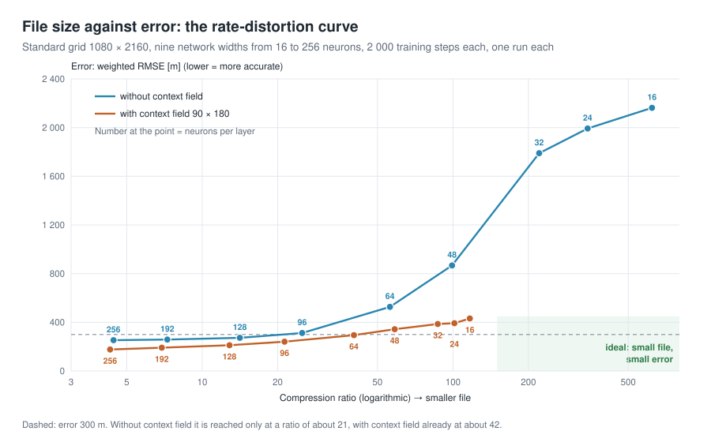

# The Earth as a Neural Field

*English · [Deutsch](README_de.md) · [Start page](README.md)*

A small learning project on **Implicit Neural Representations (INR)** as a
compression method: instead of storing elevations at grid points, you train a
network `f(lon, lat) → elevation` deliberately on *exactly this one* dataset --
and **the weights then are the file**.

The inspiration is Huang & Hoefler, *Compressing multidimensional weather and climate
data into neural networks* (ICLR 2023). Here the target field is the Earth's
topography and bathymetry (ETOPO 2022), and the result can be viewed as a 3D globe.

```bash
git clone https://github.com/gkvoelkl/python-streamlit-neural-earth-field.git
cd python-streamlit-neural-earth-field
uv sync
uv run streamlit run app.py
```

**Online without installing:** <https://python-app-neural-earth-field.streamlit.app> – on a shared CPU without GPU and therefore with much less data: coarser grids (default 360 × 720) and lighter training (see [below](#gpu-and-online-version)).

**Tutorial:** a step-by-step tutorial without program code, written in German and
being translated into English: [Deutsch](docs/tutorial/de/README.md) ·
[English](docs/tutorial/en/README.md). It is also published as a website:
<https://gkvoelkl.github.io/python-streamlit-neural-earth-field/>.

## Data

The app needs the global elevation grid ETOPO 2022 (1 arc-minute, 456 MB) in
`data/`. If the file is missing, the app asks on start-up whether it may download
it, and shows the progress. If you decline, it explains that the data are required
and shuts down. To download the file yourself instead:

```bash
mkdir -p data
curl -L -o data/ETOPO_2022_v1_60s_N90W180_surface.nc \
  https://www.ngdc.noaa.gov/thredds/fileServer/global/ETOPO2022/60s/60s_surface_elev_netcdf/ETOPO_2022_v1_60s_N90W180_surface.nc
```

The app averages it down to the chosen working resolution (180 × 360 to 2160 × 4320)
and caches it under `data/cache/`.

## GPU and online version

`uv sync` installs PyTorch from PyPI. On a Mac it uses the Apple graphics unit (MPS), on
Linux an NVIDIA GPU if there is one (the download is large because of the CUDA libraries).
On Windows, PyPI only offers PyTorch for the CPU; for an NVIDIA GPU, install the CUDA build
as described at [pytorch.org](https://pytorch.org/get-started/locally/).

The online version at <https://python-app-neural-earth-field.streamlit.app> runs from the folder [`cloud/`](cloud/README.md) on Streamlit Community
Cloud: PyTorch for the CPU only, and the elevation grids, already averaged down, come from the
release [`data-v1`](https://github.com/gkvoelkl/python-streamlit-neural-earth-field/releases/tag/data-v1)
instead of the 456 MB ETOPO file. Because Community Cloud throttles apps that keep the CPU
busy for long, the online version uses much less data: grids of at most 540 × 1080 cells
(default 360 × 720, a ninth of the standard grid), 8 192 points and at most 2 000 steps per
training run. Its numbers therefore differ from the tutorial. Local installs are not affected.

## What the app shows

| Tab | Content |
|---|---|
| **Idea & Budget** | Raw data size, parameter count and compression ratio -- before training |
| **Training** | Live error curve, RMSE / weighted RMSE / MAE / R² |
| **Globe 3D** | Original and reconstruction as two rotatable spheres |
| **Maps & Error** | Elevation maps, error map, error histogram |
| **Super-Resolution** | Query the field at arbitrarily fine coordinates |
| **Rate & Error** | Rate-distortion curve across several network sizes |
| **Export** | Weights as `.pt` in float32 / float16, with a loading example |

<p align="center">
  
  <br><sub><em>The app after start-up: settings in the sidebar, seven tabs for budget, training and results.</em></sub>
</p>

## The three tricks

1. **Coordinates on the sphere.** `(lon, lat)` has a seam at ±180° and two
   degenerate poles. `(x, y, z)` on the unit sphere doesn't. Switchable in the
   app -- the difference is directly visible on the error map.
2. **Fourier features.** A ReLU/GELU MLP has a strong *spectral bias* and
   practically never learns high frequencies. So the network doesn't get `x`, but
   `[sin(2π B x), cos(2π B x)]` with a fixed `B ~ N(0, σ²)`. `B` itself is not
   stored -- the seed (4 bytes) is enough.
   Alternatively, the encoding `spherical` uses **spherical harmonics** up to
   degree `L` -- the Fourier basis that actually belongs to the sphere. Complete
   and orthogonal, but `(L+1)²` features, so fine detail gets expensive in the
   first layer.
3. **Context field** (*context-aware INR*). A very coarse elevation grid is passed
   in as an additional input, and the network only predicts the residual. The
   bytes of this grid are honestly counted in the compression ratio.

## Results

Measured at 2160 × 4320 (17.8 MB raw data), each with only 1500 training steps
on an Apple M chip -- so not yet fully converged:

| Variant | File | Ratio | weighted RMSE | PSNR |
|---|---:|---:|---:|---:|
| Fourier MLP, σ = 8 | 322 KB | 57× | 311 m | 35.3 dB |
| + context field 90 × 180 | 355 KB | 51× | 257 m | 36.9 dB |
| + context field 180 × 360 | 450 KB | 41× | 233 m | 37.8 dB |
| SIREN | 305 KB | 60× | 258 m | 36.8 dB |

The context field costs bytes and still pays off. On the 1080 × 2160 grid
(4000 steps, single runs) it beats a slightly wider network of the same file
size for the very small, the recommended and the large Fourier MLP alike,
with the largest gain for the large one; see chapter 8 of the tutorial.
In this short run on the fine grid, SIREN comes close to the Fourier MLP with a
90 × 180 context field without the extra bytes. On the 1080 × 2160 grid with
4000 steps (three runs each) the context field is clearly ahead: 186 m versus
233 m weighted RMSE, with SIREN varying most from run to run (215–246 m). All
measurements are collected in the appendix of the tutorial.

<p align="center">
  
  <br><sub><em>File size against error on the 1080 × 2160 grid (2 000 steps, one run per point): the context field wins at every file size both curves cover. From chapter 9 of the tutorial.</em></sub>
</p>

## Tutorial website

The tutorial in `docs/tutorial/` is built into a bilingual website with
[MkDocs Material](https://squidfunk.github.io/mkdocs-material/) and
`mkdocs-static-i18n` (German at the root, English under `en/`):

```bash
uv run --group docs mkdocs serve    # preview at http://127.0.0.1:8000
uv run --group docs mkdocs build --strict
```

The workflow `.github/workflows/docs.yml` publishes it on GitHub Pages on every
push to `main`. English versions of the diagrams are generated from the German
SVGs with `uv run python docs/tutorial/tools/translate_svg.py`.

## Tests

```bash
uv run pytest
```

They check the things that would otherwise break silently: that the loading snippet
from the Export tab really yields the same field, that the spherical coordinates
have no seam at ±180°, that the context field hits the grid value at its nodes,
and that its bytes end up in the compression ratio.

## Context

The ratios of 300× to over 3000× from the paper apply to **climate fields**:
spatially smooth, and as time series with enormous redundancy between time
steps. Topography is the harder case -- coastlines and mountain ridges are
nearly fractal, and there is no time axis to exploit. The *Rate & Error* tab
shows what you actually get here. That is exactly what makes the example useful
for learning: the trade-off is visible, not hidden.

## Structure

```
src/python_streamlit_neural_earth_field/
  data.py       ETOPO loading, block-mean downsampling, area weights
  encoding.py   lon/lat → unit sphere, Fourier features, spherical harmonics
  model.py      NeuralField (MLP / SIREN / context field), size bookkeeping
  training.py   overfitting loop as a generator, area-weighted sampling
  metrics.py    RMSE, weighted RMSE, MAE, PSNR, R², compression ratio
  viz.py        3D globe, maps, error plots, rate-distortion
  app.py        Streamlit interface
```

## References

- Huang & Hoefler, *Compressing multidimensional weather and climate data into
  neural networks*, ICLR 2023
- Tancik et al., *Fourier Features Let Networks Learn High Frequency Functions in
  Low Dimensional Domains*, NeurIPS 2020
- Sitzmann et al., *Implicit Neural Representations with Periodic Activation
  Functions* (SIREN), NeurIPS 2020
- Rußwurm et al., *Geographic Location Encoding with Spherical Harmonics and
  Sinusoidal Representation Networks*, ICLR 2024
- NOAA NCEI, *ETOPO 2022 Global Relief Model*

## License

MIT, see [LICENSE](LICENSE). The ETOPO 2022 data are provided by NOAA NCEI
(DOI [10.25921/fd45-gt74](https://doi.org/10.25921/fd45-gt74)) and are not part of
this repository.
