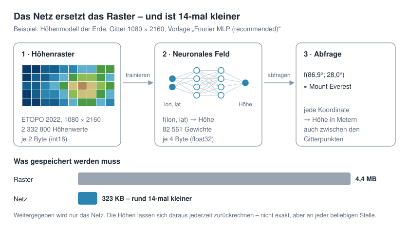

# Kapitel 1 · Geodaten als Funktion statt als Raster



**Lernziel:** Ein Höhenraster als Funktion `h(lon, lat)` begreifen, seine Rohgröße ausrechnen und die Kompressionsrate eines Netzes ehrlich bestimmen.

## Die Idee

Ein digitales Höhenmodell ist eine Tabelle: Für jede Zelle eines regelmäßigen Gitters aus Längen- und Breitengraden steht dort eine Höhe in Metern. Das globale Modell ETOPO 2022 hat in seiner feinsten Fassung 10 800 × 21 600 Zellen, also rund **233 Millionen Werte**.

Diese Tabelle ist aber nur eine Stichprobe von etwas Kontinuierlichem: der Höhe als Funktion des Ortes.

```math
h : (\text{lon}, \text{lat}) \mapsto \text{Höhe in Metern}
```

Wenn wir eine Funktion `f` finden, die an allen Gitterpunkten ungefähr die richtige Höhe liefert, brauchen wir die Tabelle nicht mehr – wir speichern stattdessen die Funktion. Ein neuronales Netz ist genau so eine Funktion, festgelegt durch seine Gewichte θ:

```math
f_\theta(\text{lon}, \text{lat}) \approx h(\text{lon}, \text{lat})
```

Gespeichert wird nur θ. **Die Gewichte sind die Datei.** Wer die Höhe an einer Stelle wissen will, setzt die Koordinate ins Netz ein und rechnet sie aus.

Damit das Speicher spart, muss θ deutlich weniger Bytes belegen als die Tabelle. Bei unserem Standardbeispiel – 1080 × 2160 Gitterpunkte, ein Netz mit 82 561 Gewichten – sind es 323 KB statt 4,4 MB. Der Preis: Das Netz trifft die Höhen nicht exakt. Wie groß der Fehler ist und wovon er abhängt, ist das Thema der folgenden Kapitel.

Dieses Vorgehen stellt gewöhnliches maschinelles Lernen auf den Kopf:

| gewöhnliches ML | hier |
|---|---|
| auf neue Daten verallgemeinern | genau **einen** Datensatz auswendig lernen |
| Overfitting ist der Fehler | Overfitting ist das Ziel |
| kleines Modell, viele Daten | das Modell **ist** die Daten |
| Erfolg = Fehler auf Testdaten | Erfolg = Rekonstruktionsfehler bei kleiner Datei |

In der Literatur heißt so ein Netz *Implicit Neural Representation* (INR) oder *neural field*.

## Ehrlich zählen: Was gehört zur Datei?

Eine Kompressionsrate ist nur so gut wie ihre Buchhaltung. Wir vergleichen zwei Größen.

**Rohgröße des Rasters** = Anzahl Gitterpunkte × Bytes pro Wert.

Die ETOPO-Datei selbst speichert jede Höhe als float32 (4 Byte). Für Höhen in ganzen Metern – von −10 935 m im Marianengraben bis 8 849 m am Mount Everest – genügt aber int16 (2 Byte, Bereich −32 768 bis 32 767). Wir rechnen deshalb mit **2 Byte pro Wert**. Das ist die vorsichtige Wahl: Gegen float32 gerechnet sähe jede Kompressionsrate doppelt so gut aus.

**Größe des Netzes** = alles, was man zum Zurückrechnen braucht:

- die Gewichte, je 4 Byte (float32),
- Mittelwert und Standardabweichung der Höhen, mit denen das Netz normiert wurde (2 × 4 Byte) – ohne sie liefert das Netz keine Meter,
- weitere Zutaten, die in späteren Kapiteln dazukommen, etwa ein Startwert für Zufallszahlen (4 Byte) oder ein grobes Kontextgitter.

Daraus folgen zwei Kennzahlen:

```math
\text{Kompressionsrate} = \frac{\text{Rohgröße}}{\text{Netzgröße}}
\qquad
\text{Bits pro Gitterpunkt} = \frac{8 \cdot \text{Netzgröße}}{\text{Anzahl Gitterpunkte}}
```

Für das Standardbeispiel: 2 332 800 Punkte × 2 Byte = 4 665 600 Byte Rohgröße, 330 256 Byte Netzgröße, also eine Rate von **14,1** und 1,13 Bits pro Gitterpunkt. Eine Rate unter 1 heißt: Das Netz ist größer als die Daten, es wird nichts gespart.

## Arbeitsauflösung: das Raster verkleinern

233 Millionen Punkte sind für ein Experiment auf dem Laptop zu viel. Die App mittelt das ETOPO-Raster deshalb auf eine wählbare Arbeitsauflösung herunter, zwischen 180 × 360 (1°, etwa 111 km pro Zelle) und 2160 × 4320 (1/12°, etwa 9 km). Dafür fasst sie Blöcke von Zellen zusammen und nimmt ihren Mittelwert; das Ergebnis landet in `data/cache/`, damit es beim nächsten Start sofort da ist.

Diese gemittelte Fassung ist ab jetzt „das Original“: Das Netz soll sie reproduzieren, und gegen sie wird gemessen.

## Ausprobieren

1. App starten: `uv run streamlit run app.py`. Fehlt die ETOPO-Datei, arbeitet die App mit einer synthetischen Erde – für dieses Kapitel genügt das.
2. Reiter *Idea & Budget* öffnen. Unter *Your budget – before training* stehen vier Kennzahlen: *Grid points*, *Parameters*, *Compression ratio* und *Bits per grid point*.
3. In der Seitenleiste unter *1 · Data* den Regler *Grid resolution* verschieben. Beobachte: Die Zahl der Parameter bleibt gleich, Rohgröße und Kompressionsrate ändern sich.
4. Den Regler ganz nach links schieben (180 × 360). Was meldet die App?
5. Unter *2 · Network* eine andere Vorlage wählen, etwa *Fourier MLP, very small* oder *Fourier MLP, large*, und die Rate vergleichen.

Trainiert wird in diesem Kapitel noch nichts: Alle Zahlen stehen schon vor dem Training fest. Die Kompressionsrate wird durch die Wahl des Netzes festgelegt, nicht durch das Training – das Training entscheidet nur, wie gut die Rekonstruktion wird.

## Im Code

Die Rohgröße berechnet `ElevationGrid` in `src/python_streamlit_neural_earth_field/data.py`:

```python
BYTES_PER_SAMPLE = 2  # whole metres fit int16; ETOPO itself stores float32, so this is conservative

@dataclass
class ElevationGrid:
    lon: np.ndarray  # (nx,)  cell centres in degrees, -180..180
    lat: np.ndarray  # (ny,)  cell centres in degrees, -90..90
    z: np.ndarray  # (ny, nx) elevation in metres, float32
    ...

    @property
    def raw_bytes(self) -> int:
        """Size of the grid as raw int16 data -- the reference for the compression ratio."""
        return self.n_points * BYTES_PER_SAMPLE
```

Das Herunterrechnen erledigt `_block_mean_2d` in derselben Datei. Es liest das große Raster streifenweise, damit nie alle 233 Millionen Werte gleichzeitig im Speicher liegen:

```python
def _block_mean_2d(var, fy: int, fx: int, ny: int, nx: int, block_rows: int = 48) -> np.ndarray:
    """Averages fy x fx blocks without loading the whole 233-million-point array."""
    out = np.empty((ny, nx), dtype=np.float32)
    for start in range(0, ny, block_rows):
        stop = min(start + block_rows, ny)
        chunk = np.asarray(var[start * fy : stop * fy, : nx * fx], dtype=np.float32)
        out[start:stop] = chunk.reshape(stop - start, fy, nx, fx).mean(axis=(1, 3))
    return out
```

Der Trick steckt im `reshape`: Ein Streifen der Form `(Zeilen · fy, Spalten · fx)` wird zu `(Zeilen, fy, Spalten, fx)` umgeformt, und der Mittelwert über die Achsen 1 und 3 fasst jeden fy × fx-Block zu einem Wert zusammen.

Die Netzgröße zählt `NeuralField.stored_bytes` in `model.py` – genau die Liste von oben:

```python
def stored_bytes(self, bytes_per_param: int = 4) -> int:
    """Payload of a stored file -- everything needed for the reconstruction."""
    total = self.n_parameters() * bytes_per_param
    total += 2 * 4  # z_mean, z_std as float32
    if isinstance(self.encoding, FourierFeatures):
        total += 4  # the seed is enough, B is reconstructed from it
    if self.context is not None:
        total += self.context.stored_bytes  # int16, independent of bytes_per_param
    return total
```

Die beiden Kennzahlen rechnet `Compression` in `metrics.py` aus:

```python
@dataclass
class Compression:
    raw_bytes: int
    model_bytes: int
    n_points: int
    n_parameters: int

    @property
    def ratio(self) -> float:
        return self.raw_bytes / self.model_bytes

    @property
    def bits_per_point(self) -> float:
        return 8 * self.model_bytes / self.n_points
```

## Übungen

**1.1** Das Standardnetz (*Fourier MLP (recommended)*) belegt 330 256 Byte. Ab welcher der Gitterauflösungen in der App ist es kleiner als die Rohdaten? Erst rechnen, dann in der App nachprüfen.

**1.2** Wie viele Bits pro Gitterpunkt braucht dasselbe Netz bei der feinsten Auflösung 2160 × 4320? Was bedeutet ein Wert unter 1?

**1.3** Angenommen, wir hätten die Rohgröße mit 4 Byte pro Wert (float32) gerechnet, wie die ETOPO-Datei sie speichert. Welche Kompressionsrate stünde dann beim Standardbeispiel 1080 × 2160 – und warum ist das die weniger ehrliche Zahl?

Die Lösungen stehen im [Anhang](anhang-loesungen.md#kapitel-1).

---

[Übersicht](README.md) · Weiter: Kapitel 2 · Overfitting als Ziel *(in Arbeit)*
