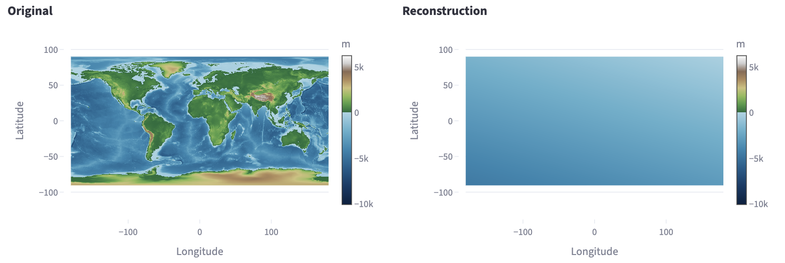
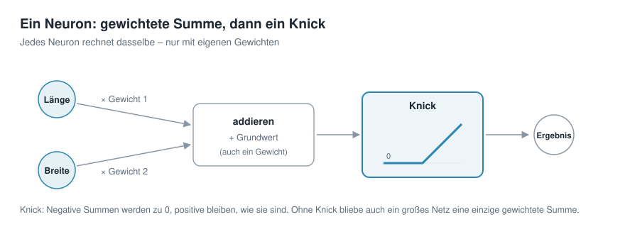
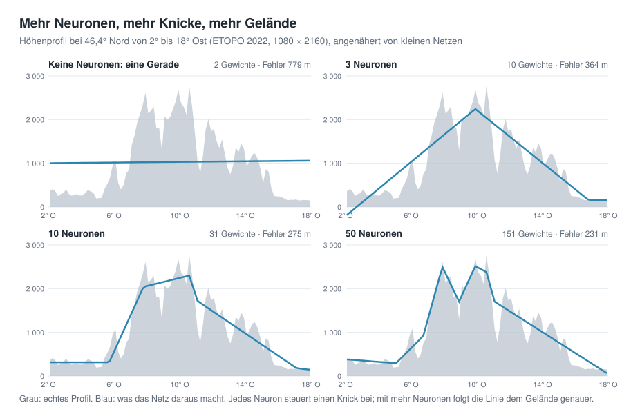
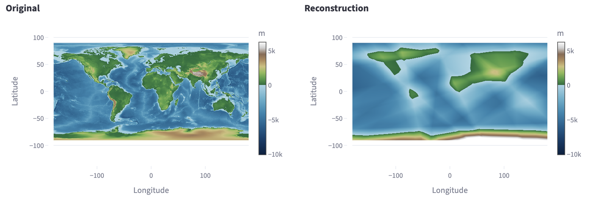
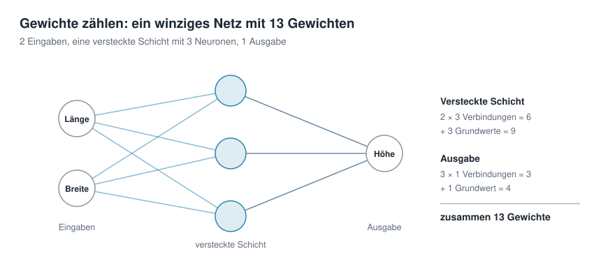
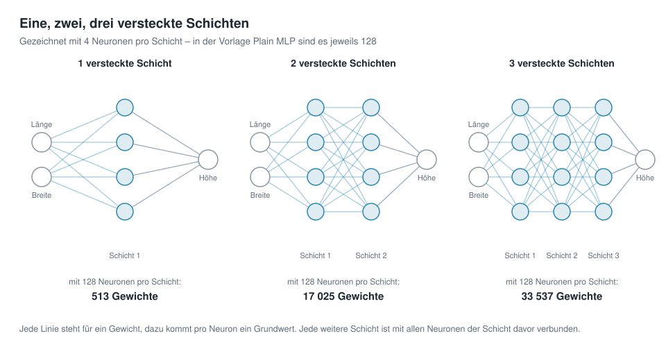
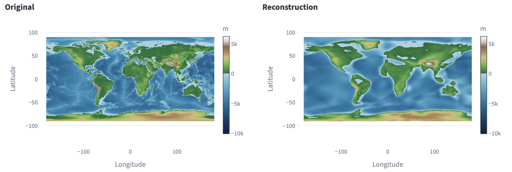
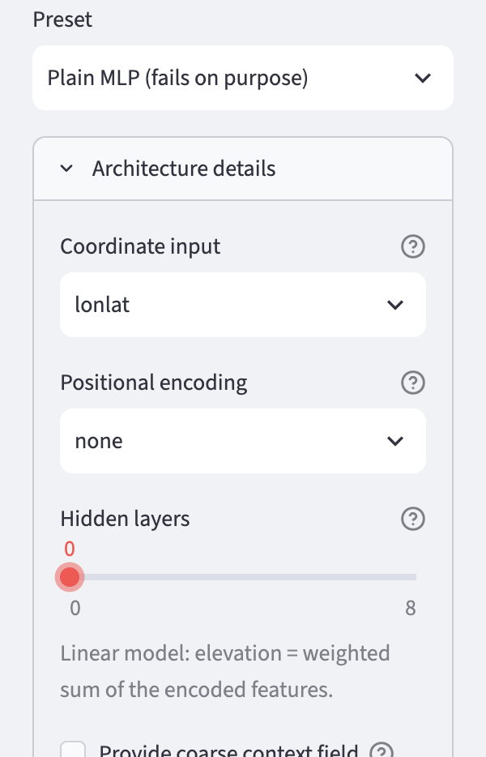

# Kapitel 3 · Architektur eines neuronalen Netzes


**Inhalt:** Was in einem neuronalen Netz eigentlich gerechnet wird – vom einfachsten Modell, einer gewichteten Summe, über ein einzelnes Neuron bis zum Netz mit mehreren Schichten.

## Ausgangspunkt

In den Kapiteln 1 und 2 war das Netz ein geschlossener Kasten:

Koordinate hinein, Höhe heraus, dazwischen 82 561 Gewichte. 

In diesem Kapitel schauen wir hinein. Wir beginnen mit dem einfachsten Modell, das es gibt, und bauen es Schritt für Schritt zu einem neuronalen Netz aus.

## Das einfachste Modell: eine gewichtete Summe

Für die Ermittlung der Höhe gibt es zwei Eingaben: Länge und Breite.

Das einfachste Modell nimmt jede davon mit einem Gewicht mal und zählt einen Grundwert dazu:

```math
\text{Höhe} = a \cdot \text{Länge} + b \cdot \text{Breite} + c
```

Das sind drei Gewichte: *a*, *b* und *c*. Auf der Weltkarte beschreibt diese sehr einfache Formel eine **schräge Ebene**: Die Ebene steigt in eine Richtung gleichmäßig an und fällt in die andere gleichmäßig ab. 

Mehr ist mit dieser einfachen Berechnungsweise nicht möglich. Kontinente, Gebirge und Ozeanbecken lassen sich damit nicht darstellen – das Training findet nur diese einfache Ebene, die insgesamt am wenigsten danebenliegt.



So sieht das in der App aus: links das Original, rechts das trainierte Modell mit drei Gewichten. Übrig bleibt eine leicht geneigte Fläche, von den Kontinenten ist nichts zu sehen. In der App heißt dieses Modell „0 versteckte Schichten“ – was eine versteckte Schicht ist, zeigt der nächste Abschnitt.

## Ein Neuron: Summe und Knick



```math
\text{Ergebnis} = \text{ReLU}\,(w_1 \cdot \text{Länge} + w_2 \cdot \text{Breite} + b)
```

Ein **Neuron**, die kleinste Recheneinheit eines neuronalen Netzes, rechnet zunächst genau dasselbe wie das einfachste Modell: jede Eingabe mal ein Gewicht (*w₁*, *w₂*), alles addieren, einen Grundwert dazu (*b*). Dann kommt allerdings ein weiterer Schritt, der **Knick**:

Ist die Summe negativ, gibt das Neuron 0 aus; ist sie positiv, gibt es sie unverändert weiter. In der Fachsprache heißt so ein Knick *Aktivierungsfunktion*. Die hier verwendete Aktivierungsfunktion heißt *ReLU*.

**ReLU** steht für *Rectified Linear Unit*, frei übersetzt „gleichgerichtete lineare Einheit“. Wie ein Gleichrichter in der Elektrotechnik nur den Strom in eine Richtung durchlässt, lässt ReLU nur positive Werte durch:

```math
\text{ReLU}(s) = \max(0,\, s)
```

| Summe *s* | −3 | −0,5 | 0 | 2 | 7,5 |
|---|---:|---:|---:|---:|---:|
| ReLU(*s*) | 0 | 0 | 0 | 2 | 7,5 |

ReLU ist die gebräuchlichste Aktivierungsfunktion, weil sie sehr einfach zu berechnen ist und sich Netze damit gut trainieren lassen. Daneben gibt es andere, etwa *GELU*, deren Knick sanft gerundet ist; auch sie ist in der App wählbar.

Warum der Knick so wichtig ist: Ohne ihn wäre jedes Neuron nur eine gewichtete Summe. Schaltet man mehrere Neuronen ohne Aktivierungsfunktion hintereinander, ist das Ergebnis – eine Summe aus gewichteten Summen – wieder nur eine gewichtete Summe.

Auch tausend Neuronen ohne "Knick" ergäben nur eine schräge Ebene. Erst durch den Knick kann das Netz andere Funktionen als Geraden abbilden; die Richtung wechseln.


## Mehr Neuronen, mehr Knicke

Bei der Abbildung der Weltkarte macht ein einzelnes Neuron Folgendes: Auf der einen Seite einer geraden Linie über die Karte gibt es 0 aus, auf der anderen Seite steigt sein Wert gleichmäßig an – wie eine Rampe, die an einer Kante beginnt. 

Ein Netz aus vielen Neuronen addiert viele solcher Rampen mit verschiedenen Kanten und Neigungen. So entsteht eine Fläche, die sich biegen kann.

Wie viel Form in den Knicken steckt, zeigt ein einzelnes Höhenprofil: ein Schnitt quer durch Frankreich, die Alpen und Österreich bei 46,4° Nord. Hier gibt es nur eine Eingabe – die Position entlang des Schnitts –, und kleine Netze mit unterschiedlich vielen Neuronen sollen das Profil nachzeichnen.



- **Keine Neuronen:** Eine Gerade, die so gut wie möglich durch das Profil gelegt wird. Sie verfehlt die Höhen im Mittel um 779 m.

- **3 Neuronen:** Drei Knicke ergeben ein grobes Dreieck – immerhin erkennt man, dass in der Mitte ein Gebirge liegt.

- **10 Neuronen:** Flachland, Anstieg, Hochgebirge und Abstieg nach Osten sind getrennt zu sehen.

- **50 Neuronen:** Die Linie zeigt zwei Gipfelbereiche und folgt dem Gelände deutlich genauer.

Jedes Neuron steuert einen Knick bei. Je mehr Neuronen, desto feiner kann die Linie dem Gelände folgen – aber desto mehr Gewichte muss man speichern.

Das gilt ebenfalls für die gesamte Erde. Hier das Ergebnis in der App mit einer Schicht aus 128 Neuronen:



Die Kontinente sind jetzt da, aber kantig, mit geraden Rändern. Das sind die Kanten der Rampen: Jedes Neuron knickt entlang einer geraden Linie über die Karte, und 128 solcher Linien zerlegen die Karte in Vielecke.


## Mehrere Schichten

Neuronen werden häufig in **Schichten** angeordnet. Die Neuronen der ersten Schicht bekommen Länge und Breite als Eingabe. Die Neuronen der zweiten Schicht bekommen die Ergebnisse der ersten Schicht, die der dritten die der zweiten und so weiter. Ganz am Ende steht ein Ausgabe-Neuron ohne Knick, das die Ergebnisse der letzten Schicht zur Höhe zusammenzählt.

Die Schichten zwischen Eingabe und Ausgabe heißen **versteckte Schichten**, weil man ihre Werte von außen nicht sieht. Ein Netz mit versteckten Schichten nennt man auch *Multi-Layer Perceptron* oder kurz **MLP** – daher der Name der App-Vorlagen.

Mehrere Schichten lohnen sich, weil jede Schicht die bereits geknickten Formen der vorherigen noch einmal knickt. Aus wenigen Gewichten entstehen so sehr viele kleine Flächenstücke – viel mehr, als dieselbe Zahl von Gewichten in einer einzigen Schicht ergeben würde.

### Gewichte zählen



Jede Verbindung zwischen zwei Neuronen hat ein Gewicht, und jedes Neuron hat zusätzlich seinen Grundwert. Für eine Schicht gilt deshalb: Eingaben × Neuronen + Neuronen. So kommt das winzige Netz oben auf 13 Gewichte.

Für die Vorlage *Plain MLP* mit 128 Neuronen pro Schicht ergibt das:

| Versteckte Schichten | Rechnung | Gewichte |
|---:|---|---:|
| 0 | 2 + 1 | 3 |
| 1 | (2 × 128 + 128) + (128 + 1) | 513 |
| 2 | 513 + (128 × 128 + 128) | 17 025 |
| 3 | 513 + 2 × (128 × 128 + 128) | 33 537 |
| 4 | 513 + 3 × (128 × 128 + 128) | 50 049 |



Jede weitere Schicht mit 128 Neuronen kostet 16 512 Gewichte, denn jedes ihrer Neuronen ist mit allen 128 Neuronen der Schicht davor verbunden.

Das Standardbeispiel aus Kapitel 1 hat 82 561 Gewichte, obwohl es ebenfalls 4 Schichten mit 128 Neuronen hat. Der Unterschied steckt in der ersten Schicht: Sie bekommt dort nicht 2 Eingaben, sondern 256 – woher die kommen, erklärt Kapitel 5.

Mit 4 versteckten Schichten sieht das Ergebnis so aus:



Die Kontinente sind runder und besser zu erkennen. Feine Einzelheiten fehlen aber noch immer: Gebirge sind verschwommen, Küstenlinien glatt gezogen. Mit noch mehr Schichten und Neuronen wird es nur langsam besser. Die Kapitel 4 und 5 zeigen zwei Kniffe, mit denen dasselbe Netz deutlich mehr Einzelheiten lernt.

## Ausprobieren

1. In der Seitenleiste unter *2 · Network* die Vorlage *Plain MLP (fails on purpose)* wählen.
2. *Architecture details* aufklappen und den Regler *Hidden layers* ganz nach links auf 0 schieben. Darunter erscheint der Hinweis, dass es jetzt ein lineares Modell ist.

   

   Die App gibt nicht Länge und Breite direkt ins Netz, sondern rechnet sie vorher um – warum, zeigt Kapitel 4. Deshalb zeigt sie etwas andere Gewichtszahlen als dieses Kapitel, zum Beispiel 4 statt 3 beim einfachsten Modell, und die Karten sehen etwas anders aus. Am Prinzip ändert das nichts. Die Bilder in diesem Kapitel sind mit der Einstellung `lonlat` entstanden, die im Screenshot unter *Coordinate input* zu sehen ist.

3. Auf *🚀 Train* klicken. Das lineare Modell ist in wenigen Sekunden fertig. Danach den Reiter *Maps & Error* öffnen.
4. *Hidden layers* auf 1 stellen, neu trainieren und die Karte vergleichen. Dann dasselbe mit 4 Schichten. Die Zahl der Gewichte steht jeweils im Reiter *Idea & Budget*.

**Hinweis zum linearen Modell:** Im Reiter *Training* kann die Fehlerkurve beim linearen Modell ansteigen statt fallen, und R² kann knapp unter 0 liegen. Das ist kein Fehler: Das Training verkleinert den flächengewichteten Fehler (Kapitel 2), die Kurve und R² messen aber ungewichtet. Der Wert *weighted RMSE* sinkt während des Trainings – im Standardbeispiel von rund 2 780 m auf 2 390 m. Für die schräge Ebene ist es ein Kompromiss: Sie passt besser zu den großen Flächen am Äquator und schlechter zu den Polargebieten, die ungewichtet viel mehr Zellen haben.

## Ideen zum Weiterprobieren

- Bei einer versteckten Schicht die *Neurons per layer* auf 8, 32 und 512 stellen. Wie verändern sich die Vielecke auf der Karte?
- Unter *Activation* statt `relu` einmal `gelu` wählen. Das ist ein sanft gerundeter Knick – was passiert mit den kantigen Rändern?
- 8 versteckte Schichten ausprobieren. Wird die Karte deutlich besser, und was kostet das an Gewichten?
- Im Reiter *Maps & Error* auf die Fehlerkarte achten: Wo liegen die größten Fehler – im offenen Ozean oder an den Küsten?

## Weiterführende Links

- 3Blue1Brown: [But what is a Neural Network?](https://www.3blue1brown.com/lessons/neural-networks) – anschauliche Einführung in Neuronen, Schichten und Gewichte (Englisch)
- Google Machine Learning Crash Course: [Neuronale Netzwerke](https://developers.google.com/machine-learning/crash-course/neural-networks?hl=de) – Knoten, versteckte Schichten und Aktivierungsfunktionen

---

[Übersicht](README.md) · Zurück: [Kapitel 2 · Training des neuronalen Netzes](02-training.md) · Weiter: [Kapitel 4 · Koordinaten gehören auf die Kugel](04-kugelkoordinaten.md)
