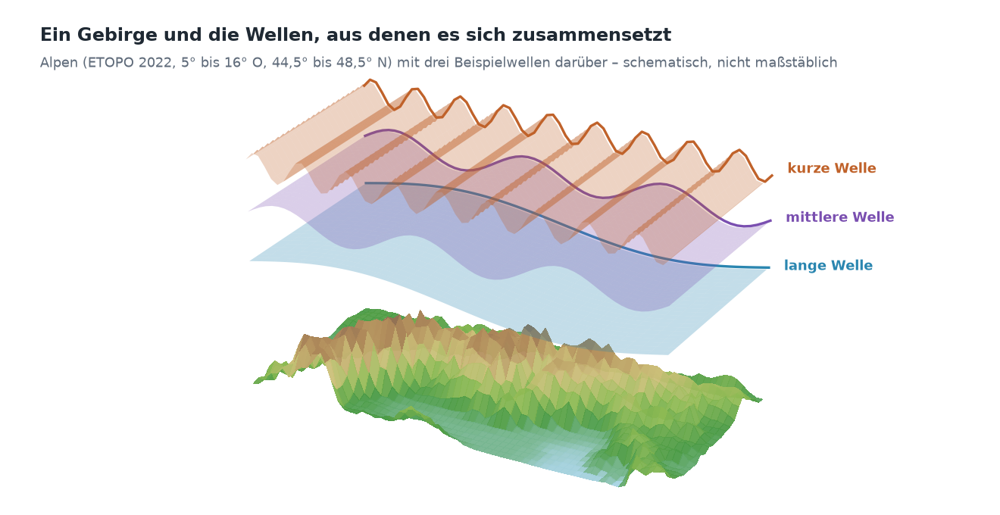
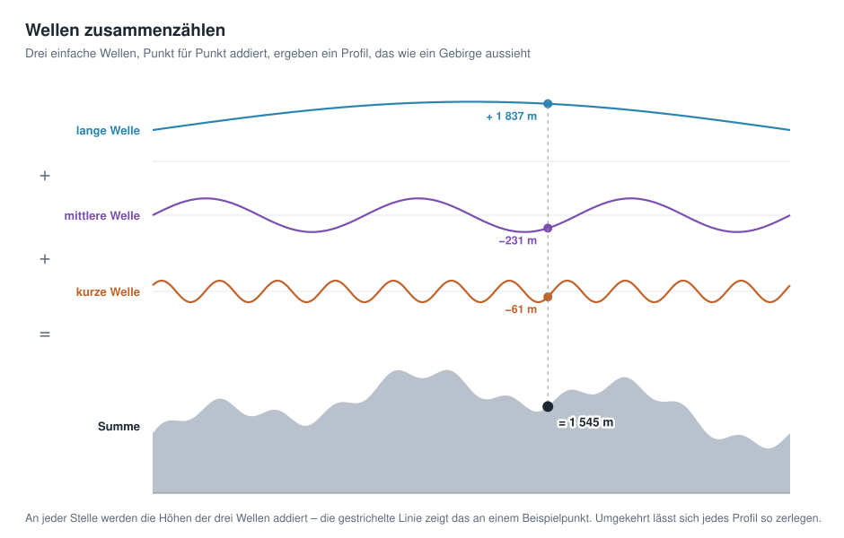
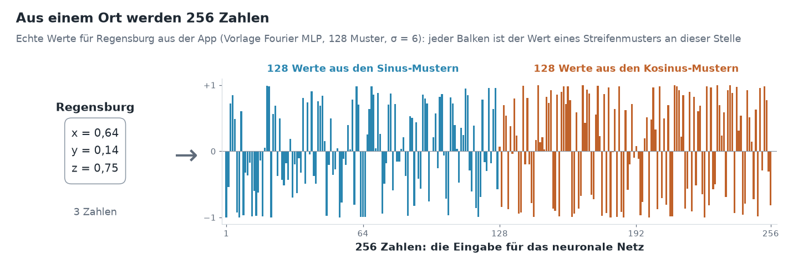

# Kapitel 5 · Höhen als Wellen


**Inhalt:** Warum ein Höhenmodell aus Wellen bestehen kann, warum ein einfaches neuronales Netz kurze Wellen schwer lernt und wie Fourier-Features das ändern können.

## Ausgangspunkt

Nach Kapitel 4 bekommt das neuronale Netz als Eingabe Kugelkoordinaten (X, Y, Z) und hat damit keine Naht mehr. 

Trotzdem: Am Ende von Kapitel 3 waren die Kontinente zwar zu erkennen, Gebirge und Küsten aber nicht. Woran liegt das, und was kann man für mehr Details tun?

## Ein Gebirge ist eine Summe von Wellen

Bei Frequenzen denkt man meist an Töne: Schwingungen pro Sekunde. Es gibt aber auch **räumliche Frequenzen**: Schwingungen pro Strecke. Gemeint ist, wie schnell sich die Höhe ändert, wenn man über das Gelände wandert.



Jedes Höhenprofil lässt sich als Summe von Wellen verschiedener Länge schreiben. Das zeigt das Profil durch die Alpen aus Kapitel 3, diesmal in voller ETOPO-Auflösung:


- **Lange Wellen** (über 400 km) sind die Großform: Hier steht ein Gebirge, links und rechts davon ist Flachland.
- **Mittlere Wellen** (100 bis 400 km) sind einzelne Gebirgsgruppen und Becken.
- **Kurze Wellen** (unter 100 km) sind Gipfel und Täler.

Zusammengezählt ergeben die drei Teile genau das Original. 



Das Prinzip zeigt ein einfaches Beispiel: An jeder Stelle werden die Höhen der Wellen addiert. Wo die lange Welle hoch ist und die kürzeren gerade nach oben ausschlagen, entsteht ein Gipfel; wo sie nach unten ausschlagen, ein Tal.

Für die ganze Erde gilt dasselbe, nur in zwei Richtungen: Kontinente und Ozeanbecken sind lange Wellen, Küstenlinien, Gebirge und Tiefseegräben kurze. 


Die Zerlegung eines Signals (hier Oberflächenrelief) in Wellen heißt nach dem Mathematiker Joseph Fourier **Fourier-Analyse**.

## Ein einfaches Netz lernt lange Wellen zuerst

Neuronale Netze haben eine bekannte Vorliebe: Sie lernen lange Wellen schnell und kurze nur sehr langsam. In der Fachsprache heißt das *spectral bias* [1]. Der Grund steckt in Kapitel 3: Ein Netz mit ReLU setzt seine Form aus geraden Stücken zusammen. Eine sanfte Großform braucht dafür wenige Knicke, ein zerklüfteter Grat sehr viele – und das Training findet die vielen Knicke nur mühsam.

Das zeigt ein Versuch mit dem Alpenprofil. Zwei gleich große Netze lernen es, das obere auf die bisherige Art, das untere mit Fourier-Features, die der nächste Abschnitt erklärt:


Das einfache Netz kommt auch nach 3 000 Schritten kaum über die Großform hinaus. Mit Fourier-Features sind die Gipfel schon nach 50 Schritten da, und nach 500 Schritten liegt die Kurve fast auf dem Profil.

## Fourier-Features: Streifenmuster als Eingabe

Die Idee: Wenn das Netz kurze Wellen so schwer selbst bilden kann, gibt man ihm schon bei der Eingabe Wellen mit. Wie das geht, in drei Schritten.

### 1 · Der Ort als Punkt auf der Kugel

Ausgangspunkt ist die Einheitskugel aus Kapitel 4: die Erde als Kugel mit dem Radius 1, der Ursprung im Erdmittelpunkt. Jeder Ort ist dort ein Punkt mit drei Zahlen (x, y, z), Regensburg zum Beispiel (0,64; 0,14; 0,75).


### 2 · Streifenmuster über die Erde

Eine **Welle** ist hier ein festes Streifenmuster, das über die ganze Kugel gelegt wird – wie Zebrastreifen: Entlang einer Richtung wechseln sich Streifen mit dem Wert +1 und Streifen mit dem Wert −1 ab, dazwischen geht es fließend über. Jedes Muster hat eine eigene Richtung und einen eigenen Streifenabstand. Ein großer Abstand ist eine lange Welle, ein kleiner eine kurze.

![Drei Erdkugeln mit Streifenmustern in Orange (+1), Weiß (0) und Blau (−1), Regensburg ist jeweils als schwarzer Punkt markiert. Lange Welle mit 5 000 km Streifenabstand: Regensburg bekommt +0,70. Mittlere Welle mit 1 000 km: −0,95. Kurze Welle mit 250 km, als vergrößerter Ausschnitt von Mitteleuropa: −0,63. Durch Regensburg führt jeweils eine Linie entlang 49° Nord; darunter ist der Wert entlang dieser Linie aufgetragen – eine Wellenlinie zwischen −1 und +1, die bei der kurzen Welle schnell und bei der langen langsam schwingt.](img/streifenmuster.png)

Fährt man quer zu den Streifen über die Erde und trägt den Wert auf, entsteht eine Wellenlinie – fast genau eine Sinuskurve; nur weil die Erde gekrümmt ist, sind die Streifen leicht gebogen. Daher der Name Welle.

Für jeden Ort schaut man nach, welchen Wert das Muster an dieser Stelle hat: Regensburg liegt im langen Muster in einem orangen Streifen (+0,70), im mittleren in einem blauen (−0,95). Richtung und Abstand jedes Musters werden einmal zufällig ausgelost und bleiben dann fest – für alle Orte, beim Training und später beim Abfragen.

### 3 · 256 Zahlen als Eingabe

Im Standardbeispiel gibt es **128 solcher Muster**. Für einen einzelnen Ort schaut man in jedem der 128 Muster nach, welchen Wert es an dieser Stelle hat. Das ergibt 128 Zahlen zwischen −1 und +1. Dazu kommen 128 weitere aus denselben Mustern, um eine Viertelwelle verschoben (Kosinus statt Sinus) – so ist auch eindeutig, ob ein Ort am Anfang oder am Ende eines Streifens liegt.



Die Eingabe für das neuronale Netz sind also **256 Zahlen statt 3**. Sie beschreiben nicht mehr, *wo* der Ort liegt, sondern *in welchem Streifen jedes Musters* er liegt. Diese Umwandlung heißt **Fourier-Features** [2]: Jede solche Welle heißt in der Fachsprache **Basisfunktion**; ihr Wert an einem Ort ist ein **Merkmal** (englisch *feature*) – daher der Name Fourier-Features.

Danach geht es weiter wie in Kapitel 3: Die 256 Zahlen gehen in die erste Schicht, die Schichten rechnen, am Ende steht die Höhe.

### Warum das hilft

Zwei Orte im Abstand von 20 km haben fast dieselben x-, y- und z-Werte. Damit das Netz sie trotzdem unterscheidet, bräuchte es viele Knicke (Kapitel 3). In einem Muster mit kurzen Streifen liegen sie dagegen schon in verschiedenen Streifen und bekommen deutlich verschiedene Zahlen. Das Netz muss die feinen Unterschiede also nicht mehr selbst herstellen – sie stehen schon in der Eingabe.

Das zeigt der Vergleich von Regensburg mit Wörth an der Donau, 22 km weiter östlich, in den drei Mustern von oben:

| | Regensburg | Wörth a. d. Donau | Unterschied |
|---|---:|---:|---:|
| x, y, z | 0,64 / 0,14 / 0,75 | 0,64 / 0,14 / 0,75 | kaum sichtbar |
| lange Welle (5 000 km) | +0,70 | +0,68 | 0,02 |
| mittlere Welle (1 000 km) | −0,95 | −0,98 | 0,03 |
| kurze Welle (250 km) | −0,63 | −0,13 | **0,50** |

Lange Wellen sagen dem Netz, in welcher Gegend der Erde ein Ort liegt; kurze Wellen unterscheiden Nachbarorte. Das Netz wählt aus allen 256 Zahlen die passenden aus und kombiniert sie – so wie sich das Alpenprofil oben aus langen, mittleren und kurzen Wellen zusammensetzt.

### Für Interessierte: die Formel

Für ein einzelnes Muster sieht die Rechnung so aus:

```math
\text{Wert} = \sin\!\big(2\pi \cdot (b_x \cdot x + b_y \cdot y + b_z \cdot z)\big)
```

Die drei Zahlen *b* legen das Muster fest: Ihre Richtung ist die Richtung, in der sich die Streifen abwechseln, und ihre Größe bestimmt den Streifenabstand – je größer, desto enger die Streifen. Für die zweiten 128 Werte steht dort cos statt sin.

**Was das an Gewichten kostet:** Im Standardbeispiel sind es 128 Wellen, also mit Sinus und Kosinus 256 Eingaben statt 3. Die erste Schicht mit 128 Neuronen braucht dadurch 256 × 128 + 128 = 32 896 Gewichte. Zusammen mit den drei weiteren Schichten (3 × 16 512) und der Ausgabe (129) ergibt das die 82 561 Gewichte aus Kapitel 1.

**Was es nicht kostet:** Die zufälligen Frequenzen *b* müssen nicht gespeichert werden. Sie entstehen aus einem Zufallsgenerator mit einem festen Startwert. Wer denselben Startwert verwendet, bekommt genau dieselben Wellen. Gespeichert wird deshalb nur dieser Startwert, 4 Byte – das war die „Zutat“, die in Kapitel 1 bei der Größe des Netzes mitgezählt wurde.

### Was bisher gespeichert werden müsste

Die Netze aus den Kapiteln 3 bis 5 im Vergleich. Gespeichert werden die Gewichte (je 4 Byte), dazu 8 Byte für die Normierung der Höhen und bei Fourier-Features 4 Byte für den Startwert (Kapitel 1). Zum Vergleich: Das Höhenraster des Standardbeispiels mit 1080 × 2160 Werten belegt 4,4 MB.

| Kapitel | Netz | Gewichte | Größe | Anteil am Raster | Kompressionsrate |
|---|---|---:|---:|---:|---:|
| 3 | einfachstes Modell (Länge, Breite) | 3 | 20 Byte | < 0,001 % | 233 280 |
| 3 | 1 versteckte Schicht (Länge, Breite) | 513 | 2,0 KB | 0,04 % | 2 265 |
| 3 | 4 versteckte Schichten (Länge, Breite) | 50 049 | 196 KB | 4,3 % | 23 |
| 4 | 4 versteckte Schichten (x, y, z) | 50 177 | 196 KB | 4,3 % | 23 |
| 5 | Fourier-Features + 4 Schichten | 82 561 | 323 KB | 7,1 % | 14 |
| – | **Höhenraster (Original)** | – | **4,4 MB** | 100 % | 1 |

Je mehr Gewichte, desto größer die Datei – aber desto mehr Einzelheiten kann das Netz auch darstellen. Die beiden ersten Netze sind winzig, geben die Erde aber kaum wieder (Kapitel 3). Wie gut die einzelnen Netze die Höhen tatsächlich treffen, steht gesammelt im Anhang mit den Messungen.

## σ: wie schnell die Wellen sind

Die Frequenzen *b* werden zufällig gezogen, aber nicht beliebig: Ein einzelner Wert, **σ** (Sigma), legt fest, wie groß sie typischerweise sind. Ein kleines σ ergibt fast nur langsame Wellen, ein großes σ viele schnelle. Grob überschlagen:

| σ | Wellen rund um den Äquator | typische Wellenlänge |
|---:|---:|---:|
| 1 | etwa 11 | etwa 3 700 km |
| 6 | etwa 65 | etwa 600 km |
| 20 | etwa 220 | etwa 180 km |

Die Werte sind typisch, nicht fest: Weil die Frequenzen zufällig gezogen werden, sind immer auch langsamere und schnellere Wellen dabei.

σ ist die wichtigste Stellschraube der Fourier-Features. Wie viel sie ausmacht, zeigt Europa, gelernt mit verschiedenen Werten:


- **σ zu klein:** Es fehlen die schnellen Wellen. Das Ergebnis ist glatt und verwaschen, ähnlich wie beim einfachen Netz, nur etwas besser.
- **σ passend:** Das Netz hat Wellen für die Großform und für die Einzelheiten. Alpen, Küstenlinien und große Inseln sind zu erkennen.
- **σ zu groß:** Viele Wellen sind schneller, als es das Netz in diesem Training sinnvoll nutzen kann. Statt Gelände entsteht ein körniges Muster, und das Ergebnis ist schlechter als mit σ = 1.

Das passende σ hängt von der Gitterauflösung und der Netzgröße ab. Für das Standardbeispiel ist σ = 6 eine gute Wahl; deshalb ist es die Voreinstellung der Vorlage *Fourier MLP (recommended)*.

## Ausprobieren

1. In der Seitenleiste unter *2 · Network* die Vorlage *Fourier MLP (recommended)* wählen und *Architecture details* aufklappen.
2. Unter *Positional encoding* steht `fourier`. Darunter zwei Regler: *Fourier frequencies* ist die Zahl der Wellen, *σ (bandwidth)* ihr σ.

   

3. Trainieren und das Ergebnis im Reiter *Maps & Error* mit dem aus Kapitel 3 vergleichen. Dort hatte die Vorlage *Plain MLP* keine Fourier-Features.
4. σ auf 1 und auf 20 stellen, jeweils neu trainieren und die Karten vergleichen. Im Reiter *Idea & Budget* lässt sich prüfen, dass sich an der Zahl der Gewichte dabei nichts ändert.

## Ideen zum Weiterprobieren

- σ in kleinen Schritten zwischen 2 und 12 verändern. Wo liegt für das gewählte Gitter der beste Wert?
- Die Zahl der *Fourier frequencies* auf 32 senken oder auf 256 erhöhen. Wie ändert sich die Zahl der Gewichte, und wie das Ergebnis?
- Eine kleinere *Grid resolution* wählen (zum Beispiel 360 × 720). Passt dann ein kleineres σ besser?
- Im Reiter *Globe 3D* den Himalaya oder die Anden ansehen: Wie gut kommen hohe, schmale Gebirge mit verschiedenen σ heraus?

## Weiterführende Links

- [1] Rahaman et al.: [On the Spectral Bias of Neural Networks](https://arxiv.org/abs/1806.08734), ICML 2019 – zeigt, dass Netze mit ReLU niedrige Frequenzen bevorzugen (Englisch)
- [2] Tancik et al.: [Fourier Features Let Networks Learn High Frequency Functions in Low Dimensional Domains](https://arxiv.org/abs/2006.10739), NeurIPS 2020 – führt die Fourier-Features für Koordinaten-Netze ein (Englisch)
- 3Blue1Brown: [But what is the Fourier Transform? A visual introduction](https://www.3blue1brown.com/lessons/fourier-transforms) – anschauliche Einführung in die Zerlegung in Wellen (Englisch)

## Sie haben es geschafft!


Mit diesem Kapitel ist der Kern des Tutorials abgeschlossen. Sie wissen jetzt, wie die Höhen der ganzen Erde in die Gewichte eines kleinen Netzes kommen:

- Die Höhen werden zu einer Funktion: Koordinaten hinein, Höhe heraus (Kapitel 1).
- Das Training stellt die Gewichte so ein, dass das Netz die Höhen trifft (Kapitel 2).
- Schichten und Neuronen bestimmen, wie viele Gewichte die Datei hat (Kapitel 3).
- Die Koordinaten liegen auf einer Kugel, ohne Naht und ohne Pole als Sonderfall (Kapitel 4).
- Streifenmuster als Eingabe bringen die feinen Einzelheiten (Kapitel 5).

Genau das steckt in der Vorlage *Fourier MLP (recommended)* der App.

Alles Weitere sind **Ergänzungen und Vertiefungen**. Sie bauen auf den Kapiteln 1 bis 5 auf, lassen sich aber je nach Interesse einzeln lesen oder überspringen:

- [Kapitel 6 · Vertiefung: Kugelflächenfunktionen](06-kugelflaechenfunktionen.md) – ein geordneter Satz von Mustern, der genau auf die Kugel passt
- [Kapitel 7 · Vertiefung: SIREN](07-siren.md) – Neuronen, die selbst mit einem Sinus rechnen
- [Kapitel 8 · Das Kontextfeld](08-kontextfeld.md) – ein grobes Gitter liefert die Kontinente, das Netz lernt nur noch die Einzelheiten
- Kapitel 9 · Rate und Fehler messen – Dateigröße und Genauigkeit verschiedener Netze fair vergleichen *(in Arbeit)*
- Kapitel 10 · Abfragen und exportieren – Höhen an beliebigen Orten abfragen und das Netz als Datei weitergeben *(in Arbeit)*
- Kapitel 11 · Einordnung und Ausblick – wo das Verfahren in der Forschung steht *(in Arbeit)*
- Anhang · Messungen – alle Ergebnisse an einer Stelle *(in Arbeit)*

---

[Übersicht](README.md) · Zurück: [Kapitel 4 · Die Erde ist eine Kugel](04-kugelkoordinaten.md) · Weiter: [Kapitel 6 · Vertiefung: Kugelflächenfunktionen](06-kugelflaechenfunktionen.md)
