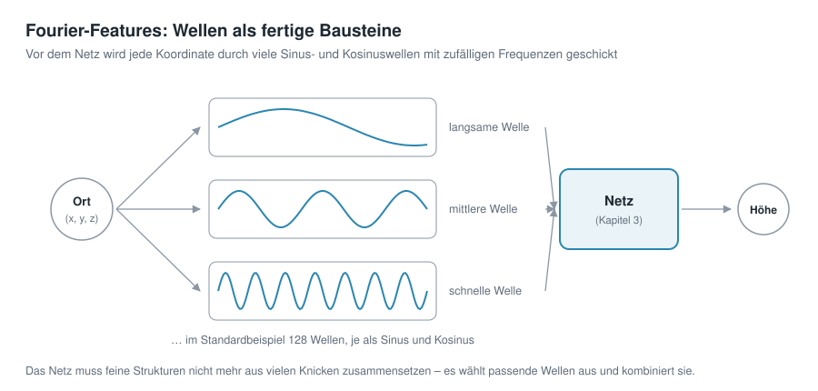

# Kapitel 5 · Räumliche Frequenzen und Fourier-Features


**Inhalt:** Warum ein Höhenmodell aus Wellen besteht, warum ein einfaches Netz die kurzen Wellen kaum lernt und wie Fourier-Features das ändern – mit dem Regler σ als wichtigster Stellschraube.

## Ausgangspunkt

Nach Kapitel 4 bekommt das Netz Kugelkoordinaten und hat keine Naht mehr. Trotzdem bleibt das Ergebnis verwaschen: Am Ende von Kapitel 3 waren die Kontinente zwar zu erkennen, Gebirge und Küsten aber nicht. Woran liegt das, und wie kommt man an die Einzelheiten heran?

## Ein Gebirge ist eine Summe von Wellen

Bei Frequenzen denkt man meist an Töne: Schwingungen pro Sekunde. Es gibt aber auch **räumliche Frequenzen**: Schwingungen pro Strecke. Gemeint ist, wie schnell sich die Höhe ändert, wenn man über das Gelände wandert.

Jedes Höhenprofil lässt sich als Summe von Wellen verschiedener Länge schreiben. Das zeigt das Profil durch die Alpen aus Kapitel 3, diesmal in voller ETOPO-Auflösung:


- **Lange Wellen** (über 400 km) sind die Großform: Hier steht ein Gebirge, links und rechts davon ist Flachland.
- **Mittlere Wellen** (100 bis 400 km) sind einzelne Gebirgsgruppen und Becken.
- **Kurze Wellen** (unter 100 km) sind Gipfel, Täler und Grate.

Zusammengezählt ergeben die drei Teile genau das Original. Für die ganze Erde gilt dasselbe, nur in zwei Richtungen: Kontinente und Ozeanbecken sind lange Wellen, Küstenlinien, Gebirge und Tiefseegräben kurze. Die Zerlegung eines Signals in Wellen heißt nach dem Mathematiker Joseph Fourier **Fourier-Analyse**.

## Ein einfaches Netz lernt lange Wellen zuerst

Neuronale Netze haben eine bekannte Vorliebe: Sie lernen lange Wellen schnell und kurze nur sehr langsam. In der Fachsprache heißt das *spectral bias* [1]. Der Grund steckt in Kapitel 3: Ein Netz mit ReLU setzt seine Form aus geraden Stücken zusammen. Eine sanfte Großform braucht dafür wenige Knicke, ein zerklüfteter Grat sehr viele – und das Training findet die vielen Knicke nur mühsam.

Das zeigt ein Versuch mit dem Alpenprofil. Zwei gleich große Netze lernen es, das obere auf die bisherige Art, das untere mit Fourier-Features, die der nächste Abschnitt erklärt:


Das einfache Netz kommt auch nach 3 000 Schritten kaum über die Großform hinaus. Mit Fourier-Features sind die Gipfel schon nach 50 Schritten da, und nach 500 Schritten liegt die Kurve fast auf dem Profil.

## Fourier-Features: Wellen als fertige Bausteine

Die Idee: Wenn das Netz kurze Wellen so schwer selbst bilden kann, gibt man ihm Wellen fertig mit.



Bevor die Koordinaten ins Netz gehen, wird jede Koordinate durch viele Sinus- und Kosinuswellen geschickt. Jede Welle hat eine zufällig gewählte Frequenz und Richtung über die Kugel. Das Ergebnis jeder Welle – eine Zahl zwischen −1 und 1 – ist eine Eingabe für das Netz. Diese Umwandlung heißt **Fourier-Features** [2].

Für eine einzelne Welle sieht die Rechnung so aus:

```math
\text{Eingabe} = \sin\!\big(2\pi \cdot (b_x \cdot x + b_y \cdot y + b_z \cdot z)\big)
```

Die drei Zahlen *b* legen fest, in welche Richtung die Welle über die Kugel läuft und wie schnell sie schwingt. Dazu kommt jeweils die gleiche Welle mit Kosinus statt Sinus.

Das Netz muss feine Strukturen jetzt nicht mehr aus vielen Knicken zusammensetzen. Es wählt aus den fertigen Wellen passende aus und kombiniert sie – genau wie in der Zerlegung des Alpenprofils oben.

**Was das an Gewichten kostet:** Im Standardbeispiel sind es 128 Wellen, also mit Sinus und Kosinus 256 Eingaben statt 3. Die erste Schicht mit 128 Neuronen braucht dadurch 256 × 128 + 128 = 32 896 Gewichte. Zusammen mit den drei weiteren Schichten (3 × 16 512) und der Ausgabe (129) ergibt das die 82 561 Gewichte aus Kapitel 1.

**Was es nicht kostet:** Die zufälligen Frequenzen *b* müssen nicht gespeichert werden. Sie entstehen aus einem Zufallsgenerator mit einem festen Startwert. Wer denselben Startwert verwendet, bekommt genau dieselben Wellen. Gespeichert wird deshalb nur dieser Startwert, 4 Byte – das war die „Zutat“, die in Kapitel 1 bei der Größe des Netzes mitgezählt wurde.

## σ: wie schnell die Wellen sind

Die Frequenzen *b* werden zufällig gezogen, aber nicht beliebig: Ein einzelner Wert, **σ** (Sigma), legt fest, wie groß sie typischerweise sind. Ein kleines σ ergibt fast nur langsame Wellen, ein großes σ viele schnelle. Grob überschlagen:

| σ | Wellen rund um den Äquator | typische Wellenlänge |
|---:|---:|---:|
| 1 | etwa 11 | etwa 3 700 km |
| 6 | etwa 65 | etwa 600 km |
| 20 | etwa 220 | etwa 180 km |

Die Werte sind typisch, nicht fest: Weil die Frequenzen zufällig gezogen werden, sind immer auch langsamere und schnellere Wellen dabei.

σ ist die wichtigste Stellschraube der Fourier-Features. Wie viel sie ausmacht, zeigt Europa, gelernt mit verschiedenen Werten:


- **σ zu klein:** Es fehlen die schnellen Wellen. Das Ergebnis ist glatt und verwaschen, ähnlich wie beim einfachen Netz, nur etwas besser.
- **σ passend:** Das Netz hat Wellen für die Großform und für die Einzelheiten. Alpen, Küstenlinien und große Inseln sind zu erkennen.
- **σ zu groß:** Viele Wellen sind schneller, als es das Netz in diesem Training sinnvoll nutzen kann. Statt Gelände entsteht ein körniges Muster, und das Ergebnis ist schlechter als mit σ = 1.

Das passende σ hängt von der Gitterauflösung und der Netzgröße ab. Für das Standardbeispiel ist σ = 6 eine gute Wahl; deshalb ist es die Voreinstellung der Vorlage *Fourier MLP (recommended)*.

## Ausprobieren

1. In der Seitenleiste unter *2 · Network* die Vorlage *Fourier MLP (recommended)* wählen und *Architecture details* aufklappen.
2. Unter *Positional encoding* steht `fourier`. Darunter zwei Regler: *Fourier frequencies* ist die Zahl der Wellen, *σ (bandwidth)* ihr σ.

   

3. Trainieren und das Ergebnis im Reiter *Maps & Error* mit dem aus Kapitel 3 vergleichen. Dort hatte die Vorlage *Plain MLP* keine Fourier-Features.
4. σ auf 1 und auf 20 stellen, jeweils neu trainieren und die Karten vergleichen. Im Reiter *Idea & Budget* lässt sich prüfen, dass sich an der Zahl der Gewichte dabei nichts ändert.

## Ideen zum Weiterprobieren

- σ in kleinen Schritten zwischen 2 und 12 verändern. Wo liegt für das gewählte Gitter der beste Wert?
- Die Zahl der *Fourier frequencies* auf 32 senken oder auf 256 erhöhen. Wie ändert sich die Zahl der Gewichte, und wie das Ergebnis?
- Eine kleinere *Grid resolution* wählen (zum Beispiel 360 × 720). Passt dann ein kleineres σ besser?
- Im Reiter *Globe 3D* den Himalaya oder die Anden ansehen: Wie gut kommen hohe, schmale Gebirge mit verschiedenen σ heraus?

## Weiterführende Links

- [1] Rahaman et al.: [On the Spectral Bias of Neural Networks](https://arxiv.org/abs/1806.08734), ICML 2019 – zeigt, dass Netze mit ReLU niedrige Frequenzen bevorzugen (Englisch)
- [2] Tancik et al.: [Fourier Features Let Networks Learn High Frequency Functions in Low Dimensional Domains](https://arxiv.org/abs/2006.10739), NeurIPS 2020 – führt die Fourier-Features für Koordinaten-Netze ein (Englisch)
- 3Blue1Brown: [But what is the Fourier Transform? A visual introduction](https://www.3blue1brown.com/lessons/fourier-transforms) – anschauliche Einführung in die Zerlegung in Wellen (Englisch)

---

[Übersicht](README.md) · Zurück: [Kapitel 4 · Die Erde ist eine Kugel](04-kugelkoordinaten.md) · Weiter: Kapitel 6 · Vertiefung: Kugelflächenfunktionen *(in Arbeit)*
