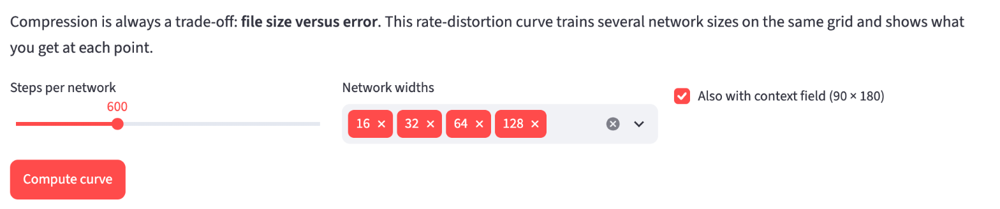
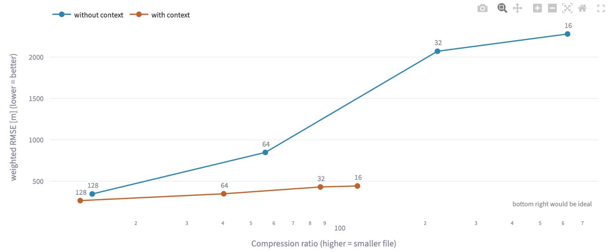

# Geodaten in neuronalen Netzen speichern
# Kapitel 9 · Kompresions-Rate und Fehler messen


**Inhalt:**

* Warum eine einzelne Zahl nicht reicht, um ein Kompressionsverfahren zu beurteilen
* Wie man eine Kompressions-Rate-Distortion-Kurve erzeugt und liest
* Was PSNR bedeutet

## Ausgangspunkt

In den bisherigen Kapiteln stand bei jedem Netz eine Kompressionsrate und ein Fehler. Das Standardbeispiel etwa ist 14-mal kleiner als das Raster und liegt im Mittel rund 250 m daneben.

Ob das gut ist, lässt sich so nicht sagen. Ein größeres neuronales Netz wäre genauer, aber die Datei wäre größer. Ein kleineres Netz spart mehr, macht aber größere Fehler. Jede Kompression ist eine Abwägung zwischen diesen beiden Zielen.

Ein ehrlicher Vergleich zeigt deshalb nicht einen Punkt, sondern eine ganze Kurve.

## Zwei Zahlen für jedes Netz

Für jedes Netz gibt es zwei Kennzahlen, die beide schon bekannt sind:

- **Kompressions-Rate:** die Kompressionsrate aus Kapitel 1 – Rohgröße des Rasters geteilt durch die Größe der Datei. Höher heißt: kleinere Datei.
- **Fehler:** der flächengewichtete RMSE aus Kapitel 2 – um wie viele Meter das Netz im Mittel danebenliegt, mit den Polgebieten nach ihrer echten Fläche gewichtet. Niedriger heißt: genauer.

In der Fachsprache heißt der Fehler bei der Kompression *distortion* (Verzerrung). Die Kurve, die beide Zahlen gegeneinander aufträgt, heißt deshalb **Rate-Distortion-Kurve**. Der Begriff stammt aus der Informationstheorie von Claude Shannon [1].

## Die Kurve erzeugen

Für die Kurve trainiert man mehrere Netze, die sich nur in einer Eigenschaft unterscheiden: der Zahl der Neuronen pro Schicht, der **Netzbreite**. Alles andere bleibt gleich – dasselbe Raster, dieselbe Zahl an Trainingsschritten, dieselbe Kodierung. Jedes Netz ergibt einen Punkt: rechts oder links je nach Dateigröße, oben oder unten je nach Fehler. Verbindet man die Punkte, entsteht die Kurve.

Das Diagramm zeigt das für das Standardgitter 1080 × 2160 mit neun Netzbreiten von 16 bis 256 Neuronen, einmal ohne und einmal mit dem Kontextfeld aus Kapitel 8:

![Rate-Distortion-Kurve auf dem Standardgitter: waagerecht die Kompressionsrate von 3 bis 800 auf einer logarithmischen Achse, senkrecht der gewichtete RMSE von 0 bis 2 400 m. Die blaue Kurve ohne Kontextfeld liegt links bei 250 m und steigt rechts von einer Rate um 50 steil an, bis auf 2 160 m beim Netz mit 16 Neuronen. Die orange Kurve mit Kontextfeld liegt überall darunter, von 176 m links bis 431 m bei einer Rate von 117, und endet dort. Eine gestrichelte Linie bei 300 m schneidet die blaue Kurve bei einer Rate von etwa 21 und die orange bei etwa 42. Unten rechts ist der ideale Bereich grün hinterlegt.](img/rd-kurve.svg)

Die Zahlen dazu:

| Neuronen pro Schicht | ohne Kontextfeld: Datei | Rate | Fehler | mit Kontextfeld: Datei | Rate | Fehler |
|---:|---:|---:|---:|---:|---:|---:|
| 16 | 7 KB | 622 | 2 163 m | 39 KB | 117 | 431 m |
| 24 | 13 KB | 344 | 1 993 m | 45 KB | 101 | 393 m |
| 32 | 21 KB | 221 | 1 790 m | 52 KB | 87 | 386 m |
| 48 | 46 KB | 99 | 867 m | 78 KB | 59 | 343 m |
| 64 | 81 KB | 56 | 527 m | 113 KB | 40 | 294 m |
| 96 | 182 KB | 25 | 312 m | 214 KB | 21 | 240 m |
| 128 | 323 KB | 14 | 272 m | 355 KB | 13 | 211 m |
| 192 | 628 KB | 7,3 | 258 m | 660 KB | 6,9 | 191 m |
| 256 | 1 029 KB | 4,4 | 253 m | 1 062 KB | 4,3 | 176 m |

Alle Netze haben 4 versteckte Schichten und Fourier-Features mit σ = 8 und wurden 2 000 Schritte lang trainiert, jedes einmal. Der Fehler ist auf einer festen Stichprobe von 200 000 Gitterzellen gemessen. Die Werte schwanken von Lauf zu Lauf etwas.

Das Netz mit 128 Neuronen hat genauso viele Gewichte wie das Standardbeispiel (82 561). Es ist aber nur 2 000 statt 4 000 Schritte trainiert und hat σ = 8 statt 6, deshalb liegt sein Fehler etwas höher.

## Die Kurve lesen

**Unten rechts wäre ideal.** Dort wäre die Datei klein und der Fehler gering. Kein Verfahren kommt dorthin, aber je näher eine Kurve dieser Ecke ist, desto besser ist das Verfahren.

**Die logarithmische Achse.** Die Kompressionsrate reicht von 4 bis über 600. Damit die Punkte nicht alle links zusammengedrängt liegen, wächst die Achse in Faktoren: Von 10 bis 100 ist es genauso weit wie von 100 bis 1 000.

**Eine Kurve unter einer anderen ist besser.** Die orange Kurve mit Kontextfeld liegt überall unter der blauen. Bei jeder Dateigröße ist das Netz mit Kontextfeld genauer. Ein Beispiel: Das Netz ohne Kontextfeld mit 64 Neuronen (81 KB, 527 m) und das Netz mit Kontextfeld mit 48 Neuronen (78 KB, 343 m) sind fast gleich groß, das zweite liegt aber um fast 200 m weniger daneben.

Ein Netz, das in beiden Zahlen schlechter ist als ein anderes, braucht man nicht. Übrig bleiben nur die Netze, bei denen man für mehr Genauigkeit eine größere Datei in Kauf nehmen muss. In der Fachsprache heißt diese untere Kante aller Punkte *Pareto-Front*.

**Waagerecht ablesen: Was kostet ein bestimmter Fehler?** Die gestrichelte Linie liegt bei 300 m. Ohne Kontextfeld erreicht man diesen Fehler erst bei einer Rate von etwa 21, mit Kontextfeld schon bei etwa 42. Für dieselbe Genauigkeit ist die Datei mit Kontextfeld also nur halb so groß.

**Senkrecht ablesen: Was bringt eine bestimmte Dateigröße?** Bei einer Rate von 14, also rund 330 KB, liegt das Netz ohne Kontextfeld 272 m daneben, mit Kontextfeld (Rate 13) 211 m.

## Was die Kurve verrät

**Der Knick nach oben.** Ohne Kontextfeld wird der Fehler rechts von einer Rate um 50 schnell größer. Das Netz mit 32 Neuronen liegt fast 1 800 m daneben, sein R² (Kapitel 2) ist nur 0,53: Es gibt kaum mehr als die Hälfte der Höhenunterschiede wieder. So kleine Netze haben zu wenige Gewichte für die Lage von Kontinenten und Ozeanbecken. Genau die liefert das Kontextfeld fertig mit. Deshalb bleibt die orange Kurve auch bei kleinen Netzen flach.

**Das Kontextfeld hat einen Mindestpreis.** Die orange Kurve endet bei einer Rate von 117. Das Kontextfeld allein belegt 31,6 KB; kleiner als das wird keine Datei mit Kontextfeld, egal wie klein das Netz ist.

**Links wird es flach.** Ohne Kontextfeld bringt die Verdopplung von 323 KB auf 628 KB nur noch 14 m, die nächste Verdopplung noch 5 m. Mehr Gewichte helfen dem Netz hier kaum noch. Mit Kontextfeld wird der Fehler dagegen bis zum größten Netz weiter kleiner.

**Die Kurve gilt nur für ihre Einstellungen.** Mit den Voreinstellungen der App, 600 statt 2 000 Schritten, liegt die blaue Kurve deutlich höher: 346 m statt 272 m beim Netz mit 128 Neuronen, 847 m statt 527 m beim Netz mit 64 Neuronen. Auch σ, die Zahl der Schichten und das Gitter verändern die Kurve. Wer zwei Verfahren vergleicht, sollte deshalb für beide gleich lange trainieren und dazuschreiben, mit welchen Einstellungen die Kurve entstanden ist.

## PSNR: der Fehler im Verhältnis zur Spannweite

Unter der Kurve zeigt die App neben dem Fehler in Metern eine zweite Zahl: **PSNR** (*peak signal-to-noise ratio*, Spitzen-Signal-Rausch-Verhältnis) [2]. Sie stammt aus der Bild- und Videokompression und sagt, wie groß der Fehler im Vergleich zur gesamten Spannweite der Daten ist.

Die Spannweite ist der Abstand zwischen dem tiefsten und dem höchsten Wert. Im Standardgitter reicht sie von −10 082 m bis 6 259 m, das sind gut 16 000 m. (Der Mount Everest erreicht hier keine 8 849 m, weil jede Zelle der Mittelwert eines Blocks von 10 × 10 Originalzellen ist.)

```math
\text{PSNR} = 20 \cdot \log_{10}\left(\frac{\text{Spannweite}}{\text{RMSE}}\right)\ \text{dB}
```

Die Einheit dB heißt Dezibel. Ein Rechenbeispiel mit runden Zahlen: Liegt das Netz bei einer Spannweite von 16 000 m im Mittel 160 m daneben, ist der Fehler ein Hundertstel der Spannweite. Der Logarithmus von 100 ist 2, mal 20 ergibt **40 dB**.

Zwei Faustregeln reichen zum Lesen:

- **+6 dB** heißt: Der Fehler ist nur noch halb so groß.
- **+20 dB** heißt: Der Fehler ist nur noch ein Zehntel so groß.

Höher ist also besser. Im Diagramm oben reicht PSNR von 17 dB beim kleinsten Netz ohne Kontextfeld bis 39 dB beim größten Netz mit Kontextfeld.

Der Vorteil von PSNR: Man kann Datensätze mit ganz verschiedenen Einheiten vergleichen, etwa Höhen in Metern und Temperaturen in Grad. Der Nachteil: PSNR verwendet den einfachen RMSE ohne Gewichtung nach Fläche, und ein einzelner Ausreißer im Marianengraben verändert die Spannweite. Für die Erde bleibt deshalb der gewichtete RMSE in Metern das wichtigere Maß; PSNR ist eine Ergänzung für Vergleiche mit anderen Arbeiten.

## So vergleicht auch die Forschung

Huang und Hoefler, die Vorlage dieser Tutorial-Reihe, beurteilen ihr Verfahren ebenfalls mit beiden Zahlen: Bei Kompressionsraten von 300 bis über 3 000 messen sie den gewichteten RMSE und den MAE und vergleichen mit dem klassischen Kompressionsprogramm SZ3. Nach ihren Ergebnissen ist ihr Netz dabei genauer als SZ3 [3]. Wer eigene Ergebnisse mit der Literatur vergleichen will, braucht deshalb immer beide Zahlen: Rate und Fehler.

## Ausprobieren

1. In der Seitenleiste unter *1 · Data* die Auflösung wählen. Die Kurve verwendet dieses Gitter. Die Vorlage unter *2 · Network* spielt dagegen keine Rolle: Die Kurve nutzt eigene Einstellungen mit 4 Schichten und σ = 8.
2. Den Reiter *Rate & Error* öffnen. Dort lassen sich drei Dinge einstellen:
   - *Steps per network* – Trainingsschritte für jedes Netz, 300 bis 2 000 (voreingestellt 600).
   - *Network widths* – die Netzbreiten, die als Punkte in die Kurve eingehen, von 16 bis 256 Neuronen (voreingestellt 16, 32, 64 und 128).
   - *Also with context field (90 × 180)* – zusätzlich eine zweite Kurve mit Kontextfeld.

   

3. Auf *Compute curve* klicken. Die App trainiert nun ein Netz nach dem anderen; ein Balken zeigt den Fortschritt. Mit den Voreinstellungen sind es acht Netze. Auf einem Mac mit Apple-Grafikchip dauert das gut eine Minute, ohne Grafikchip deutlich länger.
4. Die Kurve ansehen. Die Zahl an jedem Punkt ist die Netzbreite.

   

5. Unter der Kurve steht eine Tabelle mit Parametern, Dateigröße, Rate, gewichtetem RMSE und PSNR für jedes Netz.

## Ideen zum Weiterprobieren

- Welche Rate erreicht man bei einem Fehler von 250 m – mit und ohne Kontextfeld? Dafür die Breiten 96, 128 und 192 dazunehmen und waagerecht ablesen.
- *Steps per network* auf 2 000 stellen und die Kurve neu berechnen. Welche Punkte rücken am weitesten nach unten, die kleinen oder die großen Netze?
- Die Kurve auf dem Gitter 360 × 720 berechnen. Das Raster ist neunmal kleiner, die Netze bleiben gleich groß. Wohin verschiebt sich die Kurve?
- Die Vorlagen aus Kapitel 8 als einzelne Punkte gedanklich in das Diagramm eintragen: *Fourier MLP, very small* mit 75 KB und 339 m nach 4 000 Schritten. Liegt dieser Punkt über oder unter der blauen Kurve – und woran könnte das liegen?
- Ab welcher Netzbreite liegt der PSNR über 35 dB?

## Weiterführende Links

- [1] Wikipedia: [Rate-Distortion-Theorie](https://de.wikipedia.org/wiki/Rate-Distortion-Theorie) – die theoretische Grundlage: wie klein eine Datei bei einem erlaubten Fehler höchstens werden kann
- [2] Wikipedia: [Peak signal-to-noise ratio](https://en.wikipedia.org/wiki/Peak_signal-to-noise_ratio) – Definition und Beispiele aus der Bildkompression (Englisch)
- [3] Huang und Hoefler: [Compressing multidimensional weather and climate data into neural networks](https://arxiv.org/abs/2210.12538), ICLR 2023 – Vergleich mit SZ3 über gewichteten RMSE und MAE bei Kompressionsraten von 300 bis über 3 000 (Englisch)

---

[Übersicht](README.md) · Zurück: [Kapitel 8 · Das Kontextfeld](08-kontextfeld.md) · Weiter: [Kapitel 10 · Abfragen und exportieren](10-abfragen-und-exportieren.md)

*Dieses Tutorial wurde von Gerhard Völkl unter Verwendung von Claude Code (Anthropic) erstellt. Es soll helfen, mehr über das Thema „Geodaten in neuronalen Netzen speichern“ zu lernen. Verbesserungsvorschläge gerne an gkvoelkl@nelson-games.de.*
