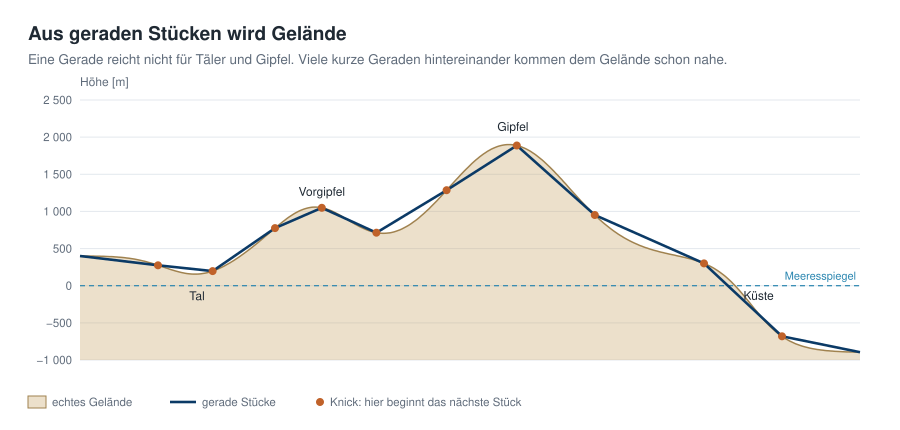

# Geodaten in neuronalen Netzen speichern
# Kapitel 1 · Geodaten als Funktion statt als Raster

*[English version](../en/01-geodaten-als-funktion.md)*


**Inhalt:** 

* Das Höhenraster der Erde als Funktion `h(lon, lat)` begreifen

* Ein neuronales Netz lernt diese Höhen

* Speichersparen: Wie viel weniger Speicher braucht das neuronale Netz im Vergleich zum ursprünglichen Höhenraster?

## Die Kern-Idee

Wer mit detaillierten Geodaten wie den Höhendaten der ganzen Welt arbeitet, hat es immer mit riesigen Datenmengen zu tun. Bei anderen Daten in diesem Bereich ist es nicht einfacher.

Findige Menschen kamen deshalb auf die Idee:

**Nehmen wir ein neuronales Netz und bringen ihm alle Höhendaten bei. Wenn wir Höhen wissen wollen, fragen wir das Netz. Cool ist es, wenn das neuronale Netz weniger Speicher braucht als die ursprünglichen Geodaten.**

Das ist die Kern-Idee, mit der sich dieses Tutorial und alle Kapitel dieser Reihe befassen.

Der Einfachheit halber verwendet diese Tutorial-Reihe als Beispiel die Höhendaten der Erde. Die Prinzipien gelten genauso für andere Geodaten, etwa Temperaturen oder Niederschläge.


## Die verwendeten Daten im Detail

Ein digitales Höhenmodell ist nichts anderes als eine Tabelle: Für jede Zelle eines regelmäßigen Gitters aus Längen- und Breitengraden steht dort eine Höhe in Metern.


Das globale Modell ETOPO 2022 hat in der Fassung, die hier Verwendung findet, 10 800 × 21 600 Zellen, also rund **233 Millionen Werte**.

Jede Zelle gehört zu einem Ort auf der Erde, und jeder Ort ist durch zwei Winkel festgelegt: die **Länge** (*longitude*, kurz lon) gibt an, wie weit östlich oder westlich vom Nullmeridian durch Greenwich er liegt, die **Breite** (*latitude*, kurz lat), wie weit nördlich oder südlich vom Äquator. Klappt man dieses Gradnetz von der Kugel auf, wird es zu einem Rechteck – und genau dieses Rechteck ist das Raster.


Alle Beispiele der Tutorial-Reihe können Sie in der Begleit-App nachvollziehen:


Wie Sie die App installieren und starten, steht am Ende dieses Kapitels im Abschnitt [Ausprobieren](#ausprobieren).

### Vertiefung: ETOPO 2022

ETOPO 2022 ist das globale Reliefmodell der US-Behörde NOAA (National Centers for Environmental Information), veröffentlicht 2022. Es setzt Höhen an Land, Wassertiefen am Meeresboden und Küstenlinien aus vielen regionalen und weltweiten Quellen zu einem einzigen, lückenlosen Raster zusammen.

- **Auflösungen:** NOAA bietet das Modell mit Zellen von 15, 30 und 60 Bogensekunden an. Wir nutzen die 60-Bogensekunden-Fassung: eine Zelle ist 1/60 Grad groß, am Äquator etwa 1,85 km. Die Datei ist 456 MB groß.
- **Zwei Varianten:** *Ice Surface* zeigt Grönland und die Antarktis mit der Oberfläche ihrer Eisschilde, *Bedrock* den Fels darunter. Wir verwenden die Eisoberfläche.
- **Bezug:** Die Höhen sind Meter über dem Geoid EGM2008, also grob über dem mittleren Meeresspiegel; negative Werte liegen darunter. Die Lage bezieht sich auf WGS 84, das System, das auch GPS verwendet.

**Was die Zeilen und Spalten bedeuten:**

- **Zeilen** sind Breitenstreifen. 180 Breitengrade von Süd- bis Nordpol × 60 Zellen je Grad ergeben 10 800 Zeilen. In der Datei liegt der südlichste Streifen (−89,99°) in der ersten Zeile, der nördlichste in der letzten.
- **Spalten** sind Längenstreifen. 360 Längengrade × 60 ergeben 21 600 Spalten, beginnend bei −180° an der Datumsgrenze und nach Osten fortlaufend.
- **Eine Zelle** in Zeile *i* und Spalte *j* enthält die Höhe des Feldes, das zwischen diesen Breiten- und Längengraden liegt.

Wer eine Höhe nachschlagen will, rechnet also die Koordinate in eine Zeilen- und eine Spaltennummer um und liest den Wert ab.

### Vom Raster zur Funktion

Die Tabelle enthält die Höhe nur an einzelnen Punkten, den Gitterzellen. Egal wie hoch aufgelöst die Daten sind: Es bleibt eine Stichprobe aus der echten Oberfläche.

Die Oberfläche selbst kann man sich als Funktion *h* denken. Sie ordnet jeder Koordinate eine Höhe zu, auch zwischen den Gitterpunkten:

```math
h : (\text{lon}, \text{lat}) \mapsto \text{Höhe in Metern}
```

Wenn wir eine Funktion `f` finden, die an allen Gitterpunkten ungefähr die richtige Höhe liefert, brauchen wir die Tabelle nicht mehr – wir speichern stattdessen die Funktion.

Ein neuronales Netz ist genau so eine Funktion, festgelegt durch seine Parameter (Fachbegriff: Gewichte θ):

```math
f_\theta(\text{lon}, \text{lat}) \approx h(\text{lon}, \text{lat})
```

### Was sind Gewichte?

Gewichte sind die Parameter, die die Berechnungen steuern.

**Ein einfaches Beispiel:** Eine Straße steigt auf 5 km Länge gleichmäßig an. Alle 10 m wurde die Höhe gemessen, das sind rund 500 Messwerte. Beginnt die Straße auf 300 m und steigt sie je Meter um 5 cm, lassen sich alle 500 Werte durch eine einzige Formel ersetzen:

```math
\text{Höhe}(x) = 300 + 0{,}05 \cdot x \qquad (x = \text{Strecke in Metern})
```


Statt 500 Zahlen speichern wir nur zwei: **300** und **0,05**. Das sind die Gewichte dieser Funktion. Wer die Höhe nach 2,5 km wissen will, rechnet sie aus: 300 + 0,05 · 2 500 = 425 m. Die Tabelle braucht man nicht mehr.

Echtes Gelände steigt nicht gleichmäßig. Es hat Täler, Gipfel und Küsten. Dafür reicht eine Gerade nicht aus.

Ein neuronales Netz baut deshalb aus vielen solchen einfachen Stücken eine biegsame Funktion zusammen. Jedes Stück hat wieder seine eigenen Gewichte; wo ein Stück endet, knickt die Kurve ab, und das nächste beginnt.



Wie das Netz diese Stücke genau bildet, zeigt Kapitel 3. Hier genügt: Mehr Stücke bedeuten mehr Gewichte – und mehr Gewichte bedeuten mehr Speicher.

### Unser Standardbeispiel

Damit das Speicher spart, müssen die Gewichte θ eines neuronalen Netzes deutlich weniger Bytes belegen als die ursprüngliche Tabelle.

Für die Rechnungen in diesem Tutorial verwenden wir die Voreinstellung der Begleit-App als **Standardbeispiel**:

- **Daten:** ETOPO 2022, gemittelt auf 1080 × 2160 Zellen (je 1/6 Grad, etwa 19 km). Das sind **2 332 800 Höhenwerte**.

- **Netz:** die Vorlage *Fourier MLP (recommended)* mit **82 561 Gewichten**. 

Gespeichert sind das **323 KB statt 4,4 MB**. 

Der Preis: Das Netz trifft die Höhen nicht exakt. Wie groß der Fehler ist und wovon er abhängt, ist das Thema der folgenden Kapitel.

### Lernen andersherum

Beim normalen Trainieren eines neuronalen Netzes sind die Input-Daten Beispiele, aus denen das neuronale Netz lernt.

Es schließt später von diesen Beispielen auf neue Daten, die es nie gesehen hat.

Beim Training von neuronalen Netzen zum Speichern von Geo-Informationen enthalten die Input-Daten bereits **alle** bekannten Werte. 

Das neuronale Netz soll nach dem Training diese möglichst genau wiedergeben.


| Gewöhnliches Training | Training zum Speichern |
|---|---|
| auf neue Daten verallgemeinern | genau **einen** Datensatz auswendig lernen |
| kleines Modell, viele Daten | das Modell **sind** die Daten |
| Erfolg = geringer Fehler bei Testdaten | Erfolg = geringer Rekonstruktionsfehler |

#### Literatur-Hinweis

In der Literatur heißt so ein Netz *Implicit Neural Representation* (INR) oder *neural field*. Xie et al. beschreiben neuronale Felder in ihrem Überblicksartikel als Netze, die eine Größe in Abhängigkeit von Raum- und Zeitkoordinaten darstellen [1]; bekannt gemacht haben den Begriff INR unter anderem Sitzmann et al. [2]. Dass man auf diese Weise Geodaten komprimieren kann, zeigen Huang und Hoefler für Wetter- und Klimadaten [3] – die direkte Vorlage für diese Tutorial-Reihe. Danke!

## Kompressionsrate ermitteln

Man vergleicht zwei Größen.

**Rohgröße des Rasters** = Anzahl Gitterpunkte × Bytes pro Wert.

Die ETOPO-Datei selbst speichert jede Höhe als float32 (4 Byte). Für Höhen in ganzen Metern – von −10 935 m im Marianengraben bis 8 849 m am Mount Everest – genügt aber int16 (2 Byte, Bereich −32 768 bis 32 767).

Wir rechnen deshalb mit **2 Byte pro Wert**. Das ist die vorsichtige Wahl: Gegen float32 gerechnet sähe jede Kompressionsrate doppelt so gut aus.

**Größe des neuronalen Netzes** = alles, was es zum Rechnen braucht:

- die Gewichte, je 4 Byte (float32),

- Mittelwert und Standardabweichung der Höhen, mit denen das Netz normiert wurde (2 × 4 Byte) – ohne sie liefert das Netz keine Meter,

- weitere Zutaten, die in späteren Kapiteln dazukommen, etwa ein Startwert für Zufallszahlen (4 Byte) oder ein grobes Kontextgitter.

Daraus folgen zwei Kennzahlen:

```math
\text{Kompressionsrate} = \frac{\text{Rohgröße}}{\text{Netzgröße}}
\qquad
\text{Bits pro Gitterpunkt} = \frac{8 \cdot \text{Netzgröße}}{\text{Anzahl Gitterpunkte}}
```

Für das Standardbeispiel: 

2 332 800 Punkte × 2 Byte = 4 665 600 Byte Rohgröße.

Das Netz belegt 82 561 × 4 Byte für die Gewichte plus 12 Byte für Normierung und Startwert, zusammen 330 256 Byte.

Das ergibt eine Rate von **14,1** und 1,13 Bits pro Gitterpunkt. 

In Worten: Das neuronale Netz braucht in diesem Fall **14,1-mal** weniger Speicher als die Originaldaten.

Wäre die Rate unter 1, würde das heißen: Das neuronale Netz ist größer als die Daten. Es wird nichts gespart.

## Vereinfachen: Das Raster verkleinern

233 Millionen Punkte aus dem ursprünglichen ETOPO-Raster sind für die Verarbeitung auf dem Laptop zu viel.

Die Begleit-App reduziert das ETOPO-Raster deshalb auf eine wählbare Arbeitsauflösung zwischen 180 × 360 (1°, etwa 111 km pro Zelle) und 2160 × 4320 (1/12°, etwa 9 km).

Dafür fasst die App Blöcke von Zellen zusammen und nimmt deren Mittelwert; das Ergebnis landet in `data/cache/`, damit es beim nächsten Start wieder da ist.

## Ausprobieren

* **App installieren:** Die App braucht Python 3.14 oder neuer und den Paketmanager [uv](https://docs.astral.sh/uv/). Laden Sie das [Repository](https://github.com/gkvoelkl/python-streamlit-neural-earth-field) herunter (mit `git clone https://github.com/gkvoelkl/python-streamlit-neural-earth-field.git` oder auf GitHub über *Code → Download ZIP*) und rufen Sie im Projektordner einmal `uv sync` auf. uv legt dabei eine eigene Python-Umgebung an und installiert alle benötigten Pakete.

* **Höhendaten laden:** Die ETOPO-Datei (456 MB) wird einmal heruntergeladen und im Ordner `data/` abgelegt. Den genauen Befehl finden Sie in der [README des Projekts](https://github.com/gkvoelkl/python-streamlit-neural-earth-field/blob/main/README_de.md#daten) unter *Daten*. Ohne die Datei läuft die App trotzdem, dann mit einer künstlichen Test-Erde (Quelle *Synthetic*).

* **App starten:** `uv run streamlit run app.py`. Die App öffnet sich im Browser.

* Den Reiter **Idea & Budget** öffnen. Unter *Your budget – before training* stehen vier Kennzahlen: *Grid points*, *Parameters*, *Compression ratio* und *Bits per grid point*.

   

   - *Grid points* – die Zahl der Gitterzellen in der Arbeitsauflösung: 1080 × 2160 = 2 332 800 Höhenwerte.
   - *Parameters* – die Zahl der Gewichte des gewählten Netzes: 82 561.
   - *Compression ratio* – Rohgröße geteilt durch Netzgröße, wie oben berechnet: 14.
   - *Bits per grid point* – so viele Bits braucht das Netz im Schnitt für einen Höhenwert: 1,133. Im Raster sind es 16 Bit (2 Byte).

* In der **Seitenleiste** unter **1 · Data** den Regler **Grid resolution** verschieben. Beobachten Sie: Die Zahl der Parameter bleibt gleich, Rohgröße und Kompressionsrate ändern sich.

   

* Den Regler ganz nach links schieben (180 × 360). Was meldet die App?

* Unter *2 · Network* die Netzwerk-Architektur des neuronalen Netzes wählen, etwa *Fourier MLP, very small* oder *Fourier MLP, large*, und die Rate vergleichen.

Das Training des Netzes ist Thema im nächsten Kapitel.

Die Architektur des neuronalen Netzes legt die Kompressionsrate fest. 

Das Training entscheidet darüber, wie gut die Rekonstruktion wird.

## Ideen zum Weiterprobieren

- Den Regler *Grid resolution* Stufe für Stufe nach links schieben: Ab welcher Auflösung ist das Netz größer als die Daten?
- Die feinste Auflösung 2160 × 4320 wählen und auf *Bits per grid point* achten. Was bedeutet es, wenn das Netz für einen Gitterpunkt weniger als ein Bit braucht?
- Alle Vorlagen unter *2 · Network* durchgehen und die Parameterzahl vergleichen. Welche spart am meisten, welche gar nicht?
- Unter *Architecture details* die *Neurons per layer* verdoppeln. Wächst die Parameterzahl auf das Doppelte – oder stärker?
- Zwischen den Quellen *ETOPO 2022* und *Synthetic* wechseln. Warum ändert sich am Budget nichts?

## Weiterführende Links

- NOAA NCEI: [ETOPO Global Relief Model](https://www.ncei.noaa.gov/products/etopo-global-relief-model) – Beschreibung, Download und Nutzerhandbuch, Zitat: DOI [10.25921/fd45-gt74](https://doi.org/10.25921/fd45-gt74)
- [1] Xie et al.: [Neural Fields in Visual Computing and Beyond](https://arxiv.org/abs/2111.11426), 2022 – Überblick über neuronale Felder
- [2] Sitzmann et al.: [Implicit Neural Representations with Periodic Activation Functions](https://arxiv.org/abs/2006.09661), 2020
- [3] Huang und Hoefler: [Compressing multidimensional weather and climate data into neural networks](https://arxiv.org/abs/2210.12538), 2023
- Tancik et al.: [Fourier Features Let Networks Learn High Frequency Functions in Low Dimensional Domains](https://arxiv.org/abs/2006.10739), 2020 – Grundlage für ein späteres Kapitel

---

[Übersicht](README.md) · Weiter: [Kapitel 2 · Training des neuronalen Netzes](02-training.md)

*Dieses Tutorial wurde von Gerhard Völkl unter Verwendung von Claude Code (Anthropic) erstellt. Es soll helfen, mehr über das Thema „Geodaten in neuronalen Netzen speichern“ zu lernen. Verbesserungsvorschläge gerne an gkvoelkl@nelson-games.de.*