# Geodaten in neuronalen Netzen speichern
# Kapitel 2 · Training des neuronalen Netzes

*[English version](../en/02-training.md)*


**Inhalt:** 

* Wie lernt das neuronale Netz seine Parameter (Gewichte)?

* Warum soll es in diesem Fall alles auswendig lernen?

* Warum brauchen die Pole einen Ausgleich?

* Woran sieht man, wie gut das Training läuft?

## Ausgangspunkt

Aus Kapitel 1 kennen Sie das Höhenraster mit 2 332 800 Werten. Trainiert wird in diesem Kapitel ein einfaches Netz: Es bekommt Länge und Breite als Eingabe und hat 50 049 Gewichte. Das Netz des Standardbeispiels mit 82 561 Gewichten ist eine verbesserte Fassung davon; wie man vom einfachen Netz dorthin kommt, zeigen die Kapitel 3 bis 5.

Am Anfang, vor dem Training, sind die Gewichte zufällige Zahlen, und das Netz liefert für jede Koordinate Unsinn.

**Training** heißt: Gewichte finden, mit denen das Netz die Höhen des Rasters möglichst genau wiedergibt.

## Ein Trainingsschritt


Ein Trainingsschritt besteht aus vier Teilen:

1. **Stichprobe ziehen.** Die App wählt zufällig 32 768 Zellen aus dem Raster aus. Von jeder kennt sie Länge, Breite und die echte Höhe.
2. **Das Netz rechnet.** Für jede dieser Zellen verwendet die App Länge und Breite als Eingabe für das neuronale Netz. Das Netz liefert eine Höhe – am Anfang eine ziemlich falsche.
3. **Fehler messen.** Die App vergleicht die Höhen des Netzes mit den echten und fasst alle Abweichungen zu einer einzigen Zahl zusammen, dem Fehler. Mehr dazu im Abschnitt [Den Fehler messen](#den-fehler-messen).
4. **Gewichte nachjustieren.** Jedes der 50 049 Gewichte wird ein kleines Stück verändert, und zwar so, dass der Fehler kleiner wird. Woher die App weiß, in welche Richtung, erklärt der Abschnitt [Was beim Nachstellen der Gewichte passiert](#was-beim-nachstellen-der-gewichte-passiert).

Nach einem solchen Schritt ist das Netz ein wenig besser als vorher – aber noch lange nicht gut.

## Das Training: viele Schritte hintereinander

Training heißt, diese Schritte immer wieder auszuführen, mit den Voreinstellungen der App 4 000-mal. Jedes Mal wählt die App neue Zellen aus, und jedes Mal verbessern sich die Gewichte um ein kleines Stück. Erst die vielen kleinen Verbesserungen zusammen machen aus dem zufälligen Netz eines, das die Erde wiedergibt.

Warum nicht in jedem Schritt alle 2,3 Millionen Zellen? Das wäre viel langsamer, und es ist nicht nötig: Um zu erkennen, in welche Richtung die Gewichte wandern sollen, genügt eine Stichprobe.

Über das ganze Training kommen trotzdem alle Zellen an die Reihe – 4 000 Schritte × 32 768 Zellen ergeben gut 131 Millionen Ziehungen, im Mittel rund 56 pro Zelle.

Am Anfang sinkt der Fehler schnell, weil das Netz zunächst die großen Formen lernt: wo Land ist und wo Meer. Danach geht es langsamer voran, denn jetzt kommen die Einzelheiten dran – Gebirge, Küsten, Tiefseegräben.

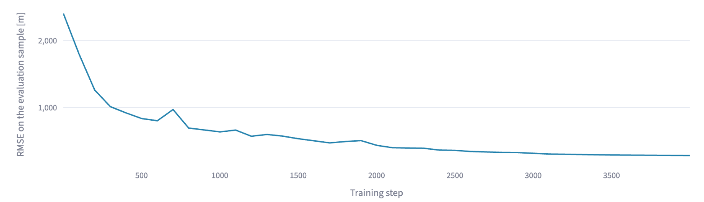

So sieht das in der App aus: die Fehlerkurve des einfachen Netzes über 4 000 Schritte. Die kleinen Ausschläge nach oben, etwa um Schritt 700, sind normal: Jeder Schritt sieht andere Zellen, und nicht jeder verbessert alles. Wie man sie genau liest, steht im Abschnitt [Den Fehler messen](#den-fehler-messen).

## Was beim Nachstellen der Gewichte passiert

In Kapitel 1 haben wir eine gleichmäßig ansteigende Straße mit der Formel Höhe = 300 + 0,05 · x beschrieben (Abschnitt [Was sind Gewichte?](01-geodaten-als-funktion.md#was-sind-gewichte)). Dort waren die beiden Gewichte 300 und 0,05 bekannt. Beim Training kennt man sie nicht – sie sollen ja erst gefunden werden.

Also fängt man mit irgendwelchen Werten an, zum Beispiel mit 0 und 0. Dann sagt die Formel für jede Stelle der Straße 0 m voraus – weit weg von den gemessenen Höhen.


Das Diagramm zeigt, wie es weitergeht, wenn man die Gewichte Schritt für Schritt nachjustiert. Nach dem ersten Schritt ist die Gerade viel zu steil – sie schießt über das Ziel hinaus. Danach pendelt sie sich ein und liegt nach 200 Schritten auf den Messpunkten: die Gewichte sind bei 300 und 0,05 angekommen. Rechts sieht man den Fehler dazu; er fällt genauso wie die Fehlerkurve in der App, erst steil, dann flach.

Jetzt fragt man für jedes Gewicht: Wird der Fehler kleiner oder größer, wenn ich es ein wenig erhöhe? Und dann stellt man es ein kleines Stück in die günstige Richtung. Das wiederholt man, bis die Formel zu den Messwerten passt. Schritt für Schritt wandern die beiden Gewichte so auf 300 und 0,05 zu. Genau das passiert in Teil 4 jedes Trainingsschritts, nur eben mit 50 049 Gewichten statt mit zwei.

Dabei wird nichts ausprobiert. Die Mathematik liefert für alle Gewichte gleichzeitig, in welche Richtung und wie stark der Fehler auf eine kleine Änderung reagiert (die Ableitung). Das Verfahren heißt **Gradientenabstieg**.

### Vertiefung: Gradientenabstieg

Ein Bild aus dem Gelände hilft: Man steht im Nebel an einem Hang und will ins Tal. Man sieht das Tal nicht, spürt aber unter den Füßen, wo es bergab geht – und macht einen kleinen Schritt in diese Richtung. Das Tal ist der kleinste Fehler, der Standort sind die Gewichte. Beim Netz hat diese Landschaft nicht zwei, sondern 50 049 Richtungen.

**Die Lernrate** bestimmt, wie groß jeder Schritt ist. Zu große Schritte springen über das Tal hinweg, zu kleine kommen kaum voran. Die App geht dabei in drei Phasen vor:

1. In den ersten 100 Schritten wächst die Schrittweite langsam an, damit die zufälligen Startgewichte nicht gleich weit danebenspringen.
2. Dann arbeitet sie mit der eingestellten Lernrate.
3. Bis zum Ende schrumpft die Schrittweite allmählich auf 2 % davon, damit sich die Gewichte zum Schluss fein einstellen können.

Genauer gesagt verwendet die App eine Weiterentwicklung des Gradientenabstiegs namens **Adam** [1], die für jedes Gewicht eine eigene, passende Schrittweite findet.

## Auswendiglernen ist hier erwünscht

Normalerweise soll ein neuronales Netz aus Beispielen etwas Allgemeines lernen und es auf neue Fälle anwenden. Deshalb hält man einen Teil der Daten zurück und prüft damit, ob das Netz auch unbekannte Fälle richtig einschätzt. Passt sich ein Netz zu genau an seine Trainingsdaten an und versagt dann bei neuen, heißt das **Overfitting** – eigentlich der klassische Fehler beim maschinellen Lernen.

Hier ist es genau umgekehrt. Es gibt keine neuen Fälle: Das Raster *ist* der vollständige Datensatz. Das Netz soll ihn so genau wie möglich auswendig lernen, und deshalb wird nichts zurückgehalten. Gemessen wird, wie gut das Netz das Raster wiedergibt.

Ganz gelingt das nie. Beim einfachen Netz dieses Kapitels muss jedes Gewicht im Mittel 47 Rasterzellen „erklären“ (2 332 800 / 50 049), beim Standardbeispiel 28. Für jede Einzelheit reicht das nicht – das Netz glättet. Wie stark, entscheidet vor allem die Größe des Netzes, also die Kompressionsrate aus Kapitel 1.

## Die Pole brauchen einen Ausgleich

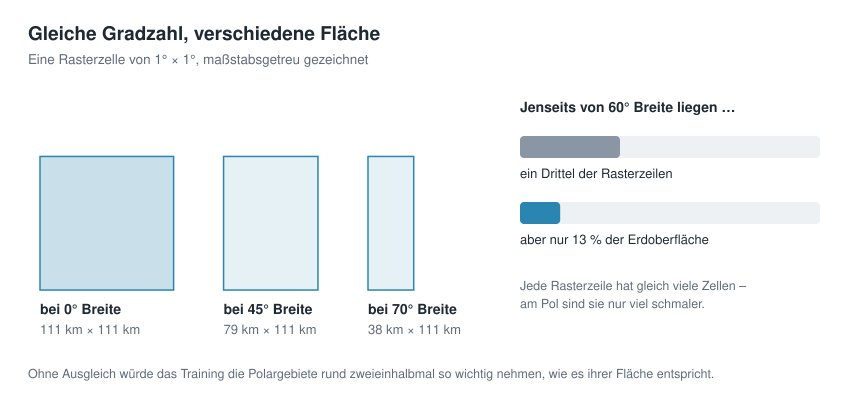

Jede Zeile des Rasters hat gleich viele Zellen, egal ob sie am Äquator oder nahe am Pol liegt. Die Zellen sind aber verschieden groß: Zu den Polen hin rücken die Längengrade zusammen, die Zellen werden schmaler. Ihre Breite schrumpft mit dem Kosinus der geografischen Breite: Bei 60° ist eine Zelle nur noch halb so breit wie am Äquator, weil cos(60°) = 0,5 ist.

Zieht man die Zellen einfach gleichmäßig, bekommen die Polargebiete im Training ein Gewicht, das ihrer Fläche nicht entspricht – jenseits von 60° Breite rund zweieinhalbmal zu viel. Das Netz würde viel Mühe auf Arktis und Antarktis verwenden und dafür bei den Kontinenten sparen.

Die App gleicht das aus: Sie zieht die Zeilen mit einer Wahrscheinlichkeit, die zur Fläche ihrer Zellen passt. Zeilen am Äquator kommen häufiger dran, Zeilen am Pol seltener. In der Seitenleiste heißt das **Area-weighted sampling**.

## Den Fehler messen

Für jede Rasterzelle gibt es einen **Fehler**: 

**die Höhe, die das Netz ausrechnet, minus die Höhe im Raster**. 

Um aus Millionen solcher Einzelfehler eine Zahl zu machen, zeigt die App vier Maße:

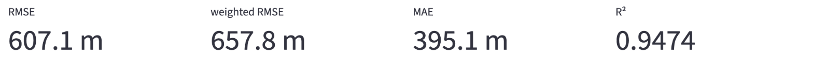

Was hinter den vier Zahlen steckt, zeigt ein kleines, ausgedachtes Beispiel mit nur fünf Rasterzellen. Vier davon trifft das Netz bis auf 100 m, bei Zelle D liegt es 500 m daneben.

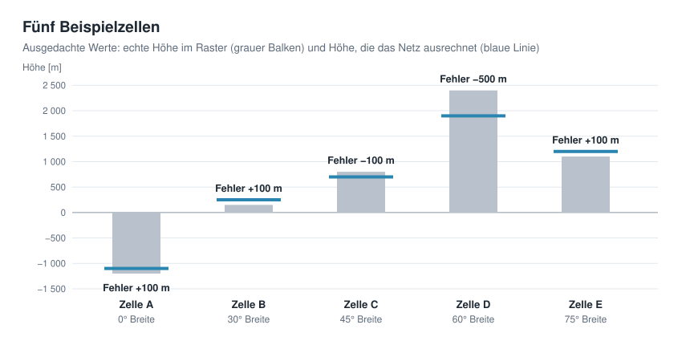

- **RMSE** (*root mean square error*): jeden Fehler quadrieren, den Mittelwert bilden, daraus die Wurzel ziehen. Das Ergebnis ist wieder in Metern. Durch das Quadrieren zählen große Fehler stärker als kleine.

  ```math
  \text{RMSE} = \sqrt{\frac{1}{N} \sum_{i=1}^{N} (\text{Netz}_i - \text{Raster}_i)^2}
  ```

  **Beispiel:** Die Fehler sind +100, +100, −100, −500 und +100 m. Quadriert ergibt das 10 000, 10 000, 10 000, 250 000 und 10 000 m². Der Mittelwert ist 290 000 / 5 = 58 000 m², die Wurzel daraus **241 m**.

  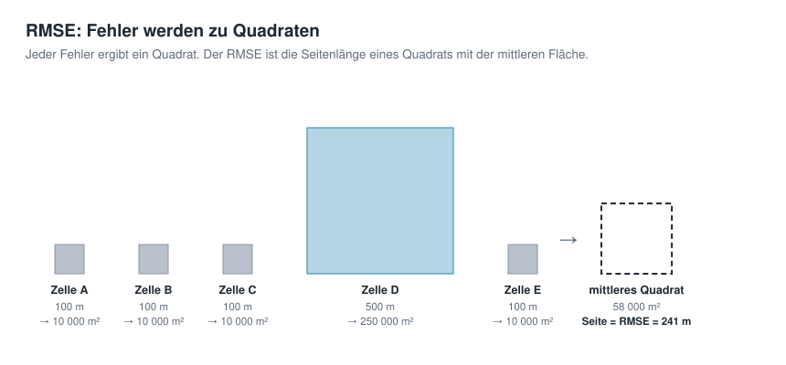

- **MAE** (*mean absolute error*): der mittlere Fehler ohne Vorzeichen, ebenfalls in Metern. Er ist meist kleiner als der RMSE, weil Ausreißer weniger ins Gewicht fallen.

  **Beispiel:** (100 + 100 + 100 + 500 + 100) / 5 = 900 / 5 = **180 m**. Der RMSE ist mit 241 m deutlich größer, weil der eine große Fehler in Zelle D quadriert besonders schwer wiegt.

  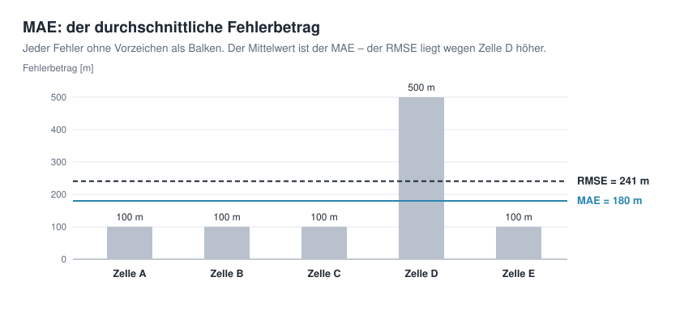

- **Gewichteter RMSE** (*weighted RMSE*): wie der RMSE, aber jede Zelle zählt nach ihrer Fläche. So rechnet auch die Wetterforschung, etwa im Vergleichsdatensatz WeatherBench [2]. Für die ganze Erde ist das das fairste Maß.

  **Beispiel:** Das Gewicht einer Zelle ist der Kosinus ihrer Breite: 1,00 / 0,87 / 0,71 / 0,50 / 0,26. Damit die Gewichte im Mittel 1 ergeben, teilt man sie durch ihren Mittelwert 0,666: 1,50 / 1,30 / 1,06 / 0,75 / 0,39. Jedes Fehlerquadrat wird mit seinem Gewicht multipliziert: 15 000 + 13 000 + 10 600 + 187 500 + 3 900 = 230 000 m². Der Mittelwert ist 46 000 m², die Wurzel **214 m**. Der große Fehler in Zelle D liegt bei 60° Breite und zählt deshalb weniger als am Äquator.

  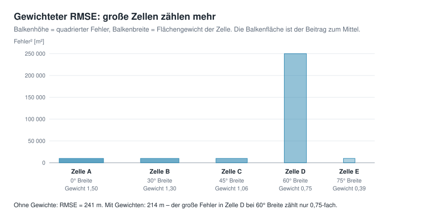

- **R²**: der Anteil der Höhenunterschiede, den das Netz erklärt. 1 heißt perfekt; 0 hieße, das Netz wäre nicht besser als überall dieselbe mittlere Höhe.

  **Beispiel:** Die mittlere echte Höhe der fünf Zellen ist (−1 200 + 150 + 800 + 2 400 + 1 100) / 5 = 650 m. Wie stark die Höhen um diesen Mittelwert streuen, misst das mittlere Quadrat der Abstände: 1 392 000 m². Der Netzfehler hat ein mittleres Quadrat von 58 000 m² (das ist das Quadrat des RMSE). Also R² = 1 − 58 000 / 1 392 000 = **0,958**: Das Netz erklärt knapp 96 % der Höhenunterschiede.

  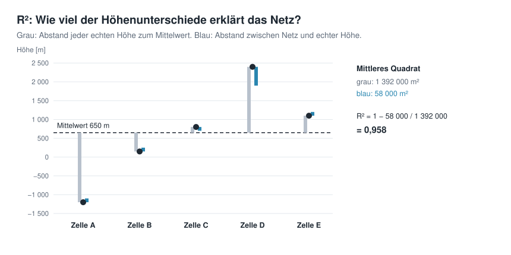

Während des Trainings misst die App diese Werte regelmäßig an einer festen Stichprobe von 200 000 Zellen – immer denselben, damit die Werte vergleichbar sind. Das ganze Raster wird erst ganz am Ende durchgerechnet; sonst würde das Messen länger dauern als das Lernen.

Die **Fehlerkurve** zeigt den RMSE über die Trainingsschritte. Ihre Höhenachse ist logarithmisch: Jeder gleich große Abstand nach unten bedeutet, dass der Fehler um denselben Faktor kleiner geworden ist. Typisch ist ein steiler Abfall in den ersten paar hundert Schritten und danach eine lange, flache Verbesserung.

## Ausprobieren

### Netz auswählen

Trainiert wird das einfache Netz aus dem Ausgangspunkt. In der Seitenleiste unter *2 · Network* wählen Sie dafür bei *Preset* die Vorlage *Plain MLP (fails on purpose)*. MLP steht für *Multi-Layer Perceptron*, ein Netz aus mehreren Schichten; wie es aufgebaut ist, zeigt Kapitel 3. Der Zusatz *fails on purpose* („scheitert absichtlich“) ist ernst gemeint: Dieses Netz kommt bewusst nicht weit, damit die Verbesserungen der folgenden Kapitel sichtbar werden.

Klappen Sie dann *Architecture details* auf und stellen Sie *Coordinate input* auf `lonlat`. Damit bekommt das Netz Länge und Breite als Eingabe, genau wie oben beschrieben. Die übrigen Einstellungen bleiben, wie sie sind.

   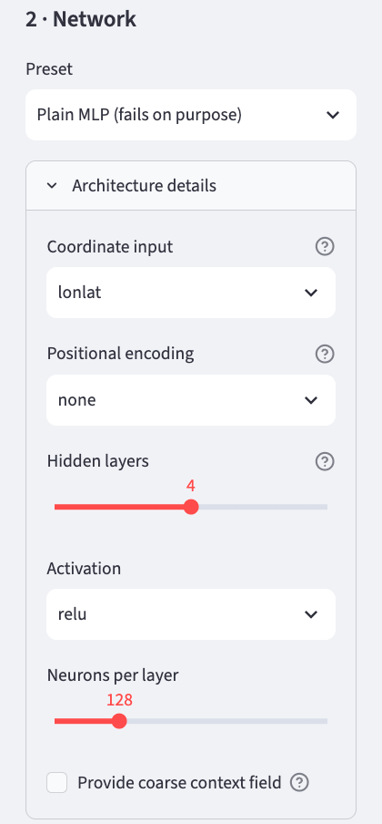

   | Einstellung | Wert | Bedeutung | erklärt in |
   |---|---|---|---|
   | *Coordinate input* | `lonlat` | Länge und Breite als Eingabe | Kapitel 4 zeigt eine bessere Wahl |
   | *Positional encoding* | `none` | die Koordinate geht unverändert ins Netz | Kapitel 5 |
   | *Hidden layers* | 4 | Zahl der versteckten Schichten | Kapitel 3 |
   | *Activation* | `relu` | der Knick in jedem Neuron | Kapitel 3 |
   | *Neurons per layer* | 128 | Neuronen in jeder Schicht | Kapitel 3 |
   | *Provide coarse context field* | aus | grobe Höhenkarte als Hilfe | Kapitel 8 |

Mit diesen Einstellungen hat das Netz 50 049 Gewichte. Das zeigt auch der Reiter *Idea & Budget* unter *Parameters*.

### Training starten

In der Seitenleiste unter *3 · Training* stehen die Einstellungen für das Training. Sie bleiben, wie sie sind.

   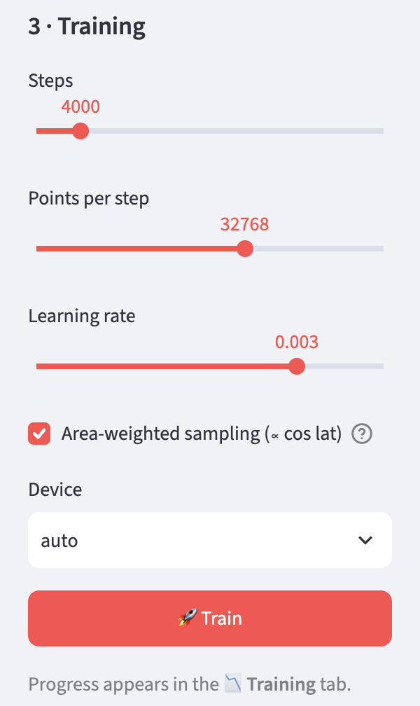

   | Einstellung | Bedeutung |
   |---|---|
   | *Steps* | Anzahl der Trainingsschritte |
   | *Points per step* | Größe der Stichprobe je Schritt |
   | *Learning rate* | Schrittweite beim Nachstellen der Gewichte |
   | *Area-weighted sampling* | Ausgleich für die Pole |
   | *Device* | Rechenwerk: *auto* nimmt die Grafikeinheit, wenn es eine gibt (*mps* auf Apple-Rechnern, *cuda* bei NVIDIA), sonst den Prozessor (*cpu*) |

Klicken Sie danach auf *🚀 Train* und öffnen Sie den Reiter *Training*. Oben läuft ein Fortschrittsbalken, darunter stehen die aktuellen Fehlermaße und die Fehlerkurve, die mit jedem Messpunkt wächst.

   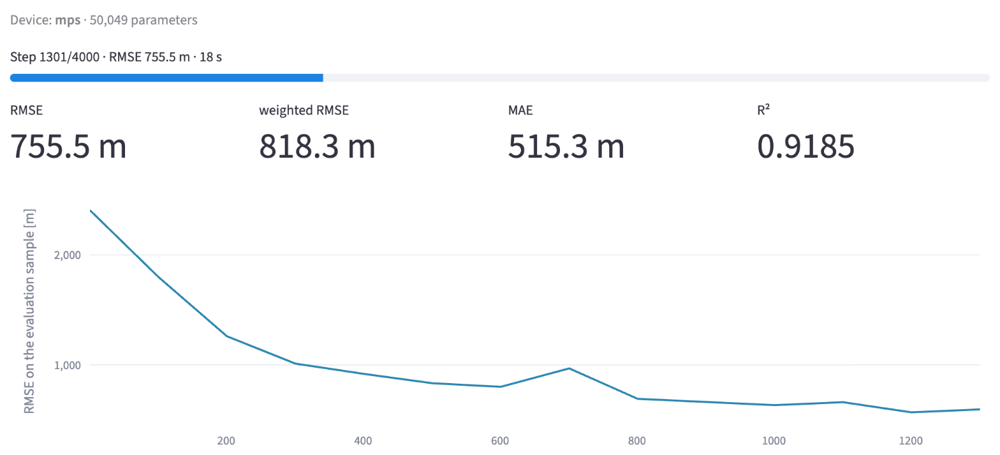

### Warten

Das Training kann einige Zeit in Anspruch nehmen. Auf einem Apple-Rechner mit M4-Chip dauert das einfache Netz etwa eine Minute, auf einem Rechner ohne Grafikeinheit deutlich länger. Dann stellt man in der Seitenleiste besser ein kleineres Raster ein.

### Abschluss

Am Ende rechnet die App das ganze Raster einmal durch und meldet *Done*. Das trainierte Netz bleibt erhalten, bis man neu trainiert; die Reiter *Globe 3D*, *Maps & Error* und *Super-Resolution* zeigen jetzt das Ergebnis.

   

Ändert man nach dem Training die Gitterauflösung, passt das Netz nicht mehr zum Raster. Die App weist dann darauf hin, dass neu trainiert werden muss.

### Ergebnis ansehen: Globe 3D

Der Reiter *Globe 3D* zeigt die Erde zweimal als Kugel: links das Original aus dem Raster, rechts das, was das Netz aus seinen 50 049 Gewichten ausrechnet. Beide verwenden dieselben Farben, von Dunkelblau für die Tiefsee über Grün bis Weiß für die höchsten Gebirge.

Drei Regler steuern die Darstellung:

| Einstellung | Bedeutung |
|---|---|
| *Vertical exaggeration* | Überhöhung des Geländes, voreingestellt 40-fach. Bei 1 wäre die Erde maßstabsgetreu – und praktisch glatt, denn selbst der Mount Everest ist im Vergleich zum Erdradius winzig. |
| *Display grid* | wie viele Punkte die Kugeln zeigen, voreingestellt 180 × 360. Das betrifft nur die Darstellung, damit der Browser flüssig bleibt; trainiert wurde mit dem feineren Raster. |
| *View direction (longitude)* | über welchem Längengrad die Kugeln stehen. Der Regler dreht beide gleichzeitig. Zieht man mit der Maus an einer Kugel, dreht sich nur diese. |


Beim einfachen Netz sieht man sofort, was die Fehlermaße bedeuten: Die Kontinente sind zu erkennen, aber nur als grobe Flächen. Das Mittelmeer ist ein breiter Streifen, Inseln, Halbinseln und Gebirge fehlen.

### Ergebnis ansehen: Maps & Error

Der Reiter *Maps & Error* zeigt dasselbe als flache Weltkarten, auf denen man die ganze Erde auf einmal sieht. Oben stehen das Original (*Original*) und das Ergebnis des Netzes (*Reconstruction*) nebeneinander, mit derselben Farbskala.

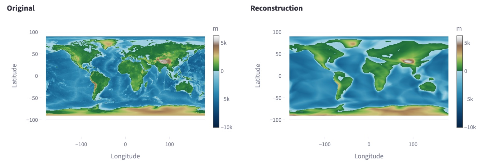

Darunter folgen zwei Darstellungen des Fehlers:

- **Fehlerkarte** (*Error*): für jede Zelle die Höhe des Netzes minus die echte Höhe. Rot heißt, das Netz liegt zu hoch, Blau zu tief, Weiß stimmt.
- **Histogramm**: wie viele Zellen welchen Fehler haben. Die senkrechte Achse ist logarithmisch, damit auch die wenigen sehr großen Fehler sichtbar bleiben.


Die größten Fehler liegen nicht im offenen Ozean, sondern dort, wo sich die Höhe auf kurzer Strecke stark ändert: an Küsten, Gebirgen und Tiefseegräben. Das Histogramm zeigt, dass die meisten Zellen nur wenig danebenliegen und nur sehr wenige mehrere Tausend Meter. Unter den Karten lassen sich bei *Detailed numbers* alle Fehlermaße für das ganze Raster aufklappen.

Die Karten selbst sind für die Darstellung auf 540 × 1080 Punkte verkleinert, damit der Browser flüssig bleibt. Die Fehlermaße rechnet die App aber auf dem ganzen Raster.

### Ergebnis ansehen: Super-Resolution

Weil das Netz eine Funktion ist, kann man es an jeder beliebigen Koordinate fragen – auch zwischen den Zellen des Rasters. Der Reiter *Super-Resolution* zeigt das für einen Ausschnitt der Erde:

| Einstellung | Bedeutung |
|---|---|
| *Longitude (centre)*, *Latitude (centre)* | Mitte des Ausschnitts, voreingestellt 10° Ost und 46° Nord, die Alpen |
| *Window [°]* | Breite und Höhe des Ausschnitts in Grad, voreingestellt 20° |
| *Points per axis* | wie fein das Netz abgefragt wird, voreingestellt 256 × 256 Punkte |


Links steht der Ausschnitt aus dem Trainingsraster, rechts das Netz, fein abgefragt. Beim einfachen Netz ist das Ergebnis ernüchternd: Von den Alpen, Italien und den Inseln bleibt nur eine glatte Grenze zwischen Land und Meer. Feiner abfragen macht das Bild zwar feiner gerastert, bringt aber keine Einzelheiten zurück, die das Netz nicht gelernt hat. Genauer darauf geht Kapitel 10 ein.

Am selben Ausschnitt lässt sich in den folgenden Kapiteln gut verfolgen, wie die Netze besser werden.

## Ideen zum Weiterprobieren

- Zum Vergleich die Vorlage *Fourier MLP (recommended)* des Standardbeispiels trainieren. Um wie viel kleiner wird der Fehler, und wie viel länger dauert es? Warum das Netz so viel besser ist, erklären die Kapitel 4 und 5.
- Die *Learning rate* auf 0.01 und auf 0.0001 stellen und die Fehlerkurven vergleichen. Wann geht es schneller, wann wird es unruhig?
- Mit wenigen *Points per step* (4096) und mit sehr vielen (131072) trainieren. Was ändert sich an der Dauer, was an der Kurve?
- 1 000 statt 4 000 Schritte – oder 10 000. Lohnt sich das längere Training?
- Das Häkchen bei *Area-weighted sampling* entfernen und neu trainieren. Wie verändern sich RMSE und gewichteter RMSE im Vergleich?
- Nach dem Training einen Blick in den Reiter *Maps & Error* werfen: Wo auf der Erde liegen die größten Fehler?
- Unter *Device* einmal *cpu* statt *auto* wählen und die Trainingsdauer vergleichen.

## Weiterführende Links

- [1] Kingma und Ba: [Adam: A Method for Stochastic Optimization](https://arxiv.org/abs/1412.6980), 2014
- [2] Rasp et al.: [WeatherBench: A benchmark dataset for data-driven weather forecasting](https://arxiv.org/abs/2002.00469), 2020 – definiert den flächengewichteten RMSE
- Google Machine Learning Crash Course: [Gradientenabstieg](https://developers.google.com/machine-learning/crash-course/linear-regression/gradient-descent?hl=de) – Schritt-für-Schritt-Erklärung an einem Beispiel
- 3Blue1Brown: [Gradient descent, how neural networks learn](https://www.3blue1brown.com/lessons/gradient-descent) – anschauliches Video (Englisch)

---

[Übersicht](README.md) · Zurück: [Kapitel 1 · Geodaten als Funktion statt als Raster](01-geodaten-als-funktion.md) · Weiter: [Kapitel 3 · Architektur eines neuronalen Netzes](03-architektur.md)

*Dieses Tutorial wurde von Gerhard Völkl unter Verwendung von Claude Code (Anthropic) erstellt. Es soll helfen, mehr über das Thema „Geodaten in neuronalen Netzen speichern“ zu lernen. Verbesserungsvorschläge gerne an gkvoelkl@nelson-games.de.*
