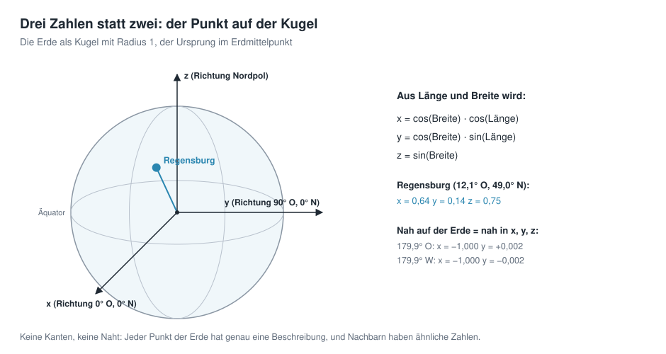

# Geodaten in neuronalen Netzen speichern
# Kapitel 4 · Die Erde ist eine Kugel

*[English version](../en/04-kugelkoordinaten.md)*


**Inhalt:** 

* Warum sind Länge und Breite eine schlechte Eingabe für ein neuronales Netz?
* Wie beschreibt man einen Ort stattdessen als Punkt auf einer Kugel?
* Was ändert diese neue Vorgehensweise an der Datumsgrenze und an den Polen?

## Ausgangspunkt

In den Kapiteln 2 und 3 bekam das neuronale Netz Länge und Breite als Eingabe – so, wie man Orte auf einer Weltkarte normalerweise angibt. Für Menschen ist das praktisch. Für das neuronale Netz ist das nicht so einfach.

## Zwei Haken bei Länge und Breite


**Die Naht.** Die Länge läuft von −180° bis +180°. Ein Punkt bei 179,9° Ost und einer bei 179,9° West liegen auf der Erde nur 22 km auseinander – beide im Pazifik, ganz in der Nähe der Datumsgrenze, die ungefähr dem 180. Längengrad folgt.

Für das neuronale Netz sind es aber die Zahlen +179,9 und −179,9: so verschieden, wie zwei Längen nur sein können. Das Netz müsste lernen, dass zwei völlig verschiedene Eingaben fast dieselbe Höhe haben. Mit der Methode aus Kapitel 3, die aus vielen geraden Rampen eine Fläche baut, ist das schwer.

**Die Pole.** Am Nordpol hat die Länge keine Bedeutung: Jede Länge zwischen −180° und +180° beschreibt denselben Punkt. Im Raster ist die oberste Zeile trotzdem eine ganze Reihe von 2 160 Zellen mit verschiedenen Längen.

Für das neuronale Netz sind das 2 160 verschiedene Eingaben für einen einzigen Ort. Am Südpol ist es genauso.

Beides liegt an der Art, wie wir Orte beschreiben: Das Rechteck der Weltkarte hat Ränder, die Erdkugel hat keine.

## Der Punkt auf der Kugel

Die Lösung: Man beschreibt einen Ort nicht durch zwei Winkel (Länge, Breite), sondern durch seine Lage im Raum.

Dazu stellt man sich die Erde als Kugel mit dem Radius 1 vor, mit dem Erdmittelpunkt als Ursprung. Jeder Ort ist dann ein Punkt auf dieser Kugel und hat drei Koordinaten *x*, *y* und *z*.



Aus Länge und Breite rechnet man sie so aus:

```math
x = \cos(\text{Breite}) \cdot \cos(\text{Länge})
```

```math
y = \cos(\text{Breite}) \cdot \sin(\text{Länge})
```

```math
z = \sin(\text{Breite})
```

Was die drei Formeln bedeuten, zeigt das Beispiel Regensburg Schritt für Schritt:


1. **Die Breite bestimmt die Höhe.** Je weiter nördlich ein Ort liegt, desto höher liegt er über der Ebene des Äquators: z = sin(Breite). Gleichzeitig rückt er näher an die Erdachse heran; der Abstand zur Achse ist r = cos(Breite).
2. **Die Länge verteilt diesen Abstand auf zwei Richtungen.** Von oben auf den Nordpol gesehen liegen alle Orte gleicher Breite auf einem Kreis mit dem Radius r. Die Länge ist der Winkel auf diesem Kreis. Der Anteil in Richtung 0° Ost ist x = r · cos(Länge).
3. **Der Rest zeigt in Richtung 90° Ost:** y = r · sin(Länge).

Setzt man r = cos(Breite) ein, ergeben sich genau die drei Formeln oben.

Ein paar Beispiele:

| Ort | Länge | Breite | x | y | z |
|---|---:|---:|---:|---:|---:|
| Golf von Guinea | 0° | 0° | 1 | 0 | 0 |
| Indischer Ozean | 90° O | 0° | 0 | 1 | 0 |
| Nordpol | beliebig | 90° N | 0 | 0 | 1 |
| Regensburg | 12,1° O | 49,0° N | 0,64 | 0,14 | 0,75 |
| Pazifik, Punkt A | 179,9° O | 0° | −1,000 | +0,002 | 0 |
| Pazifik, Punkt B | 179,9° W | 0° | −1,000 | −0,002 | 0 |

Die beiden Punkte an der Datumsgrenze haben jetzt fast dieselben Zahlen, genau wie es ihrer Lage auf der Erde entspricht. Und am Nordpol ist es egal, welche Länge man einsetzt: Weil cos(90°) = 0 ist, kommt immer (0, 0, 1) heraus – ein Ort, eine Beschreibung.

Kurz gesagt: **Wer auf der Erde nah beieinander liegt, hat jetzt auch ähnliche Koordinaten.** Es gibt keine Ränder und keine Naht mehr, über die das Netz stolpern könnte.

Der Preis ist gering. Statt zwei Eingaben hat das Netz drei, und jedes Neuron der ersten Schicht braucht ein Gewicht mehr – bei 128 Neuronen sind das 128 zusätzliche Gewichte. Aus den 50 049 Gewichten des einfachen Netzes aus Kapitel 2 werden so 50 177.

## Was das ausmacht

Wie groß der Unterschied ist, zeigt ein Vergleich: ein neuronales Netz mit derselben Architektur, ein einfaches MLP (Vorlage *Plain MLP*) mit 4 versteckten Schichten, dasselbe Raster, dasselbe Training – einmal mit Länge und Breite, einmal mit Kugelkoordinaten als Eingabeformat.

Das Bild zeigt den Pazifik zu beiden Seiten des 180. Längengrades.


Mit Länge und Breite hat das Netz an der 180°-Linie eine sichtbare **Naht**: Die Höhe springt dort, obwohl das Gelände auf beiden Seiten weitergeht. Entlang der ganzen Linie vom Süd- zum Nordpol beträgt der Sprung im Mittel 690 m. Mit Kugelkoordinaten verschwindet er fast vollständig: im Mittel 0,2 m.

Beide Netze sind fast gleich groß (50 049 und 50 177 Gewichte) und gleich lange trainiert.

## Ausprobieren

Wählen Sie in der Seitenleiste unter **2 · Network** die Vorlage **Plain MLP (fails on purpose)** und klappen Sie **Architecture details** auf.

Ganz oben steht **Coordinate input**. Voreingestellt ist `xyz` – die Kugelkoordinaten aus diesem Kapitel. Die Alternative `lonlat` gibt Länge und Breite direkt ins Netz.

   

Trainieren Sie zum Vergleich erst einmal mit `lonlat` – das ist das Netz aus Kapitel 2 – und sehen Sie sich im Reiter *Maps & Error* die Fehlerkarte am rechten und linken Rand an.

Trainieren Sie dann erneut mit `xyz` und vergleichen Sie. Der gewichtete RMSE sinkt dabei von rund 700 m auf rund 600 m (siehe [Anhang](anhang-messungen.md)).

Im Reiter *Globe 3D* lässt sich die Erde drehen. Stellen Sie den Regler *View direction (longitude)* auf 180: Dann schauen Sie direkt auf die Naht.

## Ideen zum Weiterprobieren

- Auf der Fehlerkarte nicht nur auf die Naht achten, sondern auch auf die Polargebiete: Wie sieht die Antarktis mit `lonlat` und mit `xyz` aus?
- Unter *1 · Data* die *Grid resolution* klein stellen (180 × 360), damit das Training schnell geht, und mehrmals zwischen `lonlat` und `xyz` wechseln.
- Einen bekannten Ort in Kugelkoordinaten umrechnen, zum Beispiel mit dem Taschenrechner und den Formeln oben. Bei welchen Orten ist *x* negativ, wo *y*, wo *z*?

## Weiterführende Links

- Wikipedia: [Kugelkoordinaten](https://de.wikipedia.org/wiki/Kugelkoordinaten) – Umrechnung zwischen Winkeln und *x*, *y*, *z*; dort mit dem Winkel vom Nordpol aus statt mit der geografischen Breite
- Wikipedia: [Datumsgrenze](https://de.wikipedia.org/wiki/Datumsgrenze) – verläuft im Pazifik ungefähr entlang des 180. Längengrades
- Rußwurm et al.: [Geographic Location Encoding with Spherical Harmonics and Sinusoidal Representation Networks](https://arxiv.org/abs/2310.06743), ICLR 2024 – zeigt, dass Verfahren, die die Erde als Rechteck behandeln, vor allem an den Polen Fehler erzeugen (Englisch)

---

[Übersicht](README.md) · Zurück: [Kapitel 3 · Architektur eines neuronalen Netzes](03-architektur.md) · Weiter: [Kapitel 5 · Höhen als Wellen](05-fourier-features.md)

*Dieses Tutorial wurde von Gerhard Völkl unter Verwendung von Claude Code (Anthropic) erstellt. Es soll helfen, mehr über das Thema „Geodaten in neuronalen Netzen speichern“ zu lernen. Verbesserungsvorschläge gerne an gkvoelkl@nelson-games.de.*
