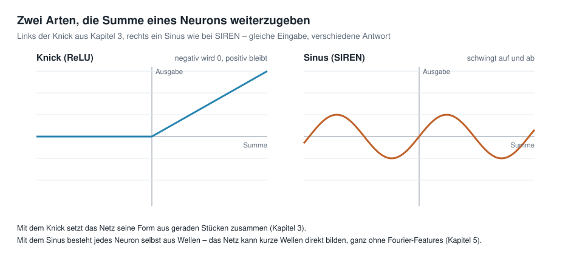
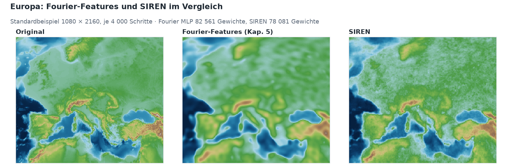
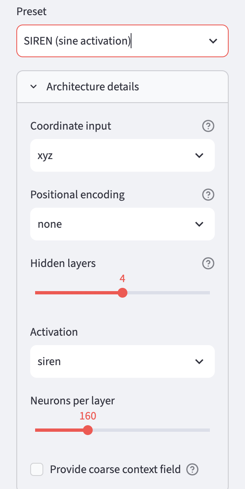

# Kapitel 7 · Vertiefung: SIREN


**Inhalt:** Ein weiterer Weg zur Arbeit mit Wellen: Statt die Eingabe in Wellen zu verwandeln (Kapitel 5), rechnet jedes Neuron selbst mit einer Sinus-Kurve.

## Ausgangspunkt

In Kapitel 5 bekam das neuronale Netz Wellen als Eingabe, die Fourier-Features. Die Neuronen selbst blieben dabei, wie sie in Kapitel 3 waren: gewichtete Summe und Knick.

2020 haben Sitzmann und Kollegen einen anderen Weg vorgeschlagen [1]: Die Eingabe bleibt, wie sie ist – hier die drei Zahlen *x*, *y*, *z* aus Kapitel 4 –, aber jedes Neuron gibt seine Summe nicht mit einem Knick, sondern durch einen **Sinus** (als Aktivierungsfunktion) weiter. Ein solches Netz heißt **SIREN**, kurz für *Sinusoidal Representation Network*.

## Sinus statt Knick



Ein Neuron rechnet in einem SIREN in drei Schritten. Als Beispiel dient Regensburg aus Kapitel 4 mit *x* = 0,64, *y* = 0,14 und *z* = 0,75; die Gewichte sind ausgedacht: *w₁* = 0,2, *w₂* = −0,5, *w₃* = 0,1 und der Grundwert *b* = −0,1.

**1. Die gewichtete Summe** – genau wie in Kapitel 3: jede Eingabe mal ihr Gewicht, alles addieren, den Grundwert dazu.

```math
s = w_1 \cdot x + w_2 \cdot y + w_3 \cdot z + b
```

Für Regensburg: *s* = 0,2 · 0,64 − 0,5 · 0,14 + 0,1 · 0,75 − 0,1 = 0,128 − 0,070 + 0,075 − 0,100 = 0,033.

**2. Bisher: der Knick.** Ein gewöhnliches Neuron gibt die Summe mit ReLU weiter – negative Werte werden 0, positive bleiben:

```math
\text{Ergebnis} = \text{ReLU}(s) = \max(0,\, s)
```

Für Regensburg: ReLU(0,033) = 0,033.

**3. Neu im SIREN: der Sinus.** Statt des Knicks wird die Summe mit einem festen Faktor ω₀ (Omega null) multipliziert und in einen Sinus gesteckt:

```math
\text{Ergebnis} = \sin(\omega_0 \cdot s)
```

Sitzmann und Kollegen empfehlen ω₀ = 30, und so ist es auch in der App eingestellt. Für Regensburg: sin(30 · 0,033) = sin(0,99) ≈ 0,84.

Das Ergebnis schneidet nichts mehr ab, sondern schwingt zwischen −1 und +1. Und weil ω₀ = 30 die Summe stark vergrößert, schwingt es schnell. Schon kleine Änderungen der Summe reichen für einen ganzen Ausschlag:

| Summe *s* | −0,1 | −0,05 | 0 | 0,02 | 0,05 | 0,1 |
|---|---:|---:|---:|---:|---:|---:|
| ReLU(*s*) | 0 | 0 | 0 | 0,02 | 0,05 | 0,1 |
| sin(30 · *s*) | −0,14 | −1,00 | 0 | 0,56 | 1,00 | 0,14 |

Was das bewirkt: Mit dem Knick setzt das Netz seine Form aus geraden Stücken zusammen. Mit dem Sinus besteht jedes Neuron selbst aus Wellen – und jede weitere Schicht verknüpft die Wellen der Schicht davor zu neuen, feineren Wellen. Das Netz kann kurze Wellen also direkt bilden, ganz ohne Fourier-Features.

## SIREN am Alpenprofil

Wie gut das funktioniert, zeigt wieder das Alpenprofil. Die oberen beiden Zeilen kennen Sie aus Kapitel 5, darunter ein etwa gleich großer SIREN:


Der SIREN braucht etwas länger, um in Gang zu kommen – nach 50 Schritten ist er noch grob. Danach holt er auf und trifft das Profil nach 3 000 Schritten sogar genauer als das Netz mit Fourier-Features.

## Ohne passende Startbelegung geht es schief

Ein SIREN ist empfindlich gegenüber seinen Startgewichten. Sind sie zufällig wie bei einem gewöhnlichen Netz verteilt, schwingen die Sinusse von Anfang an viel zu schnell. Das Netz lernt dann jeden Trainingspunkt perfekt auswendig – und erzeugt dazwischen Rauschen.

Sitzmann und Kollegen geben deshalb eine besondere **Startbelegung** vor: Die Gewichte werden so klein gewählt, dass die Summe vor jedem Sinus anfangs nur ungefähr um ±1 schwankt [1]. Dann beginnt das Netz mit gemächlichen Wellen und baut die schnellen erst im Training auf.

Wie groß der Unterschied ist, zeigt ein Versuch: Beide Netze lernen nur jeden zweiten Punkt des Alpenprofils; die Punkte dazwischen dienen zur Kontrolle.


| SIREN | Fehler auf den Trainingspunkten | Fehler auf den Punkten dazwischen |
|---|---:|---:|
| mit Startbelegung nach Sitzmann | 4 m | 116 m |
| ohne | 0 m | 923 m |

Das ist dieselbe Falle wie ein zu großes σ in Kapitel 5: zu schnelle Wellen. Für die Kompression ist das besonders tückisch, denn die Fehlerkurve beim Training sieht hervorragend aus – erst beim Abfragen zwischen den Gitterpunkten zeigt sich das Rauschen. Die App verwendet die Startbelegung nach Sitzmann.

## SIREN auf der Weltkarte

Auf der ganzen Erde, wieder am Ausschnitt Europa aus Kapitel 5:



Der SIREN zeichnet Küsten und Gebirge schärfer, hat auf dem Land aber ein feines, körniges Muster – Wellen, die etwas zu schnell geraten sind. Beide Netze sind etwa gleich groß:

| Vorlage | Eingaben | versteckte Schichten | Neuronen je Schicht | Gewichte | Größe | Kompressionsrate |
|---|---:|---:|---:|---:|---:|---:|
| *Fourier MLP (recommended)*, Kapitel 5 | 256 | 4 | 128 | 82 561 | 323 KB | 14 |
| *SIREN (sine activation)* | 3 | 4 | 160 | 78 081 | 305 KB | 15 |

Der SIREN hat nur drei Eingaben und kann deshalb bei gleicher Dateigröße mehr Neuronen pro Schicht haben. Wie genau beide die Höhen treffen, steht im [Anhang mit den Messungen](anhang-messungen.md).

**Was man beim Speichern beachten sollte:** Weil ω₀ = 30 jede kleine Änderung der Gewichte verstärkt, reagiert ein SIREN empfindlicher auf Rundung als ein Netz mit Knick. Das spielt beim Speichern mit weniger Stellen eine Rolle – dazu mehr in [Kapitel 10](10-abfragen-und-exportieren.md).

## Ausprobieren

1. In der Seitenleiste unter *2 · Network* die Vorlage *SIREN (sine activation)* wählen und *Architecture details* aufklappen.
2. *Positional encoding* steht auf `none`: Es gibt keine Fourier-Features. Unter *Activation* steht `siren`.

   

3. Trainieren und im Reiter *Maps & Error* das Ergebnis mit *Fourier MLP (recommended)* vergleichen. Im Reiter *Globe 3D* lohnt ein Blick auf Gebirge wie die Anden oder den Himalaya.

## Ideen zum Weiterprobieren

- Bei der SIREN-Vorlage die *Learning rate* auf 0.0003 senken. Wird das körnige Muster schwächer?
- *Neurons per layer* von 160 auf 64 senken. Wie viel Datei spart das, und wie viel schlechter wird die Karte?
- Unter *Activation* bei der Vorlage *Fourier MLP (recommended)* einmal `siren` wählen. Was passiert, wenn man Fourier-Features und Sinus kombiniert?

## Weiterführende Links

- [1] Sitzmann et al.: [Implicit Neural Representations with Periodic Activation Functions](https://arxiv.org/abs/2006.09661), NeurIPS 2020 – die Originalarbeit zu SIREN, mit der empfohlenen Startbelegung (Englisch)
- Projektseite: [SIREN](https://www.vincentsitzmann.com/siren/) – Beispiele, Video und ein Colab-Notebook zum Ausprobieren (Englisch)
- Rußwurm et al.: [Geographic Location Encoding with Spherical Harmonics and Sinusoidal Representation Networks](https://arxiv.org/abs/2310.06743), ICLR 2024 – kombiniert die Kugelflächenfunktionen aus Kapitel 6 mit einem SIREN (Englisch)

---

[Übersicht](README.md) · Zurück: [Kapitel 6 · Vertiefung: Kugelflächenfunktionen](06-kugelflaechenfunktionen.md) · Weiter: [Kapitel 8 · Das Kontextfeld](08-kontextfeld.md)

*Dieses Tutorial wurde von Gerhard Völkl unter Verwendung von Claude Code (Anthropic) erstellt. Es soll helfen, mehr über das Thema „Geodaten in neuronalen Netzen speichern“ zu lernen. Verbesserungsvorschläge gerne an gkvoelkl@nelson-games.de.*
