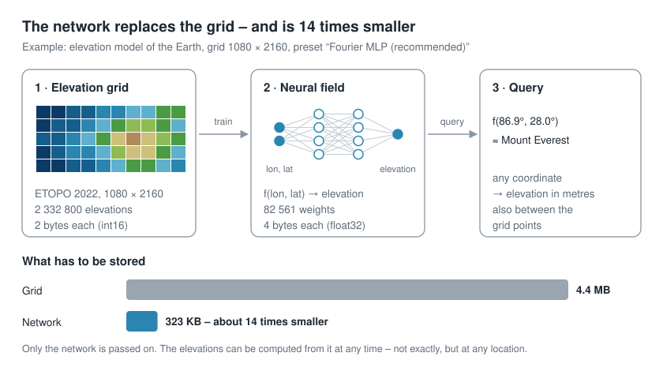
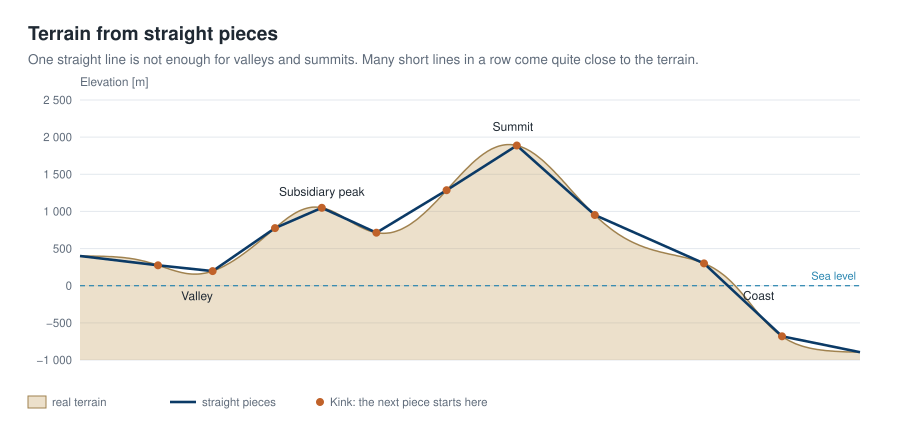
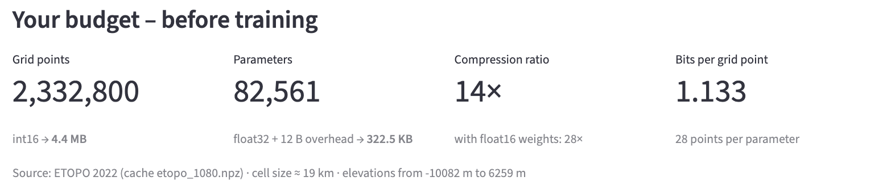
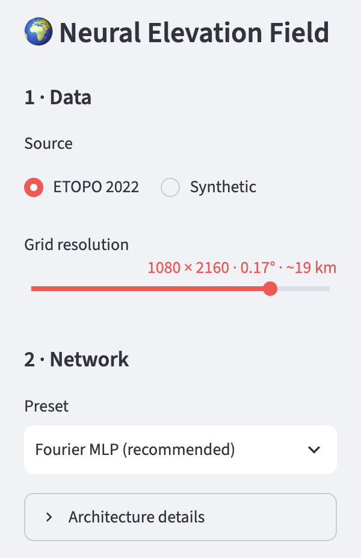

# Storing geodata in neural networks
# Chapter 1 · Geodata as a function instead of a grid

*[Deutsche Fassung](../de/01-geodaten-als-funktion.md) · Translated from the German original.*


**Contents:**

* Understanding the Earth's elevation grid as a function `h(lon, lat)`

* A neural network learns these elevations

* Saving storage: how much less memory does the neural network need compared with the original elevation grid?

## The core idea

Anyone working with detailed geodata such as elevations for the whole world always deals with huge amounts of data. Other data in the geo domain is no easier.

So some clever people came up with an idea:

**Let's take a neural network and teach it all the elevation data. When we want to know an elevation, we ask the network. It gets really interesting when the neural network needs less memory than the original geodata.**

That is the core idea behind this tutorial and every chapter of the series.

For simplicity, the series uses the Earth's elevations as its example. The principles apply just as well to other geodata, such as temperature or precipitation.



## The data in detail

A digital elevation model is nothing more than a table: for every cell of a regular grid of longitudes and latitudes, it holds an elevation in metres.


The global model ETOPO 2022, in the version used here, has 10 800 × 21 600 cells – about **233 million values**.

Every cell belongs to a place on Earth, and every place is defined by two angles: the **longitude** (lon) says how far east or west of the prime meridian through Greenwich it lies, the **latitude** (lat) how far north or south of the equator. If you unfold this graticule from the sphere, it becomes a rectangle – and that rectangle is exactly the grid.


You can follow every example of the series in the companion app:


How to install and start the app is described at the end of this chapter under [Try it out](#try-it-out).

### Deep dive: ETOPO 2022

ETOPO 2022 is the global relief model of the US agency NOAA (National Centers for Environmental Information), published in 2022. It combines land elevations, ocean depths and coastlines from many regional and global sources into a single seamless grid.

- **Resolutions:** NOAA offers the model with cells of 15, 30 and 60 arc seconds. We use the 60-arc-second version: a cell is 1/60 of a degree, about 1.85 km at the equator. The file is 456 MB.
- **Two variants:** *Ice Surface* shows Greenland and Antarctica with the surface of their ice sheets, *Bedrock* the rock beneath. We use the ice surface.
- **Reference:** elevations are metres above the EGM2008 geoid, roughly above mean sea level; negative values lie below it. Positions refer to WGS 84, the system GPS uses as well.

**What the rows and columns mean:**

- **Rows** are latitude bands. 180 degrees of latitude from the South to the North Pole × 60 cells per degree give 10 800 rows. In the file, the southernmost band (−89.99°) is the first row, the northernmost the last.
- **Columns** are longitude bands. 360 degrees of longitude × 60 give 21 600 columns, starting at −180° at the date line and running east.
- **A cell** in row *i* and column *j* holds the elevation of the area between these latitudes and longitudes.

To look up an elevation, you convert the coordinate into a row and a column number and read off the value.

### From grid to function

The table holds the elevation only at individual points, the grid cells. However high the resolution, it remains a sample of the real surface.

You can think of the surface itself as a function *h*. It assigns an elevation to every coordinate, including those between the grid points:

```math
h : (\text{lon}, \text{lat}) \mapsto \text{elevation in metres}
```

If we find a function `f` that returns roughly the right elevation at every grid point, we no longer need the table – we store the function instead.

A neural network is exactly such a function, defined by its parameters (the technical term is weights θ):

```math
f_\theta(\text{lon}, \text{lat}) \approx h(\text{lon}, \text{lat})
```

### What are weights?

Weights are the parameters that control the calculation.

**A simple example:** a road climbs evenly over 5 km. Its elevation was measured every 10 m, giving about 500 measurements. If the road starts at 300 m and rises by 5 cm per metre, all 500 values can be replaced by a single formula:

```math
\text{elevation}(x) = 300 + 0.05 \cdot x \qquad (x = \text{distance in metres})
```


Instead of 500 numbers we store only two: **300** and **0.05**. These are the weights of this function. To know the elevation after 2.5 km, you calculate it: 300 + 0.05 · 2 500 = 425 m. The table is no longer needed.

Real terrain does not rise evenly. It has valleys, summits and coasts. A straight line is not enough for that.

A neural network therefore builds a flexible function out of many such simple pieces. Each piece again has its own weights; where one piece ends, the curve bends and the next one begins.



Chapter 3 shows exactly how the network forms these pieces. For now it is enough to know: more pieces mean more weights – and more weights mean more memory.

### Our standard example

For this to save memory, the weights θ of a neural network must take up far fewer bytes than the original table.

For the calculations in this tutorial, we use the default settings of the companion app as the **standard example**:

- **Data:** ETOPO 2022, averaged to 1080 × 2160 cells (1/6 of a degree each, about 19 km). That is **2 332 800 elevations**.

- **Network:** the preset *Fourier MLP (recommended)* with **82 561 weights**.

Stored, that is **323 KB instead of 4.4 MB**.

The price: the network does not hit the elevations exactly. How large the error is and what it depends on is the subject of the following chapters.

### Learning the other way round

In ordinary training of a neural network, the input data are examples the network learns from.

Later it generalises from these examples to new data it has never seen.

When training neural networks to store geoinformation, the input data already contain **all** known values.

After training, the neural network should reproduce them as accurately as possible.


| Ordinary training | Training for storage |
|---|---|
| generalise to new data | memorise exactly **one** dataset |
| small model, lots of data | the model **is** the data |
| success = small error on test data | success = small reconstruction error |

#### A note on the literature

In the literature, such a network is called an *implicit neural representation* (INR) or a *neural field*. In their survey, Xie et al. describe neural fields as networks that represent a quantity as a function of spatial and temporal coordinates [1]; the term INR was popularised by Sitzmann et al., among others [2]. Huang and Hoefler show that geodata can be compressed this way, for weather and climate data [3] – the direct model for this tutorial series. Thank you!

## Determining the compression ratio

You compare two sizes.

**Raw size of the grid** = number of grid points × bytes per value.

The ETOPO file itself stores every elevation as float32 (4 bytes). For elevations in whole metres – from −10 935 m in the Mariana Trench to 8 849 m on Mount Everest – int16 is enough, though (2 bytes, range −32 768 to 32 767).

We therefore count **2 bytes per value**. This is the cautious choice: measured against float32, every compression ratio would look twice as good.

**Size of the neural network** = everything it needs to compute:

- the weights, 4 bytes each (float32),

- the mean and standard deviation of the elevations used to normalise the network (2 × 4 bytes) – without them the network returns no metres,

- further ingredients added in later chapters, such as a seed for random numbers (4 bytes) or a coarse context grid.

This gives two figures:

```math
\text{compression ratio} = \frac{\text{raw size}}{\text{network size}}
\qquad
\text{bits per grid point} = \frac{8 \cdot \text{network size}}{\text{number of grid points}}
```

For the standard example:

2 332 800 points × 2 bytes = 4 665 600 bytes raw size.

The network takes 82 561 × 4 bytes for the weights plus 12 bytes for normalisation and seed, 330 256 bytes in total.

That gives a ratio of **14.1** and 1.13 bits per grid point.

In words: in this case the neural network needs **14.1 times** less memory than the original data.

A ratio below 1 would mean the neural network is larger than the data. Nothing would be saved.

## Simplifying: shrinking the grid

233 million points from the original ETOPO grid are too many to process on a laptop.

The companion app therefore reduces the ETOPO grid to a selectable working resolution between 180 × 360 (1°, about 111 km per cell) and 2160 × 4320 (1/12°, about 9 km).

To do so, the app combines blocks of cells and takes their mean; the result is stored in `data/cache/` so it is available at the next start.

## Try it out

### Install the app

The app needs

* Python 3.14 or newer and
* the package manager [uv](https://docs.astral.sh/uv/).

The simplest way is to download the [repository](https://github.com/gkvoelkl/python-streamlit-neural-earth-field):

`git clone https://github.com/gkvoelkl/python-streamlit-neural-earth-field.git`

or on GitHub via *Code → Download ZIP*. Then run, once, in the newly created project folder

`uv sync`

uv creates its own Python environment and installs all required packages.

### Load the elevation data

The app needs the ETOPO file (456 MB) in the `data/` folder.

If it is missing, the app asks on the first start whether it may download it and shows the progress; depending on the connection this takes a few minutes.

Without these data the app shuts down. If you prefer to download the file yourself, the command is in the [project README](https://github.com/gkvoelkl/python-streamlit-neural-earth-field/blob/main/README_en.md#data) under *Data*.

### Start the app

Start the app in the project folder with

`uv run streamlit run app.py`

The app opens in the browser.

Open the **Idea & Budget** tab. Under *Your budget – before training* there are four figures:

*Grid points*, *Parameters*, *Compression ratio* and *Bits per grid point*.

   

   - *Grid points* – the number of grid cells at the working resolution: 1080 × 2160 = 2 332 800 elevations.
   - *Parameters* – the number of weights of the selected network: 82 561.
   - *Compression ratio* – raw size divided by network size, as calculated above: 14.
   - *Bits per grid point* – the average number of bits the network needs per elevation: 1.133. In the grid it is 16 bits (2 bytes).

* In the **sidebar** under **1 · Data**, move the **Grid resolution** slider. Notice: the number of parameters stays the same, while raw size and compression ratio change.

   

* Move the slider all the way to the left (180 × 360). What does the app report?

* Under *2 · Network*, choose a different architecture for the neural network, such as *Fourier MLP, very small* or *Fourier MLP, large*, and compare the ratio.

Training the network is the topic of the next chapter.

The architecture of the neural network determines the compression ratio.

Training decides how good the reconstruction will be.

## Ideas to explore further

- Move the *Grid resolution* slider to the left step by step: at which resolution does the network become larger than the data?
- Select the finest resolution, 2160 × 4320, and watch *Bits per grid point*. What does it mean when the network needs less than one bit per grid point?
- Go through all presets under *2 · Network* and compare the number of parameters. Which saves the most, which saves nothing?
- Under *Architecture details*, double the *Neurons per layer*. Does the number of parameters double – or grow more?

## Further reading

- NOAA NCEI: [ETOPO Global Relief Model](https://www.ncei.noaa.gov/products/etopo-global-relief-model) – description, download and user guide; citation: DOI [10.25921/fd45-gt74](https://doi.org/10.25921/fd45-gt74)
- [1] Xie et al.: [Neural Fields in Visual Computing and Beyond](https://arxiv.org/abs/2111.11426), 2022 – survey of neural fields
- [2] Sitzmann et al.: [Implicit Neural Representations with Periodic Activation Functions](https://arxiv.org/abs/2006.09661), 2020
- [3] Huang and Hoefler: [Compressing multidimensional weather and climate data into neural networks](https://arxiv.org/abs/2210.12538), 2023
- Tancik et al.: [Fourier Features Let Networks Learn High Frequency Functions in Low Dimensional Domains](https://arxiv.org/abs/2006.10739), 2020 – basis for a later chapter

---

[Overview](README.md) · Next: [Chapter 2 · Training the neural network](02-training.md)

*This tutorial was created by Gerhard Völkl using Claude Code (Anthropic). It is meant to help you learn more about storing geodata in neural networks. Suggestions for improvement are welcome at gkvoelkl@nelson-games.de.*
