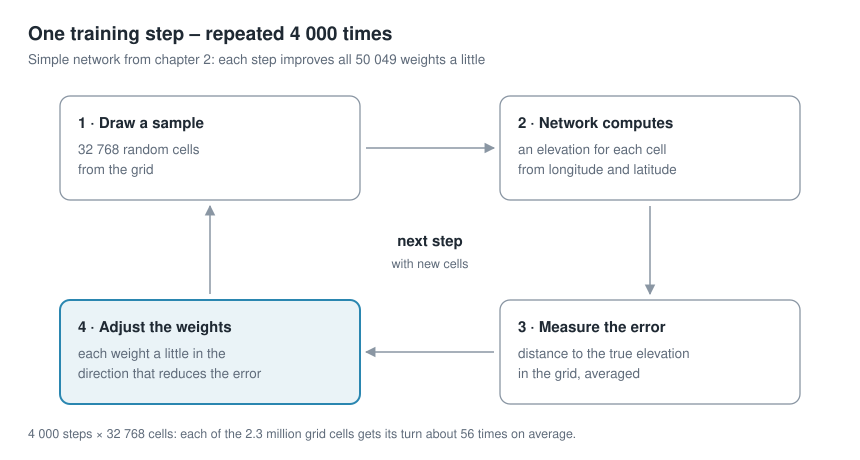
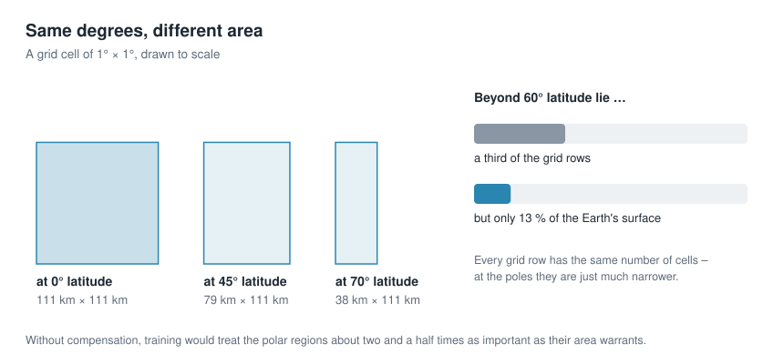
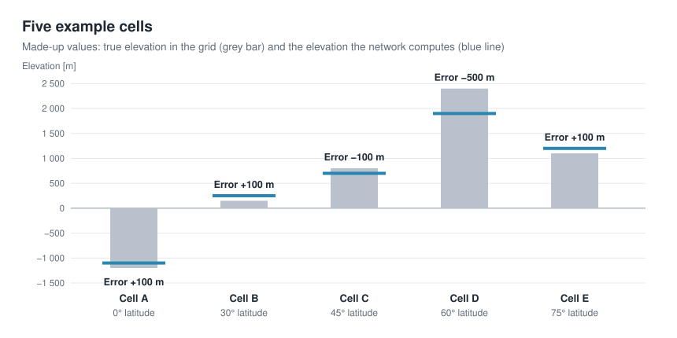
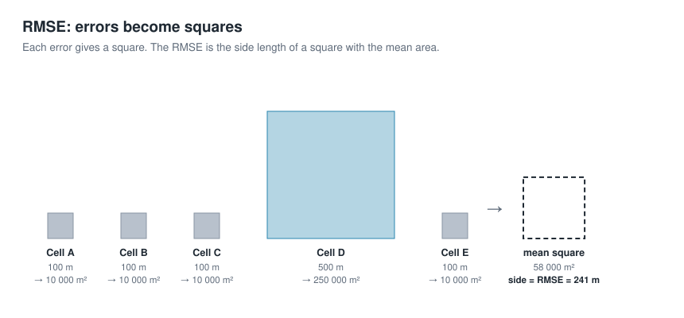
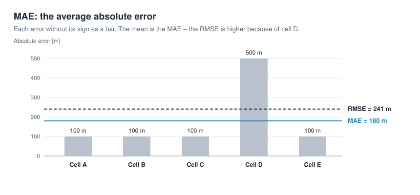
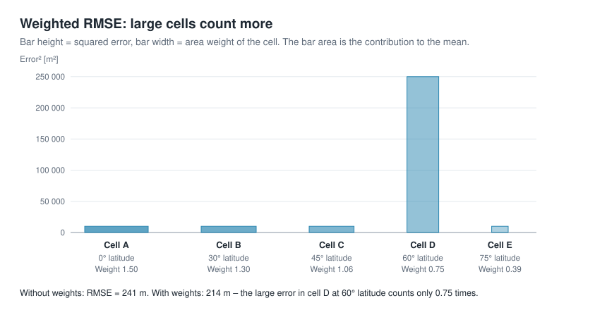
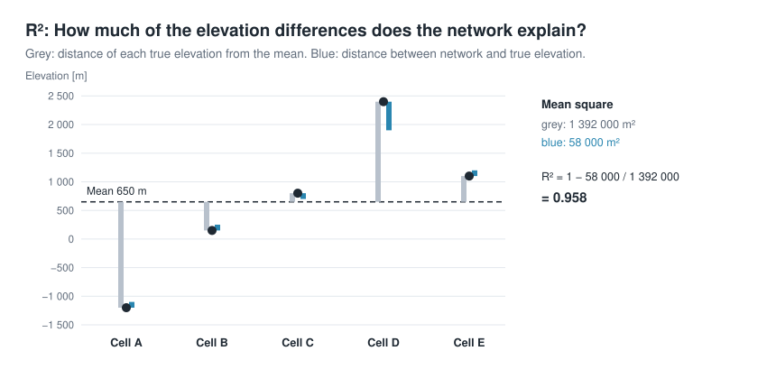
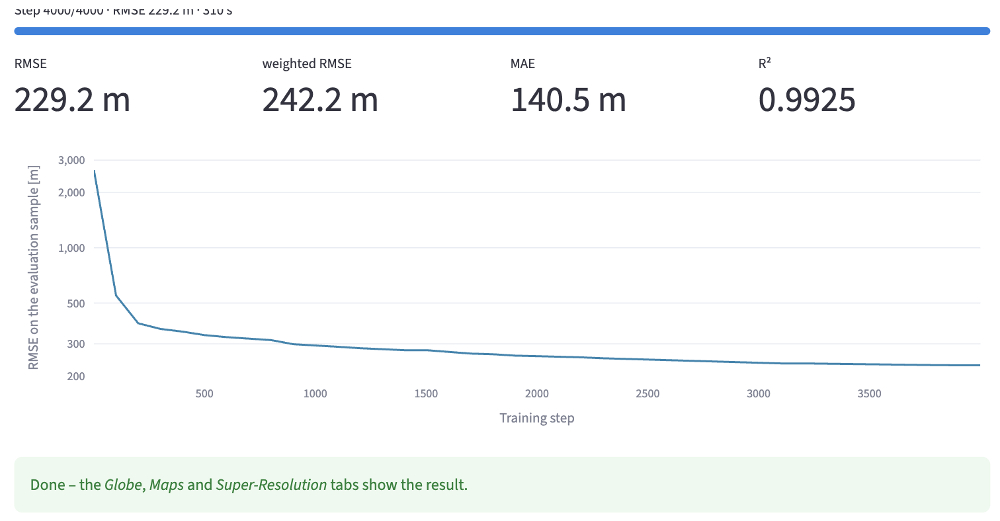

# Storing geodata in neural networks
# Chapter 2 · Training the neural network

*[Deutsche Fassung](../de/02-training.md) · Translated from the German original.*


**Contents:**

* How does the neural network learn its parameters (weights)?

* Why should it memorise everything in this case?

* Why do the poles need compensation?

* How can you tell how well the training is going?

## Starting point

From chapter 1 you know the elevation grid with 2 332 800 values. This chapter trains a simple network: it gets longitude and latitude as input and has 50 049 weights. The network of the standard example with 82 561 weights is an improved version of it; chapters 3 to 5 show how to get from the simple network to that one.

At the beginning, before training, the weights are random numbers, and the network returns nonsense for every coordinate.

**Training** means: finding weights with which the network reproduces the elevations of the grid as accurately as possible.

## One training step



A training step consists of four parts:

1. **Draw a sample.** The app randomly picks 32 768 cells from the grid. For each, it knows longitude, latitude and the true elevation.
2. **The network computes.** For each of these cells, the app uses longitude and latitude as input to the neural network. The network returns an elevation – a rather wrong one at first.
3. **Measure the error.** The app compares the network's elevations with the true ones and combines all deviations into a single number, the error. More on this in the section [Measuring the error](#measuring-the-error).
4. **Adjust the weights.** Each of the 50 049 weights is changed a little, in such a way that the error gets smaller. How the app knows in which direction is explained in the section [What happens when the weights are adjusted](#what-happens-when-the-weights-are-adjusted).

After such a step, the network is a little better than before – but far from good.

## Training: many steps in a row

Training means repeating these steps again and again, 4 000 times with the app's default settings. Each time the app picks new cells, and each time the weights improve a little. Only the many small improvements together turn the random network into one that reproduces the Earth.

Why not use all 2.3 million cells in every step? That would be much slower, and it is not necessary: a sample is enough to see in which direction the weights should move.

Over the whole training, all cells still get their turn – 4 000 steps × 32 768 cells make a good 131 million draws, about 56 per cell on average.

At first the error drops quickly, because the network learns the large shapes first: where there is land and where there is sea. After that, progress is slower, because now the details follow – mountains, coasts, ocean trenches.


This is what it looks like in the app: the error curve of the simple network over 4 000 steps. The small upward bumps, for example around step 700, are normal: each step sees different cells, and not every step improves everything. How to read the curve exactly is described in the section [Measuring the error](#measuring-the-error).

## What happens when the weights are adjusted

In chapter 1 we described an evenly climbing road with the formula elevation = 300 + 0.05 · x (section [What are weights?](01-geodaten-als-funktion.md#what-are-weights)). There, the two weights 300 and 0.05 were known. In training they are not known – they are what we want to find.

So you start with any values, for example 0 and 0. The formula then predicts 0 m for every point on the road – far from the measured elevations.


The diagram shows how it continues when the weights are adjusted step by step. After the first step the line is much too steep – it overshoots. Then it settles and after 200 steps lies on the measurements: the weights have arrived at 300 and 0.05. On the right you see the corresponding error; it falls just like the error curve in the app, steeply at first, then flat.

Now you ask for each weight: does the error get smaller or larger if I increase it a little? And then you move it a little in the favourable direction. You repeat this until the formula fits the measurements. Step by step, the two weights move towards 300 and 0.05. Exactly this happens in part 4 of every training step, only with 50 049 weights instead of two.

Nothing is tried out by trial and error. Mathematics provides, for all weights at once, in which direction and how strongly the error reacts to a small change (the derivative). The method is called **gradient descent**.

### Deep dive: gradient descent

A picture from the terrain helps: you stand on a slope in the fog and want to get down into the valley. You cannot see the valley, but you feel under your feet which way is downhill – and take a small step in that direction. The valley is the smallest error, your position is the weights. For the network, this landscape has not two but 50 049 directions.

**The learning rate** determines how large each step is. Steps that are too large jump over the valley, steps that are too small hardly make progress. The app proceeds in three phases:

1. In the first 100 steps the step size grows slowly, so that the random starting weights do not immediately jump far off.
2. Then it works with the set learning rate.
3. Towards the end the step size gradually shrinks to 2 % of it, so that the weights can settle finely at the end.

More precisely, the app uses an advanced form of gradient descent called **Adam** [1], which finds a suitable step size of its own for each weight.

## Memorising is wanted here

Normally a neural network is supposed to learn something general from examples and apply it to new cases. That is why part of the data is held back and used to check whether the network also judges unknown cases correctly. If a network adapts too closely to its training data and then fails on new data, this is called **overfitting** – actually the classic mistake in machine learning.

Here it is exactly the other way round. There are no new cases: the grid *is* the complete dataset. The network should memorise it as accurately as possible, and therefore nothing is held back. What is measured is how well the network reproduces the grid.

It never fully succeeds. With the simple network of this chapter, each weight has to "explain" 47 grid cells on average (2 332 800 / 50 049), with the standard example 28. That is not enough for every detail – the network smooths. How strongly is decided mainly by the size of the network, that is, the compression ratio from chapter 1.

## The poles need compensation



Every row of the grid has the same number of cells, no matter whether it lies at the equator or near the pole. But the cells differ in size: towards the poles the lines of longitude move closer together and the cells get narrower. Their width shrinks with the cosine of the latitude: at 60° a cell is only half as wide as at the equator, because cos(60°) = 0.5.

If cells are simply drawn evenly, the polar regions get a weight in training that does not match their area – beyond 60° latitude about two and a half times too much. The network would spend a lot of effort on the Arctic and Antarctica and save on the continents instead.

The app compensates for this: it draws the rows with a probability that matches the area of their cells. Rows at the equator come up more often, rows at the pole less often. In the sidebar this is called **Area-weighted sampling**.

## Measuring the error

For each grid cell there is an **error**:

**the elevation the network computes minus the elevation in the grid**.

To turn millions of such individual errors into one number, the app shows four measures:


What lies behind the four numbers is shown by a small, made-up example with only five grid cells. The network hits four of them to within 100 m; for cell D it is 500 m off.



- **RMSE** (*root mean square error*): square every error, take the mean, then the square root. The result is again in metres. Because of the squaring, large errors count more than small ones.

  ```math
  \text{RMSE} = \sqrt{\frac{1}{N} \sum_{i=1}^{N} (\text{network}_i - \text{grid}_i)^2}
  ```

  **Example:** The errors are +100, +100, −100, −500 and +100 m. Squared, that gives 10 000, 10 000, 10 000, 250 000 and 10 000 m². The mean is 290 000 / 5 = 58 000 m², its square root **241 m**.

  

- **MAE** (*mean absolute error*): the mean error without its sign, also in metres. It is usually smaller than the RMSE, because outliers carry less weight.

  **Example:** (100 + 100 + 100 + 500 + 100) / 5 = 900 / 5 = **180 m**. The RMSE of 241 m is clearly larger, because the one large error in cell D weighs particularly heavily when squared.

  

- **Weighted RMSE**: like the RMSE, but every cell counts according to its area. Weather research calculates it this way too, for example in the benchmark dataset WeatherBench [2]. For the whole Earth this is the fairest measure.

  **Example:** The weight of a cell is the cosine of its latitude: 1.00 / 0.87 / 0.71 / 0.50 / 0.26. So that the weights average 1, you divide them by their mean 0.666: 1.50 / 1.30 / 1.06 / 0.75 / 0.39. Each squared error is multiplied by its weight: 15 000 + 13 000 + 10 600 + 187 500 + 3 900 = 230 000 m². The mean is 46 000 m², the square root **214 m**. The large error in cell D lies at 60° latitude and therefore counts less than at the equator.

  

- **R²**: the share of the elevation differences that the network explains. 1 means perfect; 0 would mean the network is no better than the same mean elevation everywhere.

  **Example:** The mean true elevation of the five cells is (−1 200 + 150 + 800 + 2 400 + 1 100) / 5 = 650 m. How much the elevations scatter around this mean is measured by the mean square of the distances: 1 392 000 m². The network error has a mean square of 58 000 m² (that is the square of the RMSE). So R² = 1 − 58 000 / 1 392 000 = **0.958**: the network explains almost 96 % of the elevation differences.

  

During training, the app measures these values regularly on a fixed sample of 200 000 cells – always the same ones, so that the values are comparable. The whole grid is computed only at the very end; otherwise measuring would take longer than learning.

The **error curve** shows the RMSE over the training steps. Its vertical axis is logarithmic: every equally large distance downwards means that the error has become smaller by the same factor. Typical is a steep drop in the first few hundred steps and then a long, flat improvement.

## Try it out

### Choose the network

The simple network from the starting point is trained. In the sidebar under *2 · Network*, choose the preset *Plain MLP (fails on purpose)* under *Preset*. MLP stands for *multi-layer perceptron*, a network of several layers; chapter 3 shows how it is built. The addition *fails on purpose* is meant seriously: this network deliberately does not get far, so that the improvements of the following chapters become visible.

Then open *Architecture details* and set *Coordinate input* to `lonlat`. The network then gets longitude and latitude as input, exactly as described above. The other settings stay as they are.

   

   | Setting | Value | Meaning | explained in |
   |---|---|---|---|
   | *Coordinate input* | `lonlat` | longitude and latitude as input | chapter 4 shows a better choice |
   | *Positional encoding* | `none` | the coordinate goes into the network unchanged | chapter 5 |
   | *Hidden layers* | 4 | number of hidden layers | chapter 3 |
   | *Activation* | `relu` | the kink in every neuron | chapter 3 |
   | *Neurons per layer* | 128 | neurons in each layer | chapter 3 |
   | *Provide coarse context field* | off | coarse elevation map as a help | chapter 8 |

With these settings the network has 50 049 weights. The *Idea & Budget* tab shows this too, under *Parameters*.

### Start the training

In the sidebar under *3 · Training* are the settings for the training. They stay as they are.

   

   | Setting | Meaning |
   |---|---|
   | *Steps* | number of training steps |
   | *Points per step* | size of the sample per step |
   | *Learning rate* | step size when adjusting the weights |
   | *Area-weighted sampling* | compensation for the poles |
   | *Device* | processing unit: *auto* uses the graphics unit if there is one (*mps* on Apple computers, *cuda* with NVIDIA), otherwise the processor (*cpu*) |

Then click *🚀 Train*. The app switches to the *Training* tab by itself. At the top a progress bar runs, below it are the current error measures and the error curve, which grows with every measuring point.

   

### Wait

Training can take some time. On an Apple computer with an M4 chip the simple network takes about a minute, on a computer without a graphics unit considerably longer. In that case it is better to choose a smaller grid in the sidebar.

### Done

At the end the app computes the whole grid once and reports *Done*. The trained network is kept until you train again; the tabs *Globe 3D*, *Maps & Error* and *Super-Resolution* now show the result.

   

If you change the grid resolution after training, the network no longer matches the grid. The app then points out that you need to train again.

### Look at the result: Globe 3D

The *Globe 3D* tab shows the Earth twice as a sphere: on the left the original from the grid, on the right what the network computes from its 50 049 weights. Both use the same colours, from dark blue for the deep sea through green to white for the highest mountains.

Three sliders control the display:

| Setting | Meaning |
|---|---|
| *Vertical exaggeration* | exaggeration of the terrain, 40 times by default. At 1 the Earth would be true to scale – and practically smooth, because even Mount Everest is tiny compared with the Earth's radius. |
| *Display grid* | how many points the spheres show, 180 × 360 by default. This only affects the display, so that the browser stays responsive; training used the finer grid. |
| *View direction (longitude)* | above which longitude the spheres are centred. The slider turns both at the same time. If you drag a sphere with the mouse, only that one turns. |


With the simple network you see at once what the error measures mean: the continents are recognisable, but only as rough areas. The Mediterranean is a wide band; islands, peninsulas and mountains are missing.

### Look at the result: Maps & Error

The *Maps & Error* tab shows the same as flat world maps, on which you see the whole Earth at once. At the top, the original (*Original*) and the network's result (*Reconstruction*) stand side by side, with the same colour scale.


Below follow two views of the error:

- **Error map** (*Error*): for each cell the network's elevation minus the true elevation. Red means the network is too high, blue too low, white is right.
- **Histogram**: how many cells have which error. The vertical axis is logarithmic, so that the few very large errors remain visible too.


The largest errors are not in the open ocean, but where the elevation changes strongly over a short distance: along coasts, mountains and ocean trenches. The histogram shows that most cells are only a little off and very few by several thousand metres. Below the maps, *Detailed numbers* expands to show all error measures for the whole grid.

The maps themselves are reduced to 540 × 1080 points for display, so that the browser stays responsive. The app still computes the error measures on the whole grid.

### Look at the result: Super-Resolution

Because the network is a function, you can ask it at any coordinate – even between the cells of the grid. The *Super-Resolution* tab shows this for an excerpt of the Earth:

| Setting | Meaning |
|---|---|
| *Longitude (centre)*, *Latitude (centre)* | centre of the excerpt, by default 10° east and 46° north, the Alps |
| *Window [°]* | width and height of the excerpt in degrees, 20° by default |
| *Points per axis* | how finely the network is queried, 256 × 256 points by default |


On the left is the excerpt from the training grid, on the right the network, queried finely. With the simple network the result is sobering: of the Alps, Italy and the islands only a smooth boundary between land and sea remains. Querying more finely makes the picture more finely rasterised, but brings back no details the network has not learned. Chapter 10 goes into this in more detail.

On the same excerpt you can follow nicely in the following chapters how the networks get better.

## Ideas to explore further

- For comparison, train the preset *Fourier MLP (recommended)* of the standard example. How much smaller does the error get, and how much longer does it take? Why the network is so much better is explained in chapters 4 and 5.
- Set the *Learning rate* to 0.01 and to 0.0001 and compare the error curves. When is it faster, when does it become unsteady?
- Train with few *Points per step* (4096) and with very many (131072). What changes in the duration, what in the curve?
- 1 000 instead of 4 000 steps – or 10 000. Is longer training worth it?
- Remove the tick at *Area-weighted sampling* and train again. How do RMSE and weighted RMSE change in comparison?
- After training, take a look at the *Maps & Error* tab: where on Earth are the largest errors?
- Under *Device*, choose *cpu* instead of *auto* once and compare the training time.

## Further reading

- [1] Kingma and Ba: [Adam: A Method for Stochastic Optimization](https://arxiv.org/abs/1412.6980), 2014
- [2] Rasp et al.: [WeatherBench: A benchmark dataset for data-driven weather forecasting](https://arxiv.org/abs/2002.00469), 2020 – defines the area-weighted RMSE
- Google Machine Learning Crash Course: [Gradient descent](https://developers.google.com/machine-learning/crash-course/linear-regression/gradient-descent) – step-by-step explanation with an example
- 3Blue1Brown: [Gradient descent, how neural networks learn](https://www.3blue1brown.com/lessons/gradient-descent) – illustrative video

---

[Overview](README.md) · Back: [Chapter 1 · Geodata as a function instead of a grid](01-geodaten-als-funktion.md) · Next: [Chapter 3 · Architecture of a neural network](03-architektur.md)

*This tutorial was created by Gerhard Völkl using Claude Code (Anthropic). It is meant to help you learn more about storing geodata in neural networks. Suggestions for improvement are welcome at gkvoelkl@nelson-games.de.*
