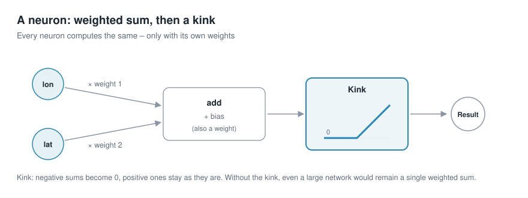
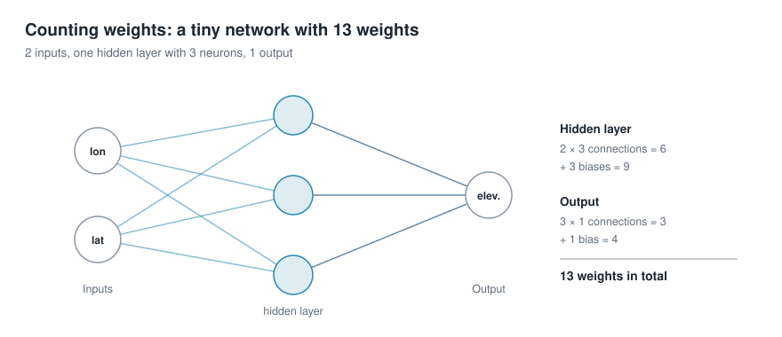
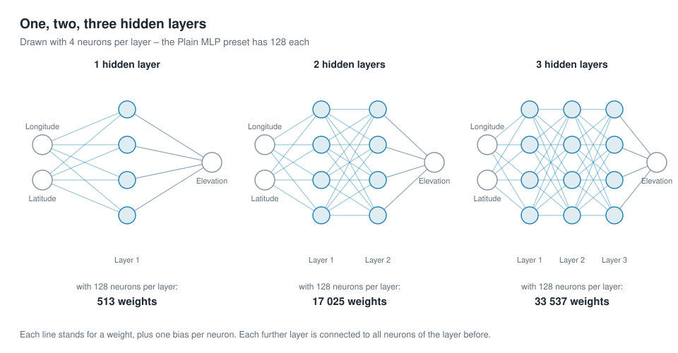

# Storing geodata in neural networks
# Chapter 3 · Architecture of a neural network

*[Deutsche Fassung](../de/03-architektur.md) · Translated from the German original.*


**Contents:**

* What is actually computed in a neural network?

* The way from the simplest model, a weighted sum, through a single neuron to a network with several layers

## Starting point

* So far the neural network was a closed box.

* Coordinate in, elevation out, weights in between – 50 049 for the simple network from chapter 2, 82 561 for the standard example.

* Now we look inside: starting from the simplest model there is, we build a neural network step by step.

## The simplest model: a weighted sum

To determine the elevation there are **two inputs**: **longitude** and **latitude**.

The simplest model multiplies each of them by a weight and adds a bias:

```math
\text{elevation} = w_1 \cdot \text{longitude} + w_2 \cdot \text{latitude} + b
```

These are three weights: *w₁*, *w₂* and the bias *b*. On the world map this very simple formula describes a **tilted plane**: the plane rises evenly in one direction and falls evenly in the other.

More is not possible with this simple way of computing. Continents, mountains and ocean basins cannot be represented with it – training a neural network with this architecture only finds this simple plane.


This is what it looks like in the app: on the left the original, on the right the trained model with three weights. The result is a slightly tilted area; of the continents nothing is visible.

## A neuron: sum and kink



```math
\text{result} = \text{ReLU}\,(w_1 \cdot \text{longitude} + w_2 \cdot \text{latitude} + b)
```

A **neuron**, the smallest computing unit of a neural network, first computes exactly the same as the simplest model: each input times a weight (*w₁*, *w₂*), add everything up, add a bias (*b*). But then comes one more step, the **kink**:

In technical terms this kink is an *activation function*. If the sum is negative, the neuron outputs 0; if it is positive, it passes the summed value on unchanged. The activation function used here is called *ReLU*.

**ReLU** stands for *rectified linear unit*. Just as a rectifier in electrical engineering lets current through in only one direction, ReLU lets only positive values through:

```math
\text{ReLU}(s) = \max(0,\, s)
```

| Sum *s* | −3 | −0.5 | 0 | 2 | 7.5 |
|---|---:|---:|---:|---:|---:|
| ReLU(*s*) | 0 | 0 | 0 | 2 | 7.5 |

ReLU is the most common activation function, because it is very easy to compute and networks train well with it. There are others, such as *GELU*, whose kink is gently rounded; it can be selected in the app too.

Why the kink matters so much: without it, every neuron would just be a weighted sum. If you connect several neurons without an activation function one after another, the result – a sum of weighted sums – is again just a weighted sum.

Even a thousand neurons without a "kink" would give only a tilted plane. Only the kink lets the network change direction and so represent functions other than straight lines.

## More neurons, more kinks

On the world map, a single neuron does the following: on one side of a straight line across the map it outputs 0, on the other side its value rises evenly – like a ramp that starts at an edge.

A network of many neurons adds up many such ramps with different edges and slopes. This creates a surface that can bend.

How much shape lies in the kinks is shown by a single elevation profile: a cut across France, the Alps and Austria at 46.4° north. Here there is only one input – the position along the cut – and small networks with different numbers of neurons are to trace the profile.


- **No neurons:** a straight line laid through the profile as well as possible. It misses the elevations by 779 m on average.

- **3 neurons:** three kinks give a rough triangle – at least you can tell that there is a mountain range in the middle.

- **10 neurons:** lowland, ascent, high mountains and the descent to the east can be seen separately.

- **50 neurons:** the line shows two summit areas and follows the terrain much more closely.

Each neuron contributes a kink. The more neurons, the more finely the line can follow the terrain – but the more weights have to be stored.

The same applies to the whole Earth. Here is the result in the app with one layer of 128 neurons:


The continents are there now, but angular, with straight edges. These are the edges of the ramps: each neuron kinks along a straight line across the map, and 128 such lines cut the map into polygons.

## Several layers

Neurons are often arranged in **layers**. The neurons of the first layer get longitude and latitude as input. The neurons of the second layer get the results of the first layer, those of the third the results of the second, and so on. At the very end there is an output neuron without a kink, which adds up the results of the last layer to the elevation.

The layers between input and output are called **hidden layers**, because their values cannot be seen from outside. A network with hidden layers is also called a *multi-layer perceptron* or **MLP** for short – hence the name of the app's presets.

Several layers pay off because each layer kinks the already kinked shapes of the previous one again. From few weights, very many small surface pieces arise this way – far more than the same number of weights in a single layer would give.

### Counting weights



Every connection between two neurons has a weight, and every neuron also has its bias. For one layer, therefore: inputs × neurons + neurons. That is how the tiny network above arrives at 13 weights.

For the preset *Plain MLP* with 128 neurons per layer this gives:

| Hidden layers | Calculation | Weights |
|---:|---|---:|
| 0 | 2 + 1 | 3 |
| 1 | (2 × 128 + 128) + (128 + 1) | 513 |
| 2 | 513 + (128 × 128 + 128) | 17 025 |
| 3 | 513 + 2 × (128 × 128 + 128) | 33 537 |
| 4 | 513 + 3 × (128 × 128 + 128) | 50 049 |



Every further layer with 128 neurons costs 16 512 weights, because each of its neurons is connected to all 128 neurons of the layer before.

The standard example from chapter 1 has 82 561 weights, although it also has 4 layers of 128 neurons. The difference lies in the first layer: there it gets not 2 inputs but 256 – where they come from is explained in chapter 5.

With 4 hidden layers – exactly the simple network from chapter 2 – the result looks like this:


The continents are rounder and easier to recognise. But fine details are still missing: mountains are blurred, coastlines smoothed out. With even more layers and neurons it improves only slowly. Chapters 4 and 5 show two tricks with which the same network learns considerably more detail.

## Try it out

### Simple architecture

In the sidebar under **2 · Network**, choose the preset **Plain MLP (fails on purpose)**.

Then open **Architecture details** and, as in chapter 2, set *Coordinate input* to `lonlat`, so that the network gets longitude and latitude as input. Then move the *Hidden layers* slider all the way to the left to 0. Below it a note appears saying that it is now a linear model.

   

Click **🚀 Train**. The linear model is finished in a few seconds. Afterwards you see the result in the other tabs, for example **Maps & Error**.

### Other architectures

Set **Hidden layers** to **1**, train again and compare the map. Then the same with **4** layers. The number of weights is shown each time in the *Idea & Budget* tab.

### Note on the linear model

In the *Training* tab, the error curve of the linear model may rise instead of fall, and R² may be slightly below 0.

This is not a bug: training reduces the area-weighted error (chapter 2), but the curve and R² measure unweighted. The *weighted RMSE* value falls during training – on the standard grid 1080 × 2160 from around 2 780 m to 2 390 m.

For the tilted plane it is a compromise: it fits the large areas at the equator better and the polar regions worse, which have many more cells when counted unweighted.

## Ideas to explore further

- With one hidden layer, set *Neurons per layer* to 8, 32 and 512. How do the polygons on the map change?
- Under *Activation*, choose `gelu` instead of `relu` once. This is a gently rounded kink – what happens to the angular edges?
- Try 8 hidden layers. Does the map get much better, and what does it cost in weights?
- In the *Maps & Error* tab, look at the error map: where are the largest errors – in the open ocean or at the coasts?

## Further reading

- 3Blue1Brown: [But what is a Neural Network?](https://www.3blue1brown.com/lessons/neural-networks) – illustrative introduction to neurons, layers and weights
- Google Machine Learning Crash Course: [Neural networks](https://developers.google.com/machine-learning/crash-course/neural-networks) – nodes, hidden layers and activation functions

---

[Overview](README.md) · Back: [Chapter 2 · Training the neural network](02-training.md) · Next: [Chapter 4 · The Earth is a sphere](../de/04-kugelkoordinaten.md) *(German; English translation in progress)*

*This tutorial was created by Gerhard Völkl using Claude Code (Anthropic). It is meant to help you learn more about storing geodata in neural networks. Suggestions for improvement are welcome at gkvoelkl@nelson-games.de.*
