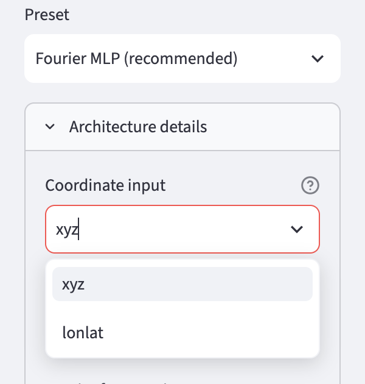

# Storing geodata in neural networks
# Chapter 4 · The Earth is a sphere

*[Deutsche Fassung](../de/04-kugelkoordinaten.md) · Translated from the German original.*


**Contents:**

* Why are longitude and latitude a poor input for a neural network?
* How do you describe a place as a point on a sphere instead?
* What does this new approach change at the date line and at the poles?

## Starting point

In chapters 2 and 3 the neural network got longitude and latitude as input – the way places are usually given on a world map. For people that is practical. For the neural network it is not so easy.

## Two catches with longitude and latitude


**The seam.** Longitude runs from −180° to +180°. A point at 179.9° east and one at 179.9° west are only 22 km apart on Earth – both in the Pacific, very close to the date line, which roughly follows the 180th meridian.

For the neural network, however, they are the numbers +179.9 and −179.9: as different as two longitudes can be. The network would have to learn that two completely different inputs have almost the same elevation. With the method from chapter 3, which builds a surface from many straight ramps, that is hard.

**The poles.** At the North Pole longitude has no meaning: every longitude between −180° and +180° describes the same point. In the grid, the top row is nevertheless a whole row of 2 160 cells with different longitudes.

For the neural network these are 2 160 different inputs for a single place. At the South Pole it is the same.

Both come from the way we describe places: the rectangle of the world map has edges, the globe has none.

## The point on the sphere

The solution: you describe a place not by two angles (longitude, latitude) but by its position in space.

To do so, imagine the Earth as a sphere with radius 1 and the centre of the Earth as the origin. Every place is then a point on this sphere and has three coordinates *x*, *y* and *z*.


From longitude and latitude they are computed like this:

```math
x = \cos(\text{latitude}) \cdot \cos(\text{longitude})
```

```math
y = \cos(\text{latitude}) \cdot \sin(\text{longitude})
```

```math
z = \sin(\text{latitude})
```

What the three formulas mean is shown step by step with the example of Regensburg:


1. **Latitude determines the height.** The further north a place lies, the higher it lies above the plane of the equator: z = sin(latitude). At the same time it moves closer to the Earth's axis; the distance to the axis is r = cos(latitude).
2. **Longitude distributes this distance between two directions.** Seen from above onto the North Pole, all places of the same latitude lie on a circle with radius r. Longitude is the angle on this circle. The share in the direction 0° east is x = r · cos(longitude).
3. **The rest points towards 90° east:** y = r · sin(longitude).

Substituting r = cos(latitude) gives exactly the three formulas above.

A few examples:

| Place | Longitude | Latitude | x | y | z |
|---|---:|---:|---:|---:|---:|
| Gulf of Guinea | 0° | 0° | 1 | 0 | 0 |
| Indian Ocean | 90° E | 0° | 0 | 1 | 0 |
| North Pole | any | 90° N | 0 | 0 | 1 |
| Regensburg | 12.1° E | 49.0° N | 0.64 | 0.14 | 0.75 |
| Pacific, point A | 179.9° E | 0° | −1.000 | +0.002 | 0 |
| Pacific, point B | 179.9° W | 0° | −1.000 | −0.002 | 0 |

The two points at the date line now have almost the same numbers, just as their position on Earth suggests. And at the North Pole it does not matter which longitude you use: because cos(90°) = 0, the result is always (0, 0, 1) – one place, one description.

In short: **places that are close together on Earth now also have similar coordinates.** There are no edges and no seam any more for the network to stumble over.

The price is small. Instead of two inputs the network has three, and every neuron of the first layer needs one more weight – with 128 neurons that is 128 additional weights. The 50 049 weights of the simple network from chapter 2 thus become 50 177.

## What difference it makes

How large the difference is shown by a comparison: a neural network with the same architecture, a simple MLP (preset *Plain MLP*) with 4 hidden layers, the same grid, the same training – once with longitude and latitude, once with spherical coordinates as input.

The picture shows the Pacific on both sides of the 180th meridian.


With longitude and latitude, the network has a visible **seam** at the 180° line: the elevation jumps there, although the terrain continues on both sides. Along the whole line from the South to the North Pole the jump is 690 m on average. With spherical coordinates it almost completely disappears: 0.2 m on average.

Both networks are almost the same size (50 049 and 50 177 weights) and trained for the same time.

## Try it out

In the sidebar under **2 · Network**, choose the preset **Plain MLP (fails on purpose)** and open **Architecture details**.

At the very top is **Coordinate input**. The default is `xyz` – the spherical coordinates from this chapter. The alternative `lonlat` passes longitude and latitude directly into the network.

   

For comparison, first train with `lonlat` – that is the network from chapter 2 – and look at the error map at the right and left edges in the *Maps & Error* tab.

Then train again with `xyz` and compare. The weighted RMSE drops from around 700 m to around 600 m (see the [appendix](../de/anhang-messungen.md), German).

In the *Globe 3D* tab the Earth can be turned. Set the *View direction (longitude)* slider to 180: then you look straight at the seam.

## Ideas to explore further

- On the error map, look not only at the seam but also at the polar regions: what does Antarctica look like with `lonlat` and with `xyz`?
- Under *1 · Data*, set the *Grid resolution* low (180 × 360) so that training is quick, and switch several times between `lonlat` and `xyz`.
- Convert a well-known place into spherical coordinates, for example with a calculator and the formulas above. For which places is *x* negative, where *y*, where *z*?

## Further reading

- Wikipedia: [Spherical coordinate system](https://en.wikipedia.org/wiki/Spherical_coordinate_system) – conversion between angles and *x*, *y*, *z*; there with the angle measured from the North Pole instead of the geographic latitude
- Wikipedia: [International Date Line](https://en.wikipedia.org/wiki/International_Date_Line) – runs through the Pacific roughly along the 180th meridian
- Rußwurm et al.: [Geographic Location Encoding with Spherical Harmonics and Sinusoidal Representation Networks](https://arxiv.org/abs/2310.06743), ICLR 2024 – shows that methods treating the Earth as a rectangle produce errors especially at the poles

---

[Overview](README.md) · Back: [Chapter 3 · Architecture of a neural network](03-architektur.md) · Next: [Chapter 5 · Elevations as waves](../de/05-fourier-features.md) *(German; English translation in progress)*

*This tutorial was created by Gerhard Völkl using Claude Code (Anthropic). It is meant to help you learn more about storing geodata in neural networks. Suggestions for improvement are welcome at gkvoelkl@nelson-games.de.*
