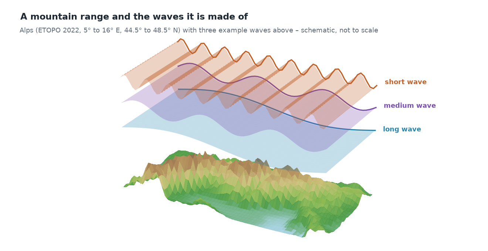
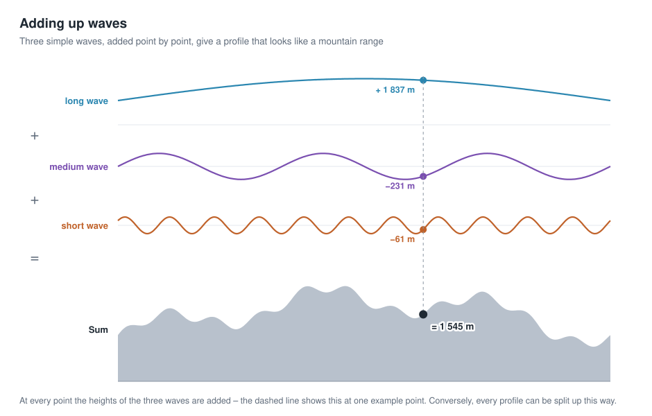
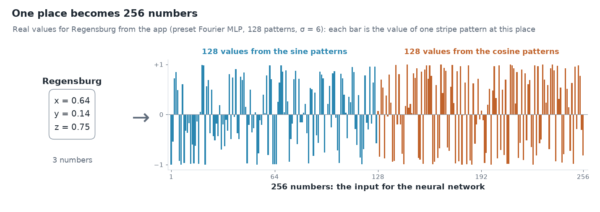
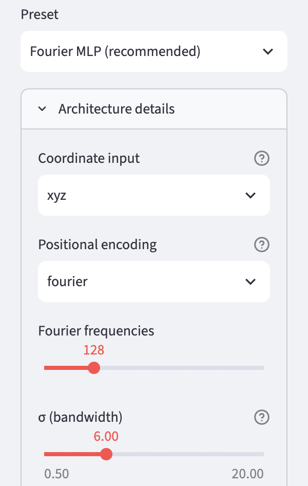

# Storing geodata in neural networks
# Chapter 5 · Elevations as waves

*[Deutsche Fassung](../de/05-fourier-features.md) · Translated from the German original.*


**Contents:**

* Why an elevation model can consist of waves
* Why a simple neural network has a hard time learning short waves
* How Fourier features can change that

## Starting point

As you saw in chapter 4, a neural network with spherical coordinates (x, y, z) as input no longer has a seam.

The continents can be recognised on the map, but mountains and coasts hardly. Why is that, and what can be done to get more detail?

## A mountain range is a sum of waves

When we think of frequencies, we usually think of sounds: oscillations per second. But there are also **spatial frequencies**: oscillations per distance. They describe how quickly the elevation changes as you walk across the terrain.



Every elevation profile can be described as a sum of waves of different lengths. This is shown by the profile through the Alps from chapter 3, this time at full ETOPO resolution:


- **Long waves** (wavelength over 400 km) are the large-scale form: here is a mountain range, to the left and right of it is lowland.
- **Medium waves** (wavelength 100 to 400 km) are individual mountain groups and basins.
- **Short waves** (wavelength under 100 km) are summits and valleys.

Added up, the three parts give almost exactly the original.



The principle with a simple example: at every point, the heights of the individual waves are added. Where the long wave is high and the shorter ones happen to swing upwards, a summit forms; where they swing downwards, a valley.

The same holds for the whole Earth, only in two directions: continents and ocean basins are long waves; coastlines, mountains and ocean trenches are short ones.


Splitting a signal (here the surface relief) into waves is called **Fourier analysis**, after the mathematician Joseph Fourier.

## A simple network learns long waves first

Neural networks have a well-known preference: they learn long waves quickly and short ones only very slowly. In technical terms this is called *spectral bias* [1]. The reason lies in chapter 3: a network with ReLU builds its shape from straight pieces. A gentle large-scale form needs few kinks for that, a rugged ridge very many – and in training the many kinks are hard to learn.

An experiment with the Alpine profile shows this. Two networks of the same size learn it, the upper one in the previous way, the lower one with Fourier features, which the next section explains:


Even after 3 000 steps, the simple network hardly gets beyond the rough shape. With Fourier features the summits are there after 50 steps already, and after 500 steps the curve lies almost on the profile.

## Fourier features: stripe patterns as input

The idea: if the network finds it so hard to form short waves itself, you give it waves right at the input. How this works, in three steps.

### 1 · The place as a point on the sphere

The starting point is the unit sphere from chapter 4: the Earth as a sphere with radius 1, the origin at the centre of the Earth. There, every place is a point with three numbers (x, y, z), Regensburg for example (0.64, 0.14, 0.75).


### 2 · Stripe patterns across the Earth

A **wave** here is a fixed stripe pattern laid over the whole sphere – like a zebra crossing: along one direction, stripes with the value +1 and stripes with the value −1 alternate, with a smooth transition in between. Each pattern has its own direction and its own stripe spacing. A large spacing is a long wave, a small one a short wave.


If you travel across the Earth perpendicular to the stripes and plot the value, you get a wavy line – almost exactly a sine curve; only because the Earth is curved are the stripes slightly bent. Hence the name wave.

For every place you look up which value the pattern has at that point: Regensburg lies in an orange stripe of the long pattern (+0.70) and in a blue one of the medium pattern (−0.95). The direction and spacing of each pattern are drawn at random once and then stay fixed – for all places, during training and later when querying.

### 3 · 256 numbers as input

The standard example has **128 such patterns**. For a single place, you look up in each of the 128 patterns which value it has at that point. That gives 128 numbers between −1 and +1. Another 128 come from the same patterns shifted by a quarter wave (cosine instead of sine) – so it is also unambiguous whether a place lies at the beginning or at the end of a stripe.



So the input to the neural network is **256 numbers instead of 3**. They no longer describe *where* the place lies, but *in which stripe of each pattern* it lies. This transformation is called **Fourier features** [2]: in technical terms each such wave is a **basis function**; its value at a place is a **feature** – hence the name Fourier features.

After that it continues as in chapter 3: the 256 numbers go into the first layer, the layers compute, and at the end comes the elevation.

### Why this helps

Two places 20 km apart have almost the same x, y and z values. For the network to tell them apart anyway, it would need many kinks (chapter 3). In a pattern with short stripes, however, they already lie in different stripes and get clearly different numbers. So the network no longer has to produce the fine differences itself – they are already in the input.

This is shown by comparing Regensburg with Wörth an der Donau, 22 km further east, in the three patterns from above:

| | Regensburg | Wörth a. d. Donau | Difference |
|---|---:|---:|---:|
| x, y, z | 0.64 / 0.14 / 0.75 | 0.64 / 0.14 / 0.75 | hardly visible |
| long wave (5 000 km) | +0.70 | +0.68 | 0.02 |
| medium wave (1 000 km) | −0.95 | −0.98 | 0.03 |
| short wave (250 km) | −0.63 | −0.13 | **0.50** |

Long waves tell the network in which region of the Earth a place lies; short waves distinguish neighbouring places. The network picks the suitable ones from all 256 numbers and combines them – just as the Alpine profile above is composed of long, medium and short waves.

### For the curious: the formula

For a single pattern the calculation looks like this:

```math
\text{value} = \sin\!\big(2\pi \cdot (b_x \cdot x + b_y \cdot y + b_z \cdot z)\big)
```

The three numbers *b* define the pattern: their direction is the direction in which the stripes alternate, and their size determines the stripe spacing – the larger, the narrower the stripes. For the second 128 values there is cos instead of sin.

**What it costs in weights:** The standard example has 128 waves, so with sine and cosine 256 inputs instead of 3. The first layer with 128 neurons therefore needs 256 × 128 + 128 = 32 896 weights. Together with the three further layers (3 × 16 512) and the output (129), this gives the 82 561 weights from chapter 1.

**What it does not cost:** The random frequencies *b* do not have to be stored. They come from a random number generator with a fixed seed. Anyone using the same seed gets exactly the same waves. So only this seed is stored, 4 bytes – that was the "ingredient" counted in chapter 1 for the size of the network.

### What would have to be stored so far

The networks from chapters 2 to 5 in comparison. Stored are the weights (4 bytes each), plus 8 bytes for normalising the elevations and, with Fourier features, 4 bytes for the seed (chapter 1). For comparison: the elevation grid of the standard example with 1080 × 2160 values takes 4.4 MB.

| Chapter | Network | Weights | Size | Share of the grid | Compression ratio |
|---|---|---:|---:|---:|---:|
| 3 | simplest model (longitude, latitude) | 3 | 20 bytes | < 0.001 % | 233 280 |
| 3 | 1 hidden layer (longitude, latitude) | 513 | 2.0 KB | 0.04 % | 2 265 |
| 2, 3 | 4 hidden layers (longitude, latitude) | 50 049 | 196 KB | 4.3 % | 23 |
| 4 | 4 hidden layers (x, y, z) | 50 177 | 196 KB | 4.3 % | 23 |
| 5 | Fourier features + 4 layers | 82 561 | 323 KB | 7.1 % | 14 |
| – | **Elevation grid (original)** | – | **4.4 MB** | 100 % | 1 |

The more weights, the larger the file – but the more detail the network can represent. The first two networks are tiny but hardly reproduce the Earth (chapter 3). How well the individual networks actually hit the elevations is collected in the [appendix with the measurements](../de/anhang-messungen.md) (German).

## σ: how fast the waves are

The frequencies *b* are drawn at random, but not arbitrarily: a single value, **σ** (sigma), determines how large they typically are. A small σ gives almost only slow waves, a large σ many fast ones. Roughly:

| σ | waves around the equator | typical wavelength |
|---:|---:|---:|
| 1 | about 11 | about 3 700 km |
| 6 | about 65 | about 600 km |
| 20 | about 220 | about 180 km |

The values are typical, not fixed: because the frequencies are drawn at random, slower and faster waves are always included too.

σ is the most important setting of the Fourier features. How much it matters is shown by Europe, learned with different values:


- **σ too small:** the fast waves are missing. The result is smooth and blurred, similar to the simple network, only somewhat better.
- **σ right:** the network has waves for the large-scale form and for the details. The Alps, coastlines and large islands can be recognised.
- **σ too large:** many waves are faster than the network can make sensible use of in this training. Instead of terrain a grainy pattern appears, and the result is worse than with σ = 1.

The right σ depends on the grid resolution and the network size. For the standard example σ = 6 is a good choice; that is why it is the default of the preset *Fourier MLP (recommended)*.

## Try it out

In the sidebar under **2 · Network**, choose the preset **Fourier MLP (recommended)** and open **Architecture details**.

Under **Positional encoding** it says `fourier`. Below are two sliders: *Fourier frequencies* is the number of waves, **σ (bandwidth)** their σ.

   

Train and compare the result in the **Maps & Error** tab with the one from chapters 2 to 4. There the preset *Plain MLP* had no Fourier features.

Set σ to 1 and to 20, train again each time and compare the maps. In the **Idea & Budget** tab you can check that the number of weights does not change.

## Ideas to explore further

- Change σ in small steps between 2 and 12. Where is the best value for the selected grid?
- Reduce the number of *Fourier frequencies* to 32 or increase it to 256. How does the number of weights change, and how the result?
- Choose a smaller *Grid resolution* (for example 360 × 720). Does a smaller σ fit better then?
- In the *Globe 3D* tab, look at the Himalaya or the Andes: how well do high, narrow mountain ranges come out with different σ?

## Further reading

- [1] Rahaman et al.: [On the Spectral Bias of Neural Networks](https://arxiv.org/abs/1806.08734), ICML 2019 – shows that networks with ReLU prefer low frequencies
- [2] Tancik et al.: [Fourier Features Let Networks Learn High Frequency Functions in Low Dimensional Domains](https://arxiv.org/abs/2006.10739), NeurIPS 2020 – introduces Fourier features for coordinate networks
- 3Blue1Brown: [But what is the Fourier Transform? A visual introduction](https://www.3blue1brown.com/lessons/fourier-transforms) – illustrative introduction to splitting into waves

## You made it!


This chapter completes the core of the tutorial. You now know how the elevations of the whole Earth get into the weights of a small network:

- The elevations become a function: coordinates in, elevation out (chapter 1).
- Training sets the weights so that the network hits the elevations (chapter 2).
- Layers and neurons determine how many weights the file has (chapter 3).
- The coordinates lie on a sphere, without a seam and without the poles as a special case (chapter 4).
- Stripe patterns as input bring the fine details (chapter 5).

That is exactly what is in the app's preset *Fourier MLP (recommended)*.

Everything else is **extensions and deep dives**. They build on chapters 1 to 5 but can be read individually or skipped as you like. They are available in German so far:

- [Chapter 6 · Spherical harmonics](06-kugelflaechenfunktionen.md) – an ordered set of patterns that fits the sphere exactly
- [Chapter 7 · SIREN](07-siren.md) – neurons that compute with a sine themselves
- [Chapter 8 · The context field](08-kontextfeld.md) – a coarse grid provides the continents, the network only learns the details
- [Chapter 9 · Measuring rate and error](../de/09-rate-und-fehler.md) – comparing file size and accuracy of different networks fairly
- [Chapter 10 · Querying and exporting](../de/10-abfragen-und-exportieren.md) – querying elevations at any location and passing the network on as a file
- [Chapter 11 · Context and outlook](../de/11-einordnung-und-ausblick.md) – where the method stands in research and how it continues with points, lines and areas
- [Appendix · Measurements](../de/anhang-messungen.md) – all results in one place

---

[Overview](README.md) · Back: [Chapter 4 · The Earth is a sphere](04-kugelkoordinaten.md) · Next: [Chapter 6 · Spherical harmonics](06-kugelflaechenfunktionen.md)

*This tutorial was created by Gerhard Völkl using Claude Code (Anthropic). It is meant to help you learn more about storing geodata in neural networks. Suggestions for improvement are welcome at gkvoelkl@nelson-games.de.*
