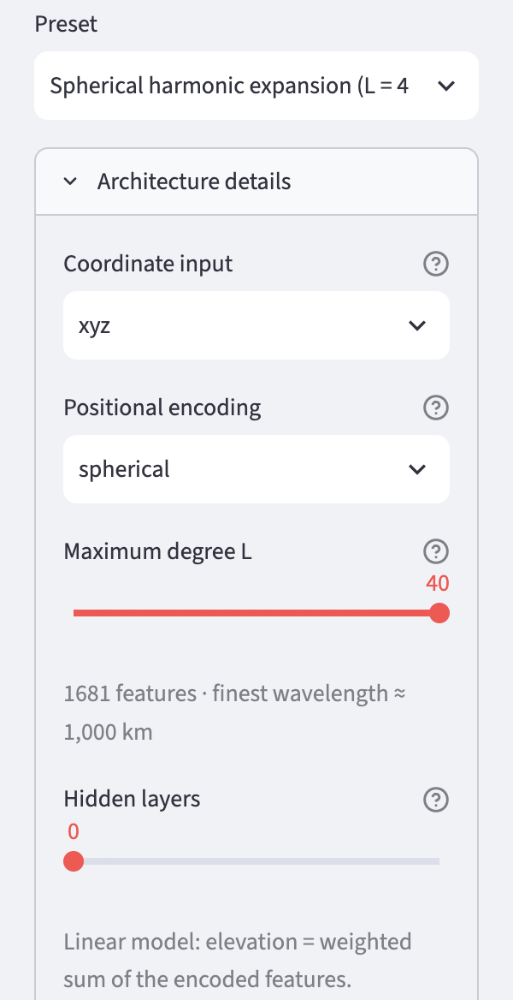

# Storing geodata in neural networks
# Chapter 6 · Spherical harmonics

*[Deutsche Fassung](../de/06-kugelflaechenfunktionen.md) · Translated from the German original.*

**Contents:**

* Which fixed, ordered set of patterns fits the sphere exactly
* How the Earth can be assembled from these spherical harmonics
* Why they become expensive for fine detail

This chapter extends chapter 5. You can also skip it.

## Starting point

In chapter 5, 128 stripe patterns with random direction and random spacing were laid over the Earth. That works well, but it is a makeshift: straight stripes do not fit a sphere exactly.

Mathematicians have long known an ordered set of such patterns that is made precisely for the sphere. They are called **spherical harmonics**. They are the counterpart on the sphere of the Fourier analysis from chapter 5.

## Spherical harmonics

The spherical harmonics are ordered by their **degree**. Each degree brings different patterns, each finer than the ones before:

As with the stripe patterns in chapter 5, you get a wave here too if you walk across the sphere and plot the values:

Unlike the straight stripes from chapter 5, these waves fit the sphere exactly: along the equator, the sector pattern has a whole number of waves – exactly three for degree 3.

- **Degree 0:** a single pattern, the same everywhere. It stands for the mean elevation.
- **Degree 1:** three patterns. Each divides the sphere into a positive and a negative half – one into north and south, two into east and west.
- **Degree 2:** five patterns; the sphere is divided into four fields or into bands.
- **Each further degree** brings **2 · degree + 1** new patterns, and the fields become smaller.

Up to a **degree *L*** there are therefore **(*L* + 1)²** patterns. The finest wave is roughly 40 000 km divided by *L* long – the Earth's circumference divided by the degree:

| highest degree *L* | patterns in total | shortest wave |
|---:|---:|---:|
| 2 | 9 | about 20 000 km |
| 8 | 81 | about 5 000 km |
| 16 | 289 | about 2 500 km |
| 40 | 1 681 | about 1 000 km |
| 100 | 10 201 | about 400 km |

Unlike the random stripes from chapter 5, these patterns are **complete**: up to their degree no wave is missing, and none appears twice. And they are **orthogonal** – each pattern describes something that no other pattern describes. That is why geodesy has used them for decades to describe the shape and the gravity field of the Earth. The Earth gravity model EGM2008, for example, consists of the weights of spherical harmonics up to degree 2190 [1].

## The Earth from spherical harmonics

With these patterns you can assemble the Earth – just like the Alpine profile from waves in chapter 5. Each pattern gets a weight, and all of them are added up. The higher the degree, the more patterns are available and the sharper the Earth becomes:

This is the simplest model from chapter 3, only with different inputs: **a weighted sum**, without hidden layers and without kinks. Each pattern is an input, each weight belongs to one pattern.

With spherical harmonics the right weights can even be computed directly, without training – that is how the figure above was made. If you instead train a network without hidden layers on these inputs, training finds the same weights. Such a network is thus exactly the classical representation used in geodesy.

## Spherical harmonics as input for a network

Instead of the random stripes from chapter 5, the spherical harmonics can also be used as input for a network with hidden layers. For a place you look up – as in chapter 5 – the value of each pattern at that point. Up to degree 16 these are 289 numbers instead of 256.

The network can then combine the patterns further with its kinks and so also form shapes that are finer than the shortest wave of the input.

The app offers two presets for this:

| Preset | Degree *L* | Inputs | Hidden layers | Weights | Size | Compression ratio |
|---|---:|---:|---:|---:|---:|---:|
| *Spherical harmonic expansion (L = 40, linear)* | 40 | 1 681 | 0 | 1 682 | 6.6 KB | 693 |
| *Spherical harmonics (L = 16)* | 16 | 289 | 4 | 86 785 | 339 KB | 13 |
| for comparison: *Fourier MLP (recommended)*, chapter 5 | – | 256 | 4 | 82 561 | 323 KB | 14 |

The linear variant is tiny: it needs only one weight per pattern and is around 700 times smaller than the grid. In return it shows no detail below about 1 000 km.

## The price of completeness

As elegant as spherical harmonics are – for fine detail they become expensive. Because they are complete, every finer wave needs *all* directions at once: for waves 400 km long you need more than 10 000 patterns, for 100 km already more than 160 000. Each pattern is an input, and each input costs one weight per neuron in the first layer of a network.

The random stripes from chapter 5 are more economical here. They do not cover every direction systematically, but they reach short waves with as few as 128 patterns. The network can then pick the right ones from many directions.

| | random stripes (chapter 5) | spherical harmonics |
|---|---|---|
| choice of patterns | random, from a seed | fixed and ordered |
| fit the sphere exactly | approximately | yes |
| complete up to a wavelength | no | yes |
| number of inputs for short waves | small (e.g. 256) | grows very quickly |
| computing effort | low | high, especially for large *L* |

Which variant matches the elevations better depends on the network size and the degree. For networks of the same size the two are close: with 4 000 training steps on the standard grid, *Spherical harmonics (L = 16)* reaches a weighted RMSE of 241 m, *Fourier MLP (recommended)* 245 m. The linear model up to degree 40 reaches 631 m with only 6.6 KB – more accurate than the simple network from chapter 2 with 706 m, which is 30 times as large. All values are in the [appendix with the measurements](../de/anhang-messungen.md) (German).

## Try it out

In the sidebar under **2 · Network**, choose the preset **Spherical harmonic expansion (L = 40, linear)** and open **Architecture details**.

**Positional encoding** now shows `spherical`. The **Maximum degree L** slider sets the highest degree. Below it the app shows the number of patterns and the shortest wave. **Hidden layers** is set to 0: a linear model.

   

Train and look at the result in the **Maps & Error** tab. It should look similar to the map "up to degree 40" above.

Then choose the preset **Spherical harmonics (L = 16)**, train and compare the result with **Fourier MLP (recommended)** from chapter 5.

**Note on computing time:** With a large degree, training becomes slow because very many patterns have to be computed for every place. On an Apple M4, 4 000 steps take about 5 minutes with *L* = 40 and just under 2 minutes with *L* = 16; *Fourier MLP (recommended)* needs a little over 1 minute. For first attempts, a smaller *L* or a smaller *Grid resolution* is worthwhile.

## Ideas to explore further

- For the linear model, set *Maximum degree L* to 8, 20 and 40 and compare the maps with the figure above.
- For the linear model, increase *Hidden layers* from 0 to 2. What happens to the number of weights – and to the detail?
- For *Spherical harmonics (L = 16)*, lower the degree to 8. How much worse does the result get, and how much smaller the file?

## Further reading

- [1] Wikipedia: [Earth Gravitational Model](https://en.wikipedia.org/wiki/Earth_Gravitational_Model) – the gravity model EGM2008 of the US agency NGA, spherical harmonics up to degree 2190
- Wikipedia: [Spherical harmonics](https://en.wikipedia.org/wiki/Spherical_harmonics) – mathematical background, with figures of the first degrees
- Rußwurm et al.: [Geographic Location Encoding with Spherical Harmonics and Sinusoidal Representation Networks](https://arxiv.org/abs/2310.06743), ICLR 2024 – spherical harmonics as input for neural networks

---

[Overview](README.md) · Back: [Chapter 5 · Elevations as waves](05-fourier-features.md) · Next: [Chapter 7 · SIREN](../de/07-siren.md) *(German; English translation in progress)*

*This tutorial was created by Gerhard Völkl using Claude Code (Anthropic). It is meant to help you learn more about storing geodata in neural networks. Suggestions for improvement are welcome at gkvoelkl@nelson-games.de.*
