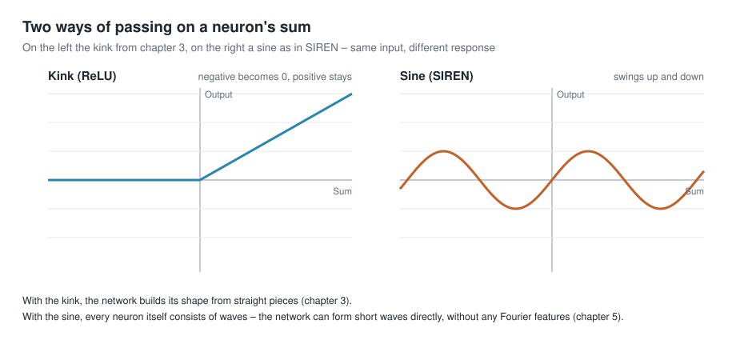
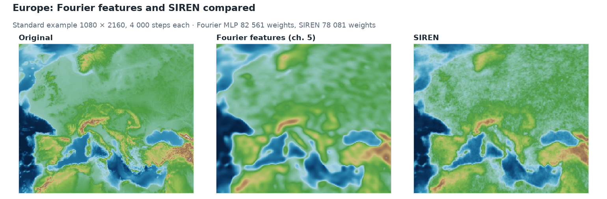

# Storing geodata in neural networks
# Chapter 7 · SIREN

*[Deutsche Fassung](../de/07-siren.md) · Translated from the German original.*


**Contents:**

* How a neuron computes with a sine instead of a kink
* Why such a network needs the right initialisation
* How it does on the world map compared with the Fourier features

Instead of turning the input into waves (chapter 5), here every neuron itself computes with a sine curve. This chapter extends chapter 5. You can also skip it.

## Starting point

In chapter 5 the neural network got waves as input, the Fourier features. The neurons themselves stayed as they were in chapter 3: weighted sum and kink.

In 2020, Sitzmann and colleagues proposed a different approach [1]: the input stays as it is – here the three numbers *x*, *y*, *z* from chapter 4 – but every neuron passes on its sum not with a kink but through a **sine** (as activation function). Such a network is called **SIREN**, short for *Sinusoidal Representation Network*.

## Sine instead of kink



A neuron in a SIREN network computes in three steps. The example is Regensburg from chapter 4 with *x* = 0.64, *y* = 0.14 and *z* = 0.75; the weights are made up: *w₁* = 0.2, *w₂* = −0.5, *w₃* = 0.1 and the bias *b* = −0.1.

**1. The weighted sum** – exactly as in chapter 3: each input times its weight, add everything up, add the bias.

```math
s = w_1 \cdot x + w_2 \cdot y + w_3 \cdot z + b
```

For Regensburg: *s* = 0.2 · 0.64 − 0.5 · 0.14 + 0.1 · 0.75 − 0.1 = 0.128 − 0.070 + 0.075 − 0.100 = 0.033.

**2. Until now: the kink.** An ordinary neuron passes on the sum with ReLU – negative values become 0, positive ones stay:

```math
\text{Result} = \text{ReLU}(s) = \max(0,\, s)
```

For Regensburg: ReLU(0.033) = 0.033.

**3. New in the SIREN network: the sine.** Instead of the kink, the sum is multiplied by a fixed factor ω₀ (omega zero) and put into a sine:

```math
\text{Result} = \sin(\omega_0 \cdot s)
```

Sitzmann and colleagues recommend ω₀ = 30, and that is also the setting in the app. For Regensburg: sin(30 · 0.033) = sin(0.99) ≈ 0.84.

The result no longer cuts anything off but swings between −1 and +1. And because ω₀ = 30 greatly enlarges the sum, it swings quickly. Even small changes of the sum are enough for a full swing:

| Sum *s* | −0.1 | −0.05 | 0 | 0.02 | 0.05 | 0.1 |
|---|---:|---:|---:|---:|---:|---:|
| ReLU(*s*) | 0 | 0 | 0 | 0.02 | 0.05 | 0.1 |
| sin(30 · *s*) | −0.14 | −1.00 | 0 | 0.56 | 1.00 | 0.14 |

What this does: with the kink, the network builds its shape from straight pieces. With the sine, every neuron itself consists of waves – and every further layer combines the waves of the layer before into new, finer waves. The network can therefore form short waves directly, without any Fourier features.

## SIREN on the Alpine profile

How well this works is shown once more by the Alpine profile. You know the top two rows from chapter 5; below them is a SIREN network of about the same size:


The SIREN network takes a little longer to get going – after 50 steps it is still rough. After that it catches up and after 3 000 steps matches the profile even more closely than the network with Fourier features.

## Without the right initialisation it goes wrong

A SIREN network is sensitive to its starting weights. If they are distributed randomly as in an ordinary network, the sines swing far too fast from the start.

The network then memorises every training point perfectly – and produces noise in between.

Sitzmann and colleagues therefore prescribe a special **initialisation**: the weights are chosen so small that the sum before each sine varies only by about ±1 at first [1]. The network then starts with leisurely waves and builds up the fast ones only during training.

How large the difference is can be seen in an experiment: both networks learn only every second point of the Alpine profile; the points in between serve as a check.


| SIREN network | Error on the training points | Error on the points in between |
|---|---:|---:|
| with initialisation after Sitzmann | 4 m | 116 m |
| without | 0 m | 923 m |

This is the same trap as a too large σ in chapter 5: waves that are too fast. For compression it is particularly treacherous, because the error curve during training looks excellent – only when querying between the grid points does the noise show. The app uses the initialisation after Sitzmann.

## SIREN on the world map

On the whole Earth, again with the section of Europe from chapter 5:



The SIREN network draws coasts and mountain ranges more sharply but has a fine, grainy pattern on land – waves that have turned out a little too fast. Both networks are about the same size:

| Preset | Inputs | Hidden layers | Neurons per layer | Weights | Size | Compression ratio |
|---|---:|---:|---:|---:|---:|---:|
| *Fourier MLP (recommended)*, chapter 5 | 256 | 4 | 128 | 82 561 | 323 KB | 14 |
| *SIREN (sine activation)* | 3 | 4 | 160 | 78 081 | 305 KB | 15 |

The SIREN network has only three inputs and can therefore have more neurons per layer for the same file size. With 4 000 training steps on the standard grid, the SIREN network reaches a weighted RMSE of 233 m on average over three runs, *Fourier MLP (recommended)* 245 m. The SIREN network varies more, though: its three runs are 31 m apart, those of the Fourier network only 5 m. All values are in the [appendix with the measurements](../de/anhang-messungen.md) (German).

**What to keep in mind when saving:** Because ω₀ = 30 amplifies every small change of the weights, a SIREN network reacts more sensitively to rounding than a network with kinks. This matters when saving with fewer digits – more on that in [chapter 10](10-abfragen-und-exportieren.md).

## Try it out

In the sidebar under **2 · Network**, choose the preset **SIREN (sine activation)** and open **Architecture details**.

**Positional encoding** is set to `none`: there are no Fourier features. **Activation** shows `siren`.

   

Train and compare the result with **Fourier MLP (recommended)** in the **Maps & Error** tab. In the **Globe 3D** tab it is worth looking at mountain ranges such as the Andes or the Himalayas.

To do so, set *View direction (longitude)* to about −70 and *Display grid* to 360. You then see North and South America:


The Andes come out sharply in the SIREN network. On flat land, however, the grainy pattern shows: small blue speckles, for example in the Amazon basin, which is green everywhere in the original. There the network computes elevations just below zero, and the colour scale switches to blue.

## Ideas to explore further

- For the SIREN preset, lower the *Learning rate* to 0.0003. Does the grainy pattern become weaker?
- Lower *Neurons per layer* from 160 to 64. How much file size does that save, and how much worse does the map get?
- Under *Activation*, choose `siren` once for the preset *Fourier MLP (recommended)*. What happens when you combine Fourier features and sine?

## Further reading

- [1] Sitzmann et al.: [Implicit Neural Representations with Periodic Activation Functions](https://arxiv.org/abs/2006.09661), NeurIPS 2020 – the original paper on SIREN, with the recommended initialisation
- Project page: [SIREN](https://www.vincentsitzmann.com/siren/) – examples, video and a Colab notebook to try out
- Rußwurm et al.: [Geographic Location Encoding with Spherical Harmonics and Sinusoidal Representation Networks](https://arxiv.org/abs/2310.06743), ICLR 2024 – combines the spherical harmonics from chapter 6 with a SIREN network

---

[Overview](README.md) · Back: [Chapter 6 · Spherical harmonics](06-kugelflaechenfunktionen.md) · Next: [Chapter 8 · The context field](08-kontextfeld.md)

*This tutorial was created by Gerhard Völkl using Claude Code (Anthropic). It is meant to help you learn more about storing geodata in neural networks. Suggestions for improvement are welcome at gkvoelkl@nelson-games.de.*
