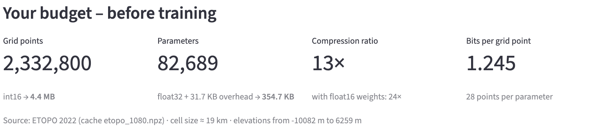
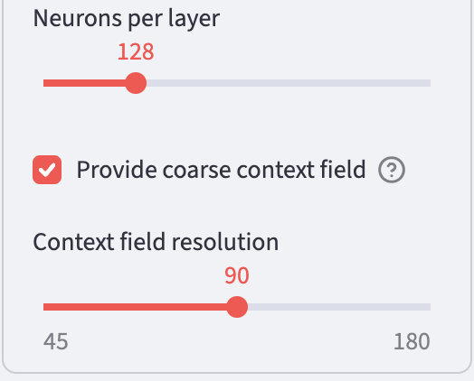

# Storing geodata in neural networks
# Chapter 8 · The context field

*[Deutsche Fassung](../de/08-kontextfeld.md) · Translated from the German original.*


**Contents:**

* How a very coarse elevation map takes the continents and ocean basins off the network's hands
* Why this map belongs in the file size
* Whether the additional storage pays off

Instead of learning the whole Earth from nothing, the neural network gets a very coarse elevation map and only learns what is still missing. This coarse map costs additional storage. This chapter extends chapter 5. You can also skip it.

## Starting point

So far the network has to learn all elevations of the Earth completely: the continents and ocean basins as well as the mountains and valleys. The elevations of the Earth vary enormously: between the deepest point of the Mariana Trench and the summit of Mount Everest there are almost 20 km.

A large part of this variation, however, is easy to describe: here lies a continent, there a deep basin in the sea. You do not need a fine resolution for that.

The idea of this chapter: these coarse forms are handed to the neural network ready-made, and it only takes care of the rest.

## The context field

The **context field** is a very coarse elevation map of the Earth. In the app's preset it has 90 × 180 grid points, i.e. one value every 2° – about every 220 km at the equator. Each value is the mean of the elevations in its cell. Between the grid points the values are connected in straight lines.

![Three maps of the Alpine region from 2° to 18° east and 40° to 52° north, each with white grid lines every 2° and a dot in each cell centre. On the left the original with the arc of the Alps, the Po Valley and the Mediterranean. In the middle the context field: each cell in a single colour with its stored elevation, for example 1 520 m in the cell with the main Alpine ridge and −2 650 m in the Mediterranean. On the right the same values, connected in straight lines between the grid points: a soft map on which the Alps appear only as a light ridge.](../img/en/kontextfeld-gitter.png)

The figure shows this with the example of the Alps:

1. **Original:** the elevations of the standard grid. The white grid lines divide the map into cells of 2° × 2°.
2. **Context field:** for each cell only one number is stored, the mean of all elevations in the cell. It belongs to the grid point in the cell centre. The cell with the main Alpine ridge thus gets 1 520 m, although its highest summit, the Ortler, is 3 905 m high – valleys and summits balance out in the mean.
3. **Connected in between:** for a place between the grid points, the values of the four nearest grid points are mixed, the nearer, the stronger. This creates no steps at the cell boundaries but a soft surface.

This allows every elevation to be split into two parts:

```math
\text{Elevation} = \text{context field} + \text{rest}
```


The context field already contains the continents and ocean basins. What remains in the rest is almost only what happens in a small space: coasts, mountain ranges, island arcs and deep-sea trenches. On average the rest deviates from zero by only around 450 m – instead of 2 500 m.

On the Alpine profile from chapter 3 it looks like this:


The context field is far too coarse for the summits and valleys – but it knows that there is a mountain range here. The network still has to learn the details itself.

## How the network uses the context field

For every place the app first looks up the context field. This value is used in two ways:

1. **As an additional input.** Besides the 256 numbers of the Fourier features from chapter 5, the network gets the elevation from the context field as the 257th number. So it knows whether it is currently computing over a mountain range or an ocean basin.
2. **As the basis for the result.** The network no longer outputs the elevation, only the rest. The app adds both together:

```math
\text{Elevation} = \text{context field} + \text{output of the network}
```

Nothing changes for training: the network is still compared with the real elevations, and the weights are adjusted so that the sum is right.

## Counting honestly: the context field belongs to the file

The context field is part of the stored data. Without it, not a single elevation can be computed from the weights. It must therefore be included in the file size and in the compression ratio.

The app stores the context field like the grid from chapter 1, with 2 bytes per value: 90 × 180 = 16 200 values × 2 bytes = 32 400 bytes, i.e. 31.6 KB.

On top of that comes the network. The additional input costs one weight per neuron in the first layer, so 128 more weights with 128 neurons: 82 561 + 128 = 82 689 weights. Together:

| Part | Size |
|---|---:|
| 82 689 weights × 4 bytes | 330 756 bytes |
| Context field 90 × 180 × 2 bytes | 32 400 bytes |
| Mean, standard deviation and seed of the Fourier features | 12 bytes |
| **File** | **363 168 bytes = 354.7 KB** |

The compression ratio thus drops from 14 to 13. The app shows exactly these numbers in the *Idea & Budget* tab:



The app lists the 31.7 KB as *overhead*: the context field plus the 12 bytes for mean, standard deviation and seed.

Not every publication counts this way. Mostajeran and colleagues also give their network additional data as context, but do not include its storage in the compression ratio [1]. For a fair comparison you should therefore always check what is counted in a compression ratio.

## Is it worth it?

The context field costs 31.6 KB. The same bytes could also go into a somewhat wider network. A fair comparison therefore puts variants with the **same file size** side by side: networks with a context field and networks without one that have a few more neurons per layer instead.

First the standard example on the map:


With the context field, coasts and mountain ranges become much sharper, although the file grows by only 10 %. The network no longer has to spend its weights on the position of the continents and has more left for the details.

For three network sizes, each with the same file size:

| Preset | File | Compression ratio | Error without context field | Error with context field 90 × 180 |
|---|---:|---:|---:|---:|
| *Fourier MLP, very small* | 75 KB | 61 | 339 m | 302 m |
| *Fourier MLP (recommended)* | 355 KB | 13 | 241 m | 185 m |
| *Fourier MLP, large* | 1 575 KB | 2.9 | 181 m | 121 m |

The error here is the area-weighted RMSE from chapter 2. For the networks without context field the layers were made a little wider (70 instead of 48, 136 instead of 128 and 260 instead of 256 neurons) so that the file is just as large. Each row is a single training run with 4 000 steps; the values vary a little from run to run.

At all three sizes the context field wins, and clearly so: the standard network with context field (355 KB) is just as accurate as the large network *Fourier MLP, large* without context field (1 542 KB, 185 m on average over three runs according to the appendix) – at less than a quarter of the file size.

### How fine should the context field be?

The app offers three resolutions. The finer the context field, the more detail it provides – and the more it costs:

| Context field | Spacing of the grid points | Size | File with standard network | Compression ratio | Error |
|---|---:|---:|---:|---:|---:|
| none | – | – | 323 KB | 14.1 | 245 m |
| 45 × 90 | 4° | 7.9 KB | 331 KB | 13.8 | 204 m |
| 90 × 180 | 2° | 31.6 KB | 355 KB | 12.8 | 185 m |
| 180 × 360 | 1° | 126.6 KB | 450 KB | 10.1 | 167 m |

Even the very coarse context field 45 × 90 with only 7.9 KB reduces the error by a sixth. Each doubling of the resolution quadruples the size of the context field but brings less and less. How to present such trade-offs between file size and error systematically is shown in [chapter 9](../de/09-rate-und-fehler.md) (German).

## Try it out

In the sidebar under **2 · Network**, choose the preset **Fourier MLP + context field** and open **Architecture details**.

At the very bottom, **Provide coarse context field** is switched on. Below it, **Context field resolution** sets how many grid points the context field has from north to south: 45, 90 or 180.

   

In the **Idea & Budget** tab, compare the file size with the preset **Fourier MLP (recommended)**.

Then train and look at the error map in the **Maps & Error** tab. Where are the largest errors now?

## Ideas to explore further

- Set the resolution of the context field to 45 and to 180. How much larger does the file get, and how much more accurate the map?
- For the preset *Fourier MLP, very small*, switch on the context field 180 × 360. The context field is then almost three times as large as the network. Which of the two now provides most of the detail?
- In the *Rate & Error* tab, switch on the comparison *Also with context field (90 × 180)* – more on this in [chapter 9](../de/09-rate-und-fehler.md) (German).

## Further reading

- [1] Mostajeran et al.: [Context-aware implicit neural representations to compress Earth systems model data](https://pmc.ncbi.nlm.nih.gov/articles/PMC12271555/), Scientific Reports 15, 25932 (2025) – network with topography and mean temperature as context for climate data; the context is not included in the compression ratio
- Wikipedia: [Bilinear interpolation](https://en.wikipedia.org/wiki/Bilinear_interpolation) – how the values between the grid points of the context field are obtained

---

[Overview](README.md) · Back: [Chapter 7 · SIREN](07-siren.md) · Next: [Chapter 9 · Measuring rate and error](../de/09-rate-und-fehler.md) *(German; English translation in progress)*

*This tutorial was created by Gerhard Völkl using Claude Code (Anthropic). It is meant to help you learn more about storing geodata in neural networks. Suggestions for improvement are welcome at gkvoelkl@nelson-games.de.*
