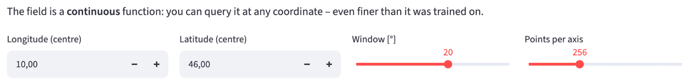
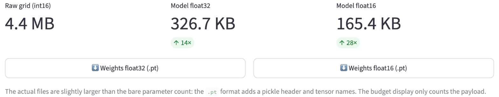

# Storing geodata in neural networks
# Chapter 10 · Querying and exporting

*[Deutsche Fassung](../de/10-abfragen-und-exportieren.md) · Translated from the German original.*

**Contents:**

* Asking the network for the elevation at any coordinates
* Why querying more finely does not provide additional detail
* Saving the network as a file – in float32 or float16 – and what float16 costs

This chapter extends chapters 1 to 5. You can also skip it.

## Starting point

After training, the Earth is stored in **82 561** weights. So far the app has used these weights only to recompute the training grid in order to show maps and errors.

Two things are still missing for the network to really replace the file: you must be able to ask it about any place, and you must be able to save it and pass it on.

## Asking the network for the elevation at any place

The neural network is a function (chapter 1). It gets a longitude and a latitude as input and returns an elevation as the result. In between happens what chapters 3 to 5 described: the coordinate becomes the point (x, y, z) on the sphere, this becomes 256 waves of the Fourier features, and these run through the four layers of the network.

Nowhere in this calculation does the grid appear. The network knows no rows and columns. It computes for 47.421° north just as for 47.4° or 47.42137°.

A few queries of the standard example, after 4 000 training steps:

| Place | Coordinate | True elevation | Cell in the grid 2160 × 4320 | Cell in the training grid 1080 × 2160 | Network |
|---|---|---:|---:|---:|---:|
| Mount Everest | 86.925° E · 27.988° N | 8 849 m | 6 345 m | 5 776 m | 4 673 m |
| Challenger Deep in the Mariana Trench | 142.2° E · 11.35° N | −10 935 m | −9 816 m | −9 369 m | −9 268 m |
| Zugspitze | 10.985° E · 47.421° N | 2 962 m | 1 250 m | 1 475 m | 1 323 m |

At first this looks alarming: Mount Everest is more than 4 000 m too low. But this is not only due to the neural network: the summit already loses the largest part of it, a good 3 000 m, in the training grid.

A cell in the training grid is about 19 km wide, and its value is the mean of all elevations in this area (chapter 1). It contains the summit, the flanks and the valleys around it – on average 5 776 m. The network has learned this mean, not the summit, and rounds it off a little more.

The Zugspitze shows this even more clearly: even in the finer grid with cells 9 km wide, not even half of the 2 962 m remains. Individual summits are too narrow for a grid of this resolution.

## Querying more finely than trained

Because the network is a function, you can also query it on a grid that is much finer than the training grid – for example every 1/60°, as in the ETOPO original. Do you get the fine details back then?

No. The profile through the Alps shows it:

The orange curve is queried very finely, 960 points over 16 degrees. Nevertheless it is smooth. Between the points it has seen in training, the network provides soft transitions, but no new summits and valleys. How should it know them? They never appeared in training.

This can be measured with the grid 2160 × 4320, which the app also offers. It is twice as fine as the training grid and has values the network has never seen:

| Comparison with the finer grid 2160 × 4320 | Weighted RMSE |
|---|---:|
| Network, queried on the fine grid | 272 m |
| Network, queried only on the training grid, each value spread over 2 × 2 fine cells | 276 m |
| Training grid itself, each value spread over 2 × 2 fine cells | 128 m |

Querying finely brings a mere 4 m. The coarse training grid, at 128 m, is even much closer to the fine grid than the network. What the network did not hit when learning, it cannot make up for when queried.

The app calls the tab in which you try this out *Super-Resolution*. That term usually means a method that creates genuine additional detail. The network does not do that, and the app says so itself in a note below the maps.

Fine querying is still useful, though. You can compute elevations exactly at the places you need – along a hiking route, at the measuring points of a weather station or on a grid of any resolution – without having to resample a grid first.

## The neural network as a file

For someone else to use the network, it has to go into a file. This file contains everything needed to recompute the elevations:

- **the blueprint:** preset, number of layers and neurons, input format, encoding and σ – i.e. the settings from the sidebar,
- **the weights:** the 82 561 numbers this tutorial is about,
- **mean and standard deviation of the elevations** with which the network was normalised (chapter 1),
- **the context field**, if the network has one (chapter 8), as whole metres with 2 bytes per value,
- **the size of the training grid**, so you know what the network was trained on.

What is *not* in the file: the random matrix of the Fourier features. It is created anew when loading, from the seed stored in the blueprint (chapter 5).

The app saves this in the format of **PyTorch**, the library the network computes with. The file has the extension `.pt`. For the standard example it is 334 527 bytes, i.e. 326.7 KB. That is a good 4 KB more than the 330 256 bytes chapter 1 calculated with: the file additionally contains names for each layer and some bookkeeping. The compression ratio does not count this bookkeeping, because it depends only on the file format and not on the method.

## float32 or float16

So far every weight took up 4 bytes (float32, chapter 1). There are also numbers with 2 bytes, **float16**. With them the file becomes half as large. The price: float16 stores fewer digits.

| | float32 | float16 |
|---|---:|---:|
| Storage per number | 4 bytes | 2 bytes |
| Exact decimal digits | about 7 | about 3 to 4 |
| Largest number | about 3.4 · 10³⁸ | 65 504 |
| Example 0.123456789 | 0.12345679 | 0.12347 |

For the weights, float16 is usually enough. They are small numbers – in the standard example practically all lie between −1 and 1 – and no single weight decides an elevation. Every elevation is made from thousands of weights, and their rounding errors largely cancel out.

How much float16 actually costs is shown by the comparison on the whole training grid, each after 4 000 steps:

| Preset | File float32 | File float16 | Rate float32 → float16 | Deviation of float16 from float32: on average | in 99 % of cells at most | largest | Weighted RMSE float32 → float16 |
|---|---:|---:|---:|---:|---:|---:|---:|
| *Fourier MLP (recommended)* | 323 KB | 161 KB | 14 → 28 | 0.5 m | 2.6 m | 8 m | 245 m → 245 m |
| *Fourier MLP + context field* | 355 KB | 193 KB | 13 → 24 | 0.2 m | 1.6 m | 6 m | 191 m → 191 m |
| *SIREN (sine activation)* | 305 KB | 153 KB | 15 → 30 | 13 m | 63 m | 239 m | 278 m → 279 m |

As in chapter 1, the file sizes here are calculated without the bookkeeping of the file format. Each row is a single training run.

**For the Fourier MLP, float16 is almost free.** The rate doubles from 14 to 28, and the error does not change by even a metre. The deviation from the float32 version is half a metre on average – vanishingly small compared with the 245 m error against the original.

**With the context field, the rate grows less.** The context field is already stored in whole metres with 2 bytes and does not get smaller with float16. Only the network shrinks, so the rate rises only from 13 to 24.

**For the SIREN network, float16 is considerably more expensive.** The deviations are about 25 times as large as for the Fourier MLP, 239 m in the worst case. The reason is in chapter 7: the SIREN network multiplies the sum by ω₀ = 30 in every layer before the sine comes. A small rounding error in a weight thus becomes 30 times larger and noticeably shifts the wave – and that from layer to layer. Overall, the error rises by only one metre, but at individual places the elevation jumps by more than 200 m.

The file would become even smaller with 8 bits or fewer per weight. Then simple rounding after training is no longer enough; the network has to learn to cope with the coarser numbers already during training. [Chapter 11](../de/11-einordnung-und-ausblick.md) (German) comes back to this.

## Passing the file on

Whoever receives the file still needs the project's program code. The file contains only numbers and the blueprint; how a network is built again from the blueprint is in the `src/` folder of the repository. Below the two download buttons, the *Export* tab shows a short example in Python that loads a file and queries the elevation at Mount Everest.

One caution belongs here: when loading, the `.pt` file format can execute not only numbers but also program code. The PyTorch documentation therefore explicitly advises against loading files from untrusted sources [1]. Your own files and those from people you trust are no problem.

## Try it out

Train the standard example: preset **Fourier MLP (recommended)**, **Steps** 4 000, then **Train**. The two tabs of this chapter only show something after training.

Open the **Super-Resolution** tab. Four things can be set there:

- **Longitude (centre)** and **Latitude (centre)** – the centre of the section, by default 10° east and 46° north, i.e. the Alps,
- **Window [°]** – how many degrees wide and high the section is, 2 to 90,
- **Points per axis** – how many points the network queries in each direction, 128 to 512.

Compare the two maps. On the left the training grid in this section, at 20° that is 120 × 120 cells. On the right the network, queried on 256 × 256 points. The right map has a finer raster but is softer – coasts and mountain ranges are blurred.

Then open the **Export** tab. At the top are three numbers: the size of the grid, the file in float32 and the file in float16, each with the compression ratio below. The two buttons below them download the files.

## Ideas to explore further

- In the *Super-Resolution* tab, set the window to 2°. How many cells of the training grid remain on the left, and what does the right map look like with 512 points per axis?
- Move the section to the Himalayas (about 87° east, 28° north) and compare the highest colour in both maps.
- Train the preset *SIREN (sine activation)* and look at the two file sizes in the *Export* tab. Why is the difference from the Fourier MLP small in file size but large in accuracy in float16?
- Train with *Fourier MLP + context field* and compare the rate in float16 with that of the standard example. Which part of the file does not shrink with it?
- If you know Python: run the loading example from the *Export* tab and query the elevation at your home town.

## Further reading

- [1] PyTorch documentation: [torch.load](https://docs.pytorch.org/docs/stable/generated/torch.load.html) – loading saved networks, with the advice not to load files from untrusted sources
- Wikipedia: [Half-precision floating-point format](https://en.wikipedia.org/wiki/Half-precision_floating-point_format) – structure of float16 with 16 bits, largest number 65 504, a good three decimal digits
- NOAA NCEI: [ETOPO Global Relief Model](https://www.ncei.noaa.gov/products/etopo-global-relief-model) – the original with cells down to 15 arc-seconds, if you need real detail

---

[Overview](README.md) · Back: [Chapter 9 · Measuring compression ratio and error](09-rate-und-fehler.md) · Next: [Chapter 11 · Context and outlook](../de/11-einordnung-und-ausblick.md) *(German; English translation in progress)*

*This tutorial was created by Gerhard Völkl using Claude Code (Anthropic). It is meant to help you learn more about storing geodata in neural networks. Suggestions for improvement are welcome at gkvoelkl@nelson-games.de.*
