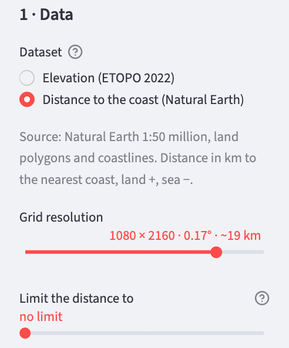
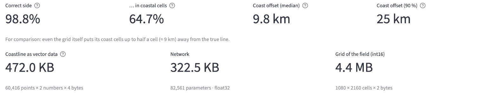

# Storing geodata in neural networks
# Chapter 12 · The coast as a distance field

*[Deutsche Fassung](../de/12-kueste-als-abstandsfeld.md) · Translated from the German original.*

**Contents:**

* Turning a coastline – that is, vector data – into a field: the signed distance to the coast
* Why a neural network reproduces the coastline more accurately from this field than from the elevations
* What limiting the distance achieves – and how much storage the coast as a neural network costs compared with the vector data

## Starting point

In chapter 11 the coast was the line where the elevation network outputs exactly 0 m. With it, the standard example classified 97 % of the Earth's surface correctly as land or sea, but near the coast (elevations between −200 m and +200 m) only 80 %.

That is no coincidence. The elevation network was never trained on the coastline, but on all elevations in general. Training the neural network rates an error of 100 m in the Alps exactly like an error of 100 m in the Netherlands.

In the Alps, 100 m do not matter much. In the flat land by the North Sea, the same error shifts the 0 m line by many kilometres.

Chapter 11 described a way out: turn vector data into a field that contains exactly the desired line, and learn this field (approach 1). This chapter tries that out on the coast.

## The coast as vector data

The coastline in this chapter comes from **Natural Earth**, a free map dataset (*public domain*) [1]. The example uses the scale 1:50 million; it is fine enough for the app's grids.

At this scale the coastline consists of a good 1 400 polylines with a total of **60 416 points**. Each point is a pair of longitude and latitude. At 4 bytes per number (float32), that is 483 328 bytes, or **472 KB**.

In addition there are the land areas of Natural Earth. They are only needed to decide on which side of the coastline a place lies.

## From the line to the field

The line becomes a field by asking for every cell of the grid: **How far is it from here to the nearest coast?** The distance is measured along the Earth's surface, in kilometres.

So that land and sea can be told apart, the distance gets a sign: positive on land, negative at sea – just like the elevation. As in chapter 11, the coast is then the line where the field is exactly 0. Chapter 11 introduced this representation as a *signed distance function* (SDF) [2]; there the inside of an area was negative. Which sign you choose makes no difference to the network.

![On the left, Corsica and Sardinia on a coarse grid. The cells on land are beige to light brown, the cells at sea light blue to dark blue, depending on the distance to the coast. Four cells are outlined in black. From each, an orange segment leads to the nearest point of the coast, labelled with the distance: +46 km in the middle of Sardinia, +12 km on Corsica, −69 km west and −90 km south-east of Sardinia. On the right, the four steps that produce the value of a cell, and a colour scale from −120 km (sea) to +120 km (land).](../img/en/kueste-linie-zu-feld.svg)

The app computes the field itself the first time it is used. To do so, it places points along the coastline at most 2 km apart, searches for the nearest of them for each of the 2 332 800 cells, and checks with the land areas whether the cell lies on land. This takes a few seconds; after that the result is kept in the cache.

The values range from **−2 830 km** in the South Pacific to **+2 473 km** in Central Asia. At the scale 1:50 million, the point in the South Pacific is even farther from land than the well-known Point Nemo, which lies 2 688 km from the nearest coast [3]. The reason: small islands such as the Pitcairn Islands are missing at this scale.

## What makes this field special

A section along 40° north shows how the distance runs:

Three things stand out:

- **The curve rises and falls similarly steeply everywhere.** If you walk 1 km straight away from the coast, the distance grows by exactly 1 km; it never gets steeper. The field therefore has no fine details like a mountain range. It consists mainly of long waves (chapter 5), and long waves are easy for a neural network to learn.
- **At the coast the curve passes straight through 0.** There is no jump and no kink there. The network can therefore place the zero exactly without any particular effort.
- **Kinks lie elsewhere:** exactly halfway between two coasts, for example between the Balearic Islands and Sardinia, and at the highest point inland. A kink is a piece of short wave, and short waves cost weights. The world map also shows that even a small island in the middle of the ocean shapes a circle many hundreds of kilometres across – everywhere within it, the island is the nearest coast.

## Elevation network against distance network

The comparison uses the same network with the same training twice: the standard example (*Fourier MLP (recommended)*, 82 561 weights, grid 1080 × 2160, 4 000 steps, one run each). One network learns the elevations from ETOPO, the other the distance to the coast. For both, the 0 line is compared with the coastline from Natural Earth.

Three things are measured:

- **Correct side:** For what share of the Earth's surface does the network say land where there is land, and sea where there is sea?
- **In coastal cells:** the same share, but only for the cells through which the true coast runs – that is, the cells that have a neighbour on the other side of the coast.
- **Coast offset:** How far are the cells of the recovered coast from the true coastline? Given are the median and the value below which 90 % of the coast lies.

| | ETOPO elevation grid itself | Elevation network | Distance network |
|---|---:|---:|---:|
| Correct side | 99.3 % | 97.1 % | 98.8 % |
| In coastal cells | 84.8 % | 58.7 % | 64.6 % |
| Coast offset, median | 7.1 km | 28.3 km | 9.9 km |
| Coast offset, 90 % | 17 km | 244 km | 25 km |

The first column is not a network, but the elevation grid itself. Even its 0 m line differs from Natural Earth: the two datasets have different sources, and a cell of 19 km is an average over land and sea. Even a perfect network could therefore not be more accurate than the grid it learns from. The distance grid matches Natural Earth by construction; its coastal cells lie at a median of 6.4 km from the line, and 90 % of them at most 14 km – that is the limit set by a grid with cells 19 km wide.

The numbers here are stricter than in chapter 11. There, all cells with elevations between −200 m and +200 m counted as coast; here only the cells directly at the coastline do.

**The distance network hits the coast much better.** The median offset drops from 28 to 10 km. The difference is even larger at 90 %: from 244 km to 25 km. You can also see this on the map:

![Two maps of Central Europe and the Mediterranean with the true coastline in black and the coast from the network in orange. On the left the elevation network: the orange line encloses large phantom lakes in the Netherlands and northern Germany, smaller ones in the Po Valley and in Hungary; Mallorca is missing, Sicily is too small. On the right the distance network: the orange line follows the black coast closely, there are no phantom lakes, Corsica and Sardinia are recognisable, Mallorca is only a small spot.](../img/en/kueste-hoehe-gegen-abstand.svg)

The elevation network invents **phantom lakes** inland: where the land is flat and low, as in the Netherlands, its error is enough to push the elevation below 0 m. In a section from 4° to 8° east and 51° to 53.5° north, the elevation network takes 151 of 311 land cells for sea, the distance network only 5. Such errors lie far away from any coast – hence the 244 km.

Small islands have a hard time in both networks. Mallorca covers 15 cells in the grid. The elevation network finds none of them, the distance network 6. In the distance field a small island is only a flat hill a few kilometres high, surrounded by deep sea values, and is easily smoothed away during learning.

## Limiting the distance

For the coastline it makes no difference whether a point in the Pacific is 2 000 or 2 800 km from land. Still, the network spends weights on learning these values.

The remedy is simple: you **limit** the distance, say to ±200 km. Everything farther from the coast simply gets the value +200 km or −200 km. In the profile above, these are the two dashed lines: the curve is cut off there. This idea is called a *truncated signed distance function* and is widely used, for example by Curless and Levoy, who used it in 1996 to combine 3D scans [4].

The app offers the slider **Limit the distance to** for this. Measured with the standard example as above:

| Limit | Correct side | In coastal cells | Coast offset, median | Coast offset, 90 % |
|---|---:|---:|---:|---:|
| none | 98.8 % | 64.6 % | 9.9 km | 25 km |
| ±500 km | 99.0 % | 68.7 % | 8.3 km | 20 km |
| ±200 km | 99.2 % | 71.5 % | 7.6 km | 18 km |
| ±100 km | 99.3 % | 74.0 % | 7.3 km | 17 km |
| ±50 km | 99.3 % | 76.0 % | 7.0 km | 16 km |
| ±25 km | 99.4 % | 78.9 % | 6.7 km | 15 km |
| ±10 km | 99.4 % | 79.0 % | 6.8 km | 15 km |
| ±1 km | 99.5 % | 82.6 % | 6.8 km | 15 km |

**The stronger the limit, the more accurate the coast.** From about ±25 km on, the offset is almost as small as for the distance grid itself (6.4 km and 14 km). A grid with cells 19 km wide cannot deliver more. Only the share in the coastal cells keeps rising.

At ±1 km almost nothing of the distance is left: every cell is either +1 or −1, except in a narrow strip along the coast. The network then learns a pure **land–sea mask**. For the coastline, that is even the best.

What you lose is the distance itself. A neural network without a limit answers the question "How far is it from here to the coast?" for every place on Earth – on average to within about 10 km (weighted RMSE 10.3 km). A network with a limit of ±25 km only knows whether a place is more than 25 km from the coast. Which variant is right therefore depends on which question the neural network should answer, and how accurately.

## Different neural networks

As in the earlier chapters, the different architectures can be tried out here as well:

| Network | Limit | File | Correct side | In coastal cells | Coast offset, median | Coast offset, 90 % |
|---|---|---:|---:|---:|---:|---:|
| *Fourier MLP (recommended)* | none | 323 KB | 98.8 % | 64.6 % | 9.9 km | 25 km |
| *SIREN (sine activation)* | none | 305 KB | 98.8 % | 64.1 % | 10.5 km | 27 km |
| *Fourier MLP + context field* | none | 355 KB | 99.3 % | 73.5 % | 7.3 km | 17 km |
| *Fourier MLP (recommended)* | ±100 km | 323 KB | 99.3 % | 74.0 % | 7.3 km | 17 km |
| *SIREN (sine activation)* | ±100 km | 305 KB | 98.7 % | 64.6 % | 10.5 km | 27 km |
| *Fourier MLP + context field* | ±100 km | 355 KB | 99.5 % | 79.5 % | 6.7 km | 15 km |

**The context field helps like the limit.** It gives the network the large distances over the oceans almost for free (chapter 8). The network can therefore spend its weights on the coast. Together with the limit, it is the best variant in the table.

**The SIREN network does not benefit.** Without a limit it is about level with the Fourier MLP, and the limit does not make it better. The reason was not investigated further here.

## What the coast as a neural network costs

Finally, the honest comparison of file sizes:

| | Size |
|---|---:|
| Coastline as vector data (60 416 points × 2 numbers × 4 bytes) | 472 KB |
| Distance grid 1080 × 2160 (2 bytes per cell) | 4.4 MB |
| Network, float32 | 323 KB |
| Network, float16 | 161 KB |

The network is smaller than the vector data. Even so, it is not a good compression of the coastline:

- **It is less accurate.** The vector data know every point of the coast exactly. The network places the coast to within about 7 km at best, and small islands are missing.
- **The vector data could be made smaller, too.** If you store only the small step from the previous point instead of every point, each number needs fewer bytes.
- **It knows no order.** The vector data say which points form an island and in which order. The field only has a zero line; anyone who needs polylines again first has to extract them from the grid.

The distance network is useful where you need the field anyway: How far is this place from the coast? Is it on land or at sea? The network answers both for any coordinate with a single query, without vector data and without a grid.

## Try it out

In the sidebar under **1 · Data**, set **Dataset** to **Distance to the coast (Natural Earth)**. The first time, the app asks whether it may download the coastal data from Natural Earth (about 3 MB). Click **Download Natural Earth (3 MB)**. The app then computes the distance field; this takes a few seconds.

Below **Grid resolution** there is now also the slider **Limit the distance to**, set to *no limit* by default.

Train the standard example: preset **Fourier MLP (recommended)**, **Steps** 4 000, then **Train**. The *Training*, *Maps & Error* and *Super-Resolution* tabs now show kilometres instead of metres.

Then open the **Coastline** tab. At the top are the three measures from this chapter, below them the three file sizes:

Below that, a map shows the selected section: the training grid in the background, the coastline from Natural Earth in black, the 0 line of the network in orange. With **Longitude (centre)** and **Latitude (centre)** you choose the centre of the section, with **Window [°]** its height in degrees; its width is twice that.

Then set **Limit the distance to** to ±25 km and train again. Compare the numbers in the *Coastline* tab.

To compare with the elevation network, set **Dataset** back to **Elevation (ETOPO 2022)** and train again. The *Coastline* tab then compares the 0 m line of the elevation with the coastline from Natural Earth.

## Ideas to explore further

- Move the section in the *Coastline* tab to Norway (about 10° east, 64° north) or Indonesia (about 115° east, 0°). Where does the network lose the coast first?
- Compare *Fourier MLP, very small* and *Fourier MLP, large* on the coast offset. Is the larger network worth more for the coast than for the elevations?
- Train on the 2160 × 4320 grid. Does the coast offset drop by half, as the halved cell width suggests?
- In the *Maps & Error* tab, look for the kinks halfway between two coasts. Is that also where the largest error lies?
- Think about how rivers could be represented as a field. A river has no inside and no outside – what sign would the distance get then?

## Further reading

- [1] Natural Earth: [Coastline 1:50m](https://www.naturalearthdata.com/downloads/50m-physical-vectors/50m-coastline/) – coastline and land areas, public domain ([terms of use](https://www.naturalearthdata.com/about/terms-of-use/))
- [2] Park et al.: [DeepSDF: Learning Continuous Signed Distance Functions for Shape Representation](https://arxiv.org/abs/1901.05103), CVPR 2019 – signed distance functions as a neural field
- [3] Wikipedia: [Pole of inaccessibility](https://en.wikipedia.org/wiki/Pole_of_inaccessibility) – Point Nemo and the other places farthest from the coast
- [4] Curless and Levoy: [A Volumetric Method for Building Complex Models from Range Images](https://graphics.stanford.edu/papers/volrange/), SIGGRAPH 1996 – truncated signed distances for 3D scans
- Chu and Shahabi: [Geo2Vec: Shape- and Distance-Aware Neural Representation of Geospatial Entities](https://arxiv.org/abs/2508.19305), 2025 – distance fields for points, lines and areas in geodata
- Wikipedia: [Signed distance function](https://en.wikipedia.org/wiki/Signed_distance_function) – definition and properties

---

[Overview](README.md) · Back: [Chapter 11 · Context and outlook](11-einordnung-und-ausblick.md) · Next: [Appendix · Measurements](anhang-messungen.md)

*This tutorial was created by Gerhard Völkl using Claude Code (Anthropic). It is meant to help you learn more about storing geodata in neural networks. Suggestions for improvement are welcome at gkvoelkl@nelson-games.de.*
